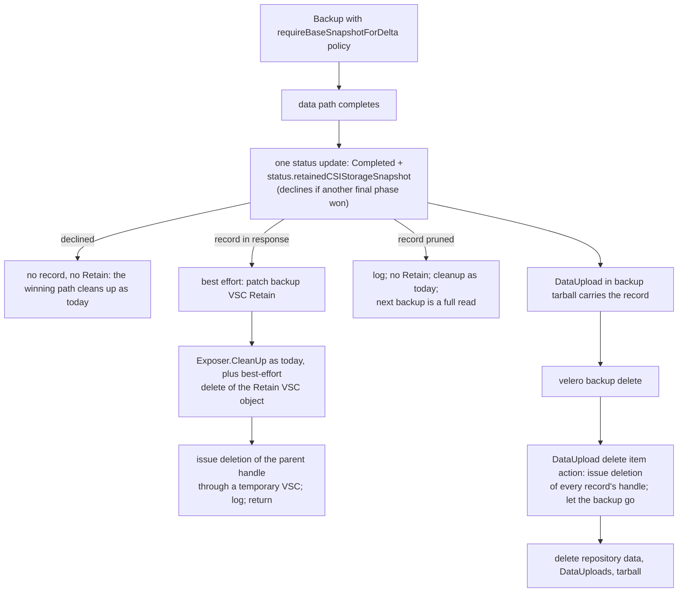
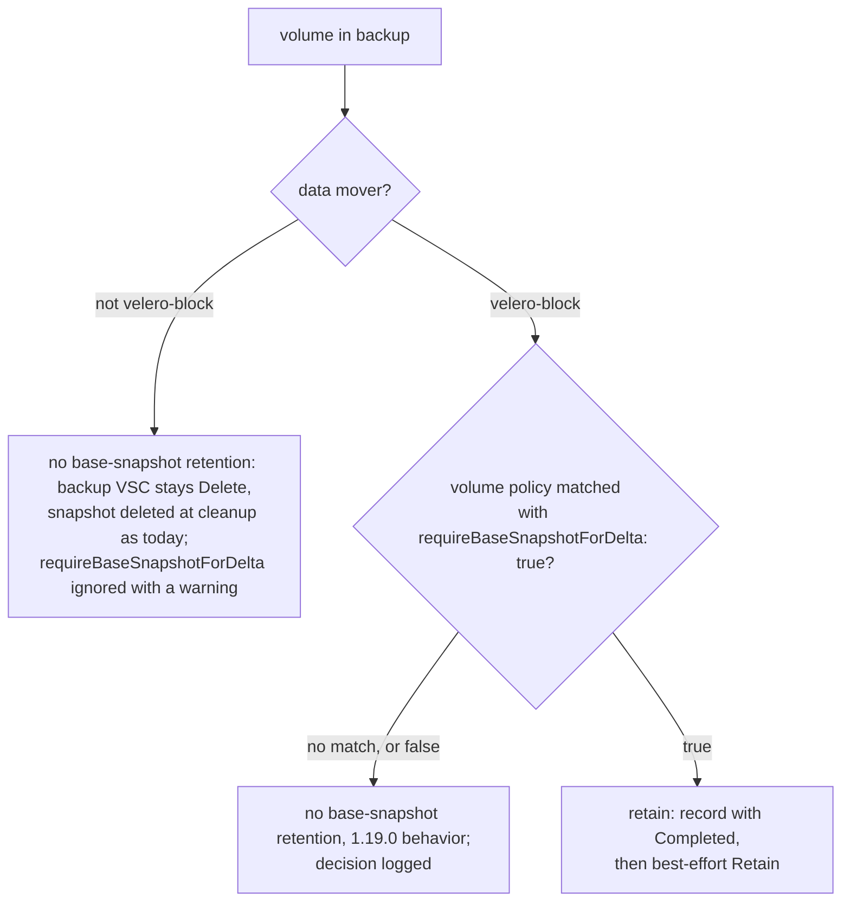
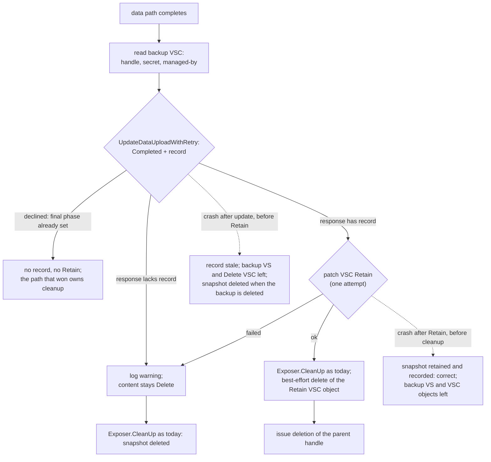
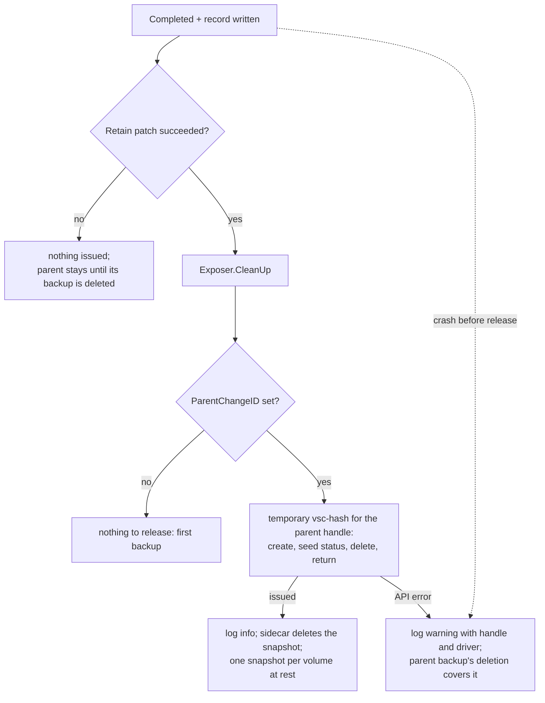
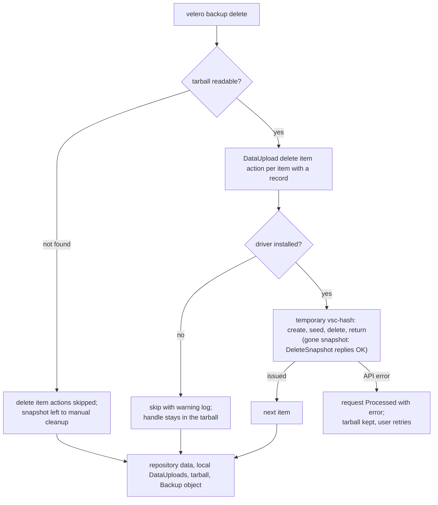
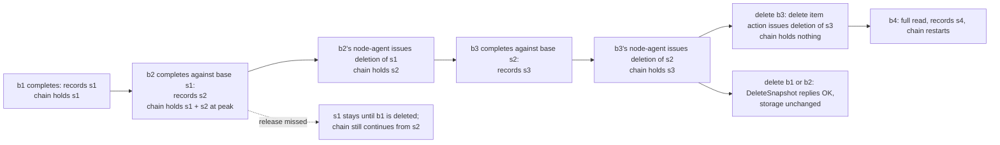

# Block Data Mover: Incremental Backups on Storage That Requires the Base Snapshot for Delta

## Abstract

This design adds incremental backup support to the Velero block data mover for storage that requires the base snapshot for delta: storage types, such as Ceph RBD, that need the base (parent) volume snapshot to still exist when changed blocks are computed.
Velero decides when to retain a snapshot and records it on the DataUpload in the same status update that marks the DataUpload `Completed`.
It keeps one snapshot per volume: the node-agent asks for the parent's deletion when the next backup of the volume completes, and backup deletion asks for the deletion of whatever a backup recorded.
Both go through a temporary VolumeSnapshotContent that the CSI snapshotter sidecar deletes; Velero issues the request and does not wait for the driver.
Retention no longer depends on the `deletionPolicy` of the user's VolumeSnapshotClass.
It targets Velero 1.19.1, as agreed in the 2026-10-27 community meeting (#10743, #10744).

## Background

The CSI Changed Block Tracking (CBT) API lets a driver compute the delta between two volume snapshots.
The block data mover builds incremental backups from that metadata, see the [block data mover design][2], section "Volume Snapshot Retention".
Storage types fall into two kinds, named here after the `requireBaseSnapshotForDelta` field of the snapshot metadata API:

- **Base snapshot not required** (`requireBaseSnapshotForDelta: false`): the driver computes changes from its own change-tracking state, so the base snapshot can be deleted as soon as the backup completes, e.g. vSphere.
- **Base snapshot required** (`requireBaseSnapshotForDelta: true`): the driver computes changes by diffing against the base snapshot its changeId refers to ([1], "ChangeId"). That snapshot must still exist in the storage when `GetMetadataDelta` is called, e.g. Ceph RBD.

On storage that requires the base snapshot, deleting the backup snapshot after each backup forces every later "incremental" back to a full read of the allocated blocks, and incremental restores degrade to full restores.

A driver declares which case it is through `SnapshotMetadataService.spec.requireBaseSnapshotForDelta` ([kubernetes-csi/external-snapshot-metadata#258](https://github.com/kubernetes-csi/external-snapshot-metadata/issues/258), [ceph/ceph-csi#6680](https://github.com/ceph/ceph-csi/issues/6680)).
That flag is the direction: Velero reads it and retains the base on its own, with no user configuration, as soon as an external-snapshot-metadata release carries the field, even before every vendor sets it (#10722).
The `requireBaseSnapshotForDelta` volume policy parameter of this design carries the same name and states the same fact by hand; it is the interim, manual configuration for the time before that, and the end goal is auto-detection only.

Release status in three facts:

- Velero 1.19.0 deletes every data mover snapshot at cleanup, whatever the VolumeSnapshotClass says (#10753); storage that requires the base snapshot is a known issue, every backup is a full read.
  A `Retain` VolumeSnapshotClass is not recommended for data movers, and when one is used the storage snapshot is still deleted; only the VolumeSnapshotContent object is left in the cluster ([documented](https://velero.io/docs/v1.19/csi-snapshot-data-movement/#volumesnapshotclass)).
- Velero 1.19.1 adds this design: opt-in retention of one base snapshot per volume, released by the next completed backup.
- Only main between 2026-09-09 and 2026-10-29 kept backup snapshots through `deletionPolicy` inheritance (#10307), and nothing deleted them: every backup of such a build leaked one storage snapshot per volume, the file system data mover included (#10693, #10723).
  No release shipped that behavior.

## Goals

- Let users opt into base snapshot retention for the block data mover through configuration Velero owns, independent of the VolumeSnapshotClass `deletionPolicy`.
- Own the retained snapshot's lifecycle: a volume keeps one retained snapshot at rest, released when the next backup of the volume completes, and whatever a backup recorded is deleted when the backup is deleted ([rolling base](#rolling-base)).
- Record retained snapshots in the backup, so the record survives Velero restarts and backup sync to another cluster, and an operator can always find the handle of a snapshot Velero did not delete.
- Retain no snapshot for failed, canceled or interrupted data movements.
- Never fail a completed data movement, and never block a backup deletion, for a retention step.
- Change nothing for storage that does not require the base snapshot and for users who do not opt in.

## Non Goals

- Auto-detection from the driver's `requireBaseSnapshotForDelta` in this release.
The field is merged upstream but not in an external-snapshot-metadata release Velero uses, and no driver sets it yet.
It is the next step, with high priority, tracked in #10722 (Background).
- Honoring a `Retain` VolumeSnapshotClass.
- Retention for volumes backed up through a VolumeGroupSnapshot.
The sidecar never issues `DeleteSnapshot` for a group member, so retention needs group-level handling; a `requireBaseSnapshotForDelta` policy is ignored for them with a warning, and on storage that requires the base snapshot their backups stay full reads.
Tracked in #10915; on Ceph RBD the snapshot metadata calls also fail for group members today ([ceph-csi issue 6763](https://github.com/ceph/ceph-csi/issues/6763)).
- The restore-side baseline snapshot, cleaned up separately in #10699.
- Concurrent backups of one volume are unsupported and out of scope.
- Deleting the Velero namespace while retained snapshots exist.
An uninstall deletes the backups first, which deletes their snapshots; a namespace teardown that skips that step leaves the storage snapshots behind with their records gone.
- Keeping N local snapshots for fast restore (#7002 / #6240).
- Changes to the repository-side incremental chain: repo snapshots, parent selection and fallback to full backup keep working as specified in [1].
- Accounting for snapshots the driver did not delete.
A VolumeSnapshotContent left in deletion is the only trace, and manual cleanup starts from it ([manual cleanup](#manual-cleanup)).

## High-Level Design

Retention is opt-in per volume through the existing volume policy: a `requireBaseSnapshotForDelta` parameter next to the existing `dataMover` parameter of the `snapshot` action.
Retention applies to the block data mover only.

The backup VolumeSnapshotContent is created with `deletionPolicy: Delete`, as on current main.
The exposer's existing `RetainVSC` call is not this retention: it keeps the storage snapshot alive only while ownership passes from the user's content to the backup content, and the backup content keeps `Delete` ([retaining the snapshot](#retaining-the-snapshot)).
Retention here means switching that *backup* content to `Retain` so the storage snapshot outlives the backup's cleanup.
When a DataUpload subject to retention completes, the node-agent writes the snapshot handle, the CSI driver and the deletion secret into a new `DataUpload.status.retainedCSIStorageSnapshot` field in the same status update that marks it `Completed`.
Only after that update succeeds does it switch the content to `Retain`, best effort, so the snapshot survives the exposer cleanup that follows.
That cleanup deletes the backup VolumeSnapshot and, best effort, the `Retain` backup VolumeSnapshotContent object, so on the normal path no API object outlives the backup.
The only objects that outlive a backup are the DataUpload record in the tarball and, after a release or a backup deletion the driver has not finished, a temporary VolumeSnapshotContent in deletion.

The DataUpload in the backup tarball is the only record a deletion reads.
Nothing reads or writes other DataUploads in the cluster, and a `Completed` DataUpload is never written again.

Data movements that do not complete never retain, by ordering: the record and the `Retain` switch exist only after the completion's status update has won `Completed` ([unfinished data movements](#unfinished-data-movements)).

A retained snapshot is released by the next completed backup of the same volume that retained its own snapshot, which knows the base handle its delta was computed against ([releasing the base at completion](#releasing-the-base-at-completion)).
Whatever a backup recorded is deleted when the backup is deleted, in a delete item action that runs first in the backup-deletion controller's order ([deletion on backup deletion](#deletion-on-backup-deletion)).
Both issue the deletion through one primitive, a temporary VolumeSnapshotContent named after the handle, and return without waiting for the driver ([deleting a storage snapshot through a temporary content](#deleting-a-storage-snapshot-through-a-temporary-content)).



## Detailed Design

### Configuration

Retention reuses the volume policy, the same surface that already selects the data mover per volume ([1], "Selectable Data Mover Type").
The `snapshot` action gains one parameter, `requireBaseSnapshotForDelta`:

```yaml
version: v1
volumePolicies:
- conditions:
    csi:
      driver: rbd.csi.ceph.com
  action:
    type: snapshot
    parameters:
      dataMover: velero-block
      requireBaseSnapshotForDelta: true
```

The policy is stored in a ConfigMap in the Velero namespace and attached to the backup through `--resource-policies-configmap` or `Backup.spec.resourcePolicy`, like any other volume policy.
The parent design [1] sketches the parameter as `RetainSnapshot`; this design names it `requireBaseSnapshotForDelta`, after the `SnapshotMetadataService` field that auto-detection will read, so the manual setting and the detected value are one concept.
A policy condition on the CSI driver expresses the requirement at its own granularity: requiring the base snapshot is a property of the storage, so all volumes of that driver opt in together.

`requireBaseSnapshotForDelta` defaults to `false`, which is today's behavior: the snapshot is deleted when the backup completes.
It is only read for volumes backed up by the block data mover; the parameter is ignored, with a warning, for any other data mover and for a volume whose backup snapshot is a VolumeGroupSnapshot member (Non Goals).

The value is validated strictly: a YAML boolean or exactly `true`/`false`, anything else fails validation with the received and the allowed values.
For `action.type: snapshot` the parameter names are also validated against a closed list (`dataMover`, `snapshotClass`, `requireBaseSnapshotForDelta`).
Otherwise, a typo such as `requireBaseSnapshotsForDelta` reads as `false` and silently turns every incremental back into a full backup.
Unknown parameters stay accepted for `custom` actions, which pass arbitrary parameters to plugins.
The closed list applies to the `snapshot` action only, and the change is called out in the changelog and in Compatibility.

The policy is evaluated once, server-side, where the DataUpload is created.
The node-agent never re-evaluates it, because the policy ConfigMap is not guaranteed to be readable from the node-agent and the global-policy annotation has its own semantics.
The decision travels on the DataUpload as `requireBaseSnapshotForDelta` in `spec.dataMoverConfig`, the string map the DataUpload spec already defines.
The backup action that creates the DataUpload writes `"true"` when a policy matches and omits the key otherwise.
`DataMoverConfig` is forwarded to the data path, which ignores unknown keys, so a key read by the node-agent's DataUpload reconcile is safe there.
The setter must not depend on the uploader-config branch that initializes the map today.



### Retaining the snapshot

When the data path of a DataUpload whose `spec.dataMoverConfig` sets `requireBaseSnapshotForDelta` to `"true"` completes, the node-agent reads the backup VolumeSnapshotContent to get the snapshot handle, the deletion secret and, when set, the `snapshot.storage.kubernetes.io/managed-by` label value.
The content still exists at that point because the exposer cleanup has not run yet (below).
The exposer creates the backup content itself, synchronously, copying the source content's status handle into `spec.source.snapshotHandle`, so the handle is read from `spec.source.snapshotHandle` with `status.snapshotHandle` as a fallback.
The deletion secret is not a field: it lives in the content's `snapshot.storage.kubernetes.io/deletion-secret-name` and `-namespace` annotations.
The driver is already on `DataUpload.spec.csiSnapshot`.

The record, a `RetainedCSIStorageSnapshot` struct, is persisted in a new optional field, `DataUpload.status.retainedCSIStorageSnapshot`.
The field is additive, so the DataUpload CRD changes are backward compatible.
Every field has a reader in the deletion: the handle names the snapshot, the driver selects the sidecar and the installed-driver check, the secret and the managed-by value go onto the temporary content.

```go
type RetainedCSIStorageSnapshot struct {
    CSISnapshotHandle   string                     `json:"csiSnapshotHandle"`
    Driver              string                     `json:"driver"`
    DeletionSecretRef   *corev1api.SecretReference `json:"deletionSecretRef,omitempty"`
    ManagedByLabelValue string                     `json:"managedByLabelValue,omitempty"`
}
```

The name avoids the existing `RetainedSnapshot` field of `VolumeInfo`, which holds the VolumeSnapshot name on the data-mover paths and would otherwise sit next to it in `velero backup describe` with a different meaning.

**One status update.**
The record is written in the same `UpdateDataUploadWithRetry` call that writes `Completed`, `snapshotID` and the other result fields in `OnDataUploadCompleted` (pkg/controller/data_upload_controller.go).
That update function declines, without a write, when the DataUpload is already in a final state, and the helper retries only on a conflict.
So the DataUpload is never partially updated: either it is `Completed` with its record, or it is not `Completed` and carries no record.
Retaining a snapshot that is not recorded is the one outcome that must not happen, and this ordering makes it impossible; not retaining a recorded snapshot is harmless, and the ordering allows it.

Upstream runs `Exposer.CleanUp` before that update.
On the retention path the order moves: the status update first, then the `Retain` patch, then the cleanup.
A DataUpload without retention keeps today's order, cleanup first, then the update.
The completion callback on the retention path:

1. Reads the backup content for the handle, the secret and the managed-by value; a content that is already gone means no retention, and the completion callback continues with step 2 and no record.
2. Runs the one status update: `Completed` plus the record, declining if another final phase won.
   `client.Update` fills the object from the API server's response, so a field an old CRD pruned is already missing there.
3. If the response carries the record, patches the backup content's `deletionPolicy` to `Retain`, one attempt.
   If the record is missing from the response, or the patch fails, the completion callback logs a warning and continues; the content stays `Delete` and the snapshot is deleted at cleanup as today.
4. Runs the unchanged `Exposer.CleanUp`, then deletes the `Retain` content object explicitly, best effort; a content object that lingers is logged.
   The explicit delete is needed because a VolumeSnapshot deletion cascades to its content only when the content's policy is `Delete`, and deleting a `Retain` content removes only the API object.
5. Issues the deletion of the parent snapshot ([releasing the base at completion](#releasing-the-base-at-completion)).

Nothing after step 2 can fail the backup, and nothing after step 2 writes the DataUpload again.
`Exposer.CleanUp` keeps its signature.
A record the API server pruned (a 1.19.1 binary against a DataUpload CRD that was not updated with it) is the case step 3 guards.
The startup schema check of #9260 (`--crd-schema-check`) lists the missing field at server start, and step 3 costs one full read on the next backup.



### Unfinished data movements

Retention is applied only when a data movement finishes.
The rule holds by ordering, not by a repair path: the record and the `Retain` switch exist only after the completion's status update has written `Completed`, and that update declines when any other final phase is already set ([retaining the snapshot](#retaining-the-snapshot)).
A cancel, failure or timeout that wins its final phase first therefore leaves a DataUpload with no record and a content that still reads `Delete`, and the cleanup that path runs deletes the snapshot as today.
Only the completion callback patches `Retain`, and only after its update won, so no path can produce a retained, unrecorded snapshot.

Two windows remain after the completion's update, both acceptable:

- A crash or an error between the update and the `Retain` patch leaves the content `Delete`.
  After an error, the cleanup that follows deletes the snapshot: the record is stale, the next backup of the volume is a full read, and the backup deletion's request for the handle finds the snapshot gone ([deletion on backup deletion](#deletion-on-backup-deletion)).
  After a crash, nothing runs the cleanup: the backup VolumeSnapshot and its `Delete` content stay, and the storage snapshot with them, until the backup is deleted and the deletion's request removes it.
- A crash after the `Retain` patch and before the cleanup leaves the snapshot retained and recorded, which is correct, and the exposer's objects behind.
  The backup pod and the backup PVC carry an ownerReference to the DataUpload (pkg/exposer/csi_snapshot.go) and are garbage-collected with it when the backup is deleted.
  The backup VolumeSnapshot carries no ownerReference by design, and the VolumeSnapshotContent is cluster-scoped, so both are left for an operator.
  No resume logic exists for a `Completed` DataUpload.

A `Completed` DataUpload deleted through the API keeps its snapshot: its record lives on in the backup tarball, and the backup deletion finds it there.

### Deleting a storage snapshot through a temporary content

Both the release and the backup deletion delete a storage snapshot the same way.
The caller creates a statically provisioned VolumeSnapshotContent named `vsc-<hash>` of the driver and the snapshot handle, with `deletionPolicy: Delete`, the handle in `spec.source.snapshotHandle`, no `volumeSnapshotClassName`, the `snapshot.storage.kubernetes.io/volumesnapshotcontent-bound-protection` finalizer, the record's `managed-by` label value and the record's deletion secret in the `snapshot.storage.kubernetes.io/deletion-secret-name` and `-namespace` annotations.
It seeds the handle into `status.snapshotHandle` through the status subresource, then deletes the content and returns.
The CSI snapshotter sidecar issues `DeleteSnapshot` to the driver and removes the content when the driver answers.
The name is deterministic so a second request for the same handle, a release and a backup deletion that meet, or a retry, gets `AlreadyExists` and reuses the content.

The finalizer and the status seed are what make the sidecar act: it calls `DeleteSnapshot` only for a content whose status carries the handle, and drops a content without one silently, with no CSI call.
The same pattern already serves legacy CSI backup deletion (`internal/delete/actions/csi/volumesnapshotcontent_action.go`, [clean artifacts in CSI flow](Implemented/clean_artifacts_in_csi_flow.md)) without those two guards; aligning it is a separate change, outside this design.

Velero issues the deletion and does not wait for the driver to confirm it.
Velero deletes every CSI snapshot this way today, in backup deletion and at the end of a data movement, whether the snapshot was retained or not.
Making Velero wait for and verify snapshot deletions is a change to those existing paths and is out of scope of this design.
A content that stays in deletion means the driver has not deleted the snapshot yet; the sidecar keeps retrying on its own backoff ([manual cleanup](#manual-cleanup)).
A snapshot that is already gone is success: the CSI spec's `DeleteSnapshot` section states "If a snapshot corresponding to the specified `snapshot_id` does not exist or the artifacts associated with the snapshot do not exist anymore, the Plugin MUST reply `0 OK`." ([spec.md, DeleteSnapshot](https://github.com/container-storage-interface/spec/blob/master/spec.md#deletesnapshot)), and ceph-csi and csi-driver-host-path comply.

### Releasing the base at completion

After the completion's status update and the `Retain` patch, the node-agent issues the deletion of the base this backup's delta was computed against.
The delta call takes the base as a handle string: `GetChangedBlocks(ctx, snapshot, changeID, ...)` passes the current VolumeSnapshot name and the parent handle as `PrevSnapshotID` (pkg/cbtservice/csi_service_impl.go).
The handle is the parent repository snapshot's `cbt-change-id` tag, read by the block uploader inside the data-mover pod (pkg/uploader/block/snapshot.go); the node-agent does not have it today, so the data path result reports it.
`BackupResult` (pkg/datapath/types.go) gains `ParentChangeID`, carried to the node-agent in the pod's termination message as `snapshotID` and `fallbackFull` are.
The uploader sets it whenever the backup has a parent repository snapshot, on either kind of storage and full-read fallback included; it does not decide whether the parent is deleted.

```go
type BackupResult struct {
    SnapshotID       string      `json:"snapshotID"`
    EmptySnapshot    bool        `json:"emptySnapshot"`
    Source           AccessPoint `json:"source,omitempty"`
    TotalBytes       int64       `json:"totalBytes,omitempty"`
    IncrementalBytes *int64      `json:"incrementalBytes,omitempty"`
    SourceSize       int64       `json:"sourceSize,omitempty"`
    FallbackFull     bool        `json:"fallbackFull,omitempty"`
    // ParentChangeID is the parent repository snapshot's cbt-change-id tag, the
    // base snapshot handle; set whenever the backup has a parent, empty otherwise.
    ParentChangeID   string      `json:"parentChangeID,omitempty"`
}
```

The node-agent decides: it issues the deletion only when `ParentChangeID` is set and this backup retained its own snapshot, that is the record was written and the `Retain` patch succeeded.
That is the `requireBaseSnapshotForDelta` opt-in; a backup on storage that does not require the base, a backup without the policy, or one that lost its record or failed the `Retain` switch issues nothing, and the parent snapshot stays until its backup is deleted.
Driver, deletion secret and managed-by value come from the current backup's own record; the base is on the same storage.
The node-agent runs the temporary-content deletion of [deleting a storage snapshot through a temporary content](#deleting-a-storage-snapshot-through-a-temporary-content) with the parent handle and returns.
It logs at info when the request was issued and at warning, with the handle and the driver, when it could not be issued because of an API error.
Nothing is written to the DataUpload, which is `Completed`, and nothing waits on the driver.
A release that was not issued, or that the driver does not finish, is left to the parent backup's deletion, whose tarball still carries the record.

A failed or canceled backup never reaches this step, so its parent stays the chain's base for the retry, which is the cleanup-phase ordering Ramen uses ([rolling base](#rolling-base)).



### Deletion on backup deletion

Backup deletion is the authoritative removal: the newest snapshot of a chain is never released by a later backup if its backup is deleted first, if retention is turned off, or if the volume is gone, and a release can have been missed.
A new DataUpload delete item action, applying to `datauploads.velero.io` items in the tarball, issues the deletion for the record of every DataUpload in the tarball and lets the backup go.
The backup-deletion controller runs delete item actions first, before the repository data, the local DataUploads and the tarball (pkg/controller/backup_deletion_controller.go).

For each DataUpload item that carries a record, the DataUpload delete item action:

1. Checks that the record's driver is a CSIDriver the cluster runs.
   An unknown driver is skipped with a warning log: a content for a driver the cluster does not run would never be reconciled and would linger.
2. Runs the temporary-content deletion of [deleting a storage snapshot through a temporary content](#deleting-a-storage-snapshot-through-a-temporary-content) and continues with the next item.

It never waits on the driver, and a driver failure never fails or blocks the backup deletion: the sidecar keeps retrying, and the content is the trace.
A snapshot already released, or never retained because the `Retain` patch did not land, is deleted on the first `DeleteSnapshot` with `0 OK`, so attempting every record costs one temporary content per volume per deleted backup and nothing on the storage.
The DataUpload delete item action returns an error only when the request could not be issued at all, that is the temporary content could not be created or deleted because of an API error.
That error fails the request as any delete item action error does: the backup-deletion controller marks the DeleteBackupRequest `Processed` with it before it touches the repository data or the tarball.
The user's retry re-reads the record; otherwise the handle would be lost with the tarball.

When the tarball is gone from backup storage, the backup-deletion controller skips the delete item actions and no record is read; the cluster DataUploads are not a source of truth.
A backup whose tarball is gone leaves its retained snapshot, if any, to [manual cleanup](#manual-cleanup).



### Manual cleanup

An operator can always find the handle of a snapshot Velero did not delete.
While the backup exists, `velero backup describe` lists the retained handle per volume, and the DataUpload in the tarball carries the full record.
After a release or a backup deletion the driver did not finish, the temporary content left in deletion carries the handle in `spec.source.snapshotHandle` and the driver in `spec.driver`.
If the tarball is lost, the cluster DataUpload's status still carries the record for as long as that object exists.
The steps are: delete the snapshot on the storage, then remove the content's finalizer so the object goes away.

### Rolling base

The block data mover always uses the most recent backup as the parent, so only the latest retained snapshot of a volume serves as the base for the next backup.
A retained snapshot stops being needed as soon as a newer backup of the same volume completes: the newer backup's delta is in the repository, and restores read from the repository, never from a storage snapshot.
Keeping it costs space and IO for nothing, so the design keeps one retained snapshot per volume at rest when releases succeed, and two at peak during a backup.
The Ceph team's statement of the need is the same: only the two snapshots `GetMetadataDelta` reads must exist, take the current one, diff against the previous, make the current the previous, delete the oldest.
Ramen's incremental sync rotates two RBD snapshots the same way on the same primitive, go-ceph `DiffIterateByID`, which ceph-csi's `GetMetadataDelta` uses ([Incremental-Sync.md](https://github.com/RamenDR/ramen/blob/main/docs/design/Incremental-Sync.md), [snapshot_method.go](https://github.com/RamenDR/ceph-volsync-plugin/blob/main/internal/mover/ceph/snapshot_method.go)).

Release runs only after completion, never during the data movement, so a retry of a failed movement still finds its base.
A missed release keeps the older snapshot until its backup is deleted; the backup deletion issues the request for every record regardless.
The `requireBaseSnapshotForDelta` contract is unchanged: the base must exist at the next delta, and only the retention horizon moves from backup lifetime to the next completed backup.

Deleting the backup that holds the chain's only snapshot makes the next backup of that volume a full read, and the chain restarts from that backup's snapshot.
Deleting an older backup whose snapshot was released changes nothing on the storage; deleting one whose release was missed deletes that snapshot then.
A restore reads its data from the repository, so no deletion or release can break a restore of an existing backup.
Turning retention off leaves the chain's current snapshot with its backup until that backup is deleted; the first backup after the change is still incremental and releases nothing, and the ones after it are full reads.
A backup in flight whose base is deleted under it falls back to a full read ([1], "Fallback to Full Backup") and retains its own snapshot, so the chain restarts from it.
An in-place incremental restore computes its delta between the restore's own baseline snapshot and the backup's snapshot, so on storage that requires the base snapshot it is incremental only while the backup's snapshot exists.
Under the rolling base that is the newest backup of the volume.
Restoring an older backup in place falls back to a full restore, as the restore path already does when the delta call fails; nothing is retained for the restore itself.

Worked through for a chain `b1 → b2 → b3` of one volume with snapshots `s1`, `s2`, `s3`, every release succeeded: at rest only `s3` exists, `s1` was released when `b2` completed and `s2` when `b3` completed.

| delete | effect on the storage | next backup `b4` |
|---|---|---|
| `b1` (first) | nothing: `s1` is gone, the request returns `0 OK`; `b2`, `b3` restore as before | parent `b3`, base `s3`: incremental |
| `b2` (middle) | nothing: `s2` is gone | parent `b3`, base `s3`: incremental |
| `b3` (latest) | `s3` deleted; the chain holds no snapshot | parent `b2`, base gone: full read, `s4` starts the chain |
| `b2` and `b3` | `s3` deleted | parent `b1`, base gone: full read |
| all | `s3` deleted | full backup |

Had `b2`'s release of `s1` been missed, `s1` would stay until `b1` is deleted, and that deletion would remove it; the chain is unaffected.



### Keys, fields and events this design adds

Everything below is new API surface; nothing else is renamed or removed.
The design adds no events.

| kind | key | on | meaning |
|---|---|---|---|
| spec field | `dataMoverConfig["requireBaseSnapshotForDelta"]` = `"true"` | DataUpload | retention decision; written only when a policy matches, absent otherwise |
| status field | `status.retainedCSIStorageSnapshot` | DataUpload | the record, written with `Completed` in one update ([retaining the snapshot](#retaining-the-snapshot)) |
| result field | `BackupResult.parentChangeID` | data-mover pod termination message | the base handle the delta used, set whenever the backup has a parent ([releasing the base at completion](#releasing-the-base-at-completion)) |
| VolumeSnapshotContent | `vsc-<hash>` of driver and handle | cluster | temporary content for one deletion, shared by release and backup deletion ([deleting a storage snapshot through a temporary content](#deleting-a-storage-snapshot-through-a-temporary-content)) |
| volume info | `retainedCSISnapshotHandle` | backup volume-info file | what `velero backup describe` shows per volume; part of the backup metadata |

## Alternatives Considered

**Honor the VolumeSnapshotClass `deletionPolicy` (main between 2026-09-09 and 2026-10-29, #10307).**
Rejected: the class is not Velero-owned configuration, it applies to every data mover including the file system one, and nothing deletes the snapshots, so every backup leaks one per volume (#10693, #10723).
The community decided against it on 2026-10-27 and rolled it back in #10753.

**Auto-detect from `requireBaseSnapshotForDelta` now.**
Not possible in this release: the field is not in an external-snapshot-metadata release Velero uses and no driver sets it.
It follows as soon as the API release is available (#10722); the volume policy parameter designed here is the manual configuration until then.

**Never delete; leave cleanup to the storage side.**
Rejected: storage-side retention policies are opaque to Velero, so a snapshot deleted under a backup's feet would silently degrade incrementals to fulls.

**Snapshot lifetime equals backup lifetime.**
Keeping every retained snapshot until its backup is deleted needs no release path.
Rejected for storage cost and IO: hourly backups kept 30 days hold 720 RBD snapshots per volume, each pinning blocks and slowing writes, for bases that are useless after the next incremental because Velero's chain is single-parent.
The Ceph team's position is that only the two snapshots `GetMetadataDelta` reads need to exist ([rolling base](#rolling-base)).

**Delete the superseded base eagerly during the backup.**
Deleting the base as soon as the new delta has been read would reach one snapshot per volume with no peak of two.
Rejected: a data movement that fails after that delete has no base for its retry, so the retry is a full read.

**A dedicated retained-snapshot controller with a ConfigMap record family, retry accounting and an orphan record.**
Every deletion would go to a controller keyed by a sharded ConfigMap family that counts `DeleteSnapshot` failures per record and moves records it gives up on into an orphan ConfigMap.
Rejected: it adds a controller, a hand-off protocol and a second state store for a patch release, where a temporary content left in deletion is already the retry and the trace.

**A dedicated CR or ConfigMap as the durable record, instead of DataUpload status.**
Rejected: the DataUpload already travels in the backup tarball, so its status gives restart survival and backup sync with no new object, where a separate object would need its own lifecycle, deletion and sync story.

## Security Considerations

**What the record exposes.**
The record stores references (a snapshot handle, a driver name and a secret reference), never secret data; it is the same information a VolumeSnapshotContent already holds in the cluster.
It travels in the backup tarball, so anyone who can read a backup can see its snapshot handles, driver and secret names — the same sensitivity level as the rest of the backup metadata.

**The deletion secret.**
The deletion secret itself stays in the cluster where the backup was taken.
If the backup is synced to another cluster and deleted there, the secret must exist in that cluster too, or the sidecar cannot delete the snapshot and the temporary content stays in deletion until it does.
A driver whose class references no deletion secret is unaffected; rook-provisioned Ceph RBD classes do reference a snapshotter secret.

**Backup storage can drive a delete.**
The handle and the driver read by the delete item action come from the backup tarball, so anyone able to write the backup storage can make Velero issue `DeleteSnapshot` for an arbitrary handle of a driver the cluster runs.
Two things bound that.
The record's driver must be a CSIDriver the cluster runs, or the delete item action skips the record; the `managed-by` label and the deletion secret come from the record, so the call goes to the sidecar and the credentials the record names.
The release path reads the current DataUpload's own record and the data path result, never the tarball.

**RBAC.**
The node-agent patches the backup VolumeSnapshotContent's `deletionPolicy`, and creates and deletes VolumeSnapshotContents and writes their status for the release.
The velero server's delete item action creates and deletes VolumeSnapshotContents and writes their status, and lists `storage.k8s.io` CSIDrivers for the driver check.
The role and clusterrole changes ship with the implementation; an operator-managed install that mirrors Velero's RBAC must mirror these verbs too, or the retention path fails with Forbidden while every other path keeps working.

## Compatibility

- Storage that does not require the base snapshot and users who do not set `requireBaseSnapshotForDelta` see exactly the post-#10753 1.19.0 behavior, cleanup order included, and no new field on their objects.
- The `DataUpload.status.retainedCSIStorageSnapshot` field is additive and optional; older Velero versions ignore it, and a backup without it has nothing to delete.
  A binary running against an older CRD is flagged at startup by the #9260 schema check and completes its DataUploads without retention ([retaining the snapshot](#retaining-the-snapshot)).
- `BackupResult.parentChangeID` is additive; an older data-mover image omits it and the node-agent releases nothing.
- Downgrading from 1.19.1 to 1.19.0 is supported but lossy: the 1.19.0 binary knows nothing of retention, so deleting a backup there leaves the storage snapshot, which is the #10693 condition this design fixes.
  Before rolling back, delete the backups that have retained snapshots, or accept that their snapshots need manual cleanup.
- A `Retain` VolumeSnapshotClass no longer keeps data mover snapshots, matching 1.19.0; the user docs state this for both data movers.
- Validating the `snapshot` action's parameter names against a closed list is a behavior change for policies that carry typos or unexpected keys today; it is called out in the changelog, and `custom` actions are unaffected.
- Backup deletion issues one `DeleteSnapshot` request per record through a temporary content and does not wait on it; a request that could not be issued fails the deletion for a retry, a driver failure does not.
- Backups taken by 1.19.0 never retained and are unaffected; retention starts with 1.19.1.
- The parent design [2] states that, on storage that requires the base snapshot, a parent snapshot "can NOT be deleted as long as there are incremental backups based on it".
  This design supersedes that sentence: once a backup's delta is uploaded, the repository chain no longer depends on the storage snapshot.

## Implementation

Built, tracked by #10743 and #10744:

- the `requireBaseSnapshotForDelta` policy parameter with the closed-list validation, and the `dataMoverConfig` key on the DataUpload;
- the record field and the completion order on the retention path ([retaining the snapshot](#retaining-the-snapshot));
- `BackupResult.parentChangeID` and the release in the completion callback;
- the temporary-content helper, shared by the release and the new DataUpload delete item action;
- the `retainedCSISnapshotHandle` volume-info field and its line in `velero backup describe`.

Tested:

- unit: the one status update declines on a final phase and never writes a record without `Completed`, and no `Retain` patch follows a declined or record-less response.
  A `Retain` failure leaves the backup `Completed`.
  The release issues only with `parentChangeID` set and the backup's own snapshot retained.
  The delete item action issues for every record, skips an unknown driver, and returns an error only on an API error.
- kind e2e (#10694), with the snapshot metadata service installed so backups are incremental, asserting on csi-driver-host-path's `/csi-data-dir/<handle>.snap` files.
  It checks one snapshot per volume at rest and two during a backup, the base released on completion and not on a failed or canceled backup, the latest backup's deletion followed by a full read, and an older backup's deletion leaving the storage unchanged.
- live validation on Ceph RBD: the same four behaviors on `rbd snap ls`, plus a node-agent killed between the status update and the release, after which the parent backup's deletion removes the parent snapshot.

Diagnostics: `velero backup describe` shows per volume the retained handle.

The "Volume Snapshot Retention" section of [1] is updated to point to this design.

Velero issue numbers (`#NNNN`) refer to https://github.com/velero-io/velero/issues/NNNN.

[1]: Implemented/block-data-mover/block-data-mover.md
[2]: Implemented/block-data-mover/block-data-mover.md#volume-snapshot-retention
