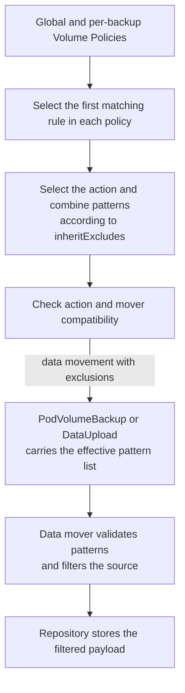

# Content Exclusion for Velero Volume Backups

This proposal addresses [Velero Issue #4129](https://github.com/velero-io/velero/issues/4129) by adding an ordered list of exclusion patterns to Volume Policies. Administrators and backup authors can omit selected content while backing up a volume. The data mover interprets the patterns and filters the source before writing backup data to the repository. Existing uploader filters also apply; the current Kopia uploader permits in-volume `.kopiaignore` rules to override policy patterns.

## Background

Volume Policies select how a volume is protected: filesystem backup, snapshot, skip, or custom handling. They do not currently provide a mover-neutral way to exclude selected content within a volume.

Workloads often contain build caches, temporary files, `node_modules/`, and VCS metadata that are unnecessary for recovery. Copying this content increases backup duration, node I/O, and repository size. Traversing temporary files can also cause avoidable failures when those files change during backup.

The proposed approach extends the existing Volume Policy model with `exclude` and `inheritExcludes`. It uses the same global and per-backup policy scopes that already select the backup action. Filesystem movers interpret exclusions as gitignore-style patterns; other movers can define matching rules appropriate to their source.

## Goals

- Allow administrators and backup authors to exclude unnecessary volume content through Volume Policies.
- Keep the pattern contract independent of the repository implementation.
- Preserve existing selection of action type, data mover, and snapshot class.
- Combine global exclusion defaults with per-backup patterns, with an explicit way to discard or replace the defaults.
- Preserve first-match-wins selection within each policy document.
- Make unsupported exclusions and invalid patterns observable through validation errors or backup warnings.
- Preserve existing behavior when no matching policy supplies exclusions.

## Non-Goals

- Adding a new in-volume ignore-file interface or enforcing policy patterns against existing uploader filters. Kopia’s existing `.kopiaignore` behavior is preserved; this proposal adds no `.veleroignore` interface.
- Filtering individual paths during block-device copying or storage-provider snapshot creation.
- Changing the unified repository interface or adding source-specific policy fields such as `exclude.files` and `exclude.tables`.
- Providing a security redaction mechanism for sensitive data.

## Proposed Design

### Configuration Model

Exclusions are declared on Volume Policy rules alongside `conditions` and `action`:

```yaml
version: v1
volumePolicies:
- conditions:
    pvcLabels:
      app: web-server
  action:
    type: fs-backup
  exclude:
  - "/cache/*"
  - "*.tmp"
  - "node_modules/"
  inheritExcludes: true
```

| Field | Meaning |
| :--- | :--- |
| `conditions` | Selects the volumes to which the rule applies. |
| `action` | Selects how the volume is backed up. |
| `exclude` | An ordered list of patterns identifying content within the selected volume to omit, interpreted by the data mover used for that volume's backup. These patterns do not select or exclude volumes. Optional; defaults to an empty list. |
| `inheritExcludes` | Whether a matching per-backup rule inherits patterns from the matching global rule. Optional; defaults to `true`. |

`inheritExcludes` is valid only in per-backup policies. A global policy is the baseline and has nothing higher to inherit from, so declaring this field in a global policy is rejected.

The existing policy scopes remain:

- **Global Volume Policy:** configured through `--global-backup-volume-policies-configmap`.
- **Per-backup Volume Policy:** referenced by `Backup.spec.resourcePolicy`, or selected with `--resource-policies-configmap`.

Snapshot data movement uses the same fields:

```yaml
volumePolicies:
- conditions:
    pvcVolumeMode: Filesystem
  action:
    type: snapshot
    parameters:
      dataMover: velero-fs
  exclude:
  - "/cache/*"
  - "*.tmp"
```

### Pattern Contract

`exclude` is an ordered list of patterns. Each pattern is represented as a string, and its meaning is defined by the mover reading the source. Policy evaluation and transport preserve the order.

Each volume backup uses at most one data mover, which interprets the entire effective pattern list for that volume, including inherited patterns. Snapshot-only backups use no data mover and follow the warning behavior in [Data-Mover Compatibility](#data-mover-compatibility).

For filesystem sources, `fs-backup` and snapshot data movement with `velero-fs` use the same gitignore-style language. Paths are relative to the volume source root, and later matching patterns override earlier ones. Detailed syntax, directory traversal rules, and platform behavior are specified in [Filesystem Exclude Patterns](filesystem-exclude-patterns.md).

Quote patterns in YAML, for example `"*.tmp"`, `"!keep.tmp"`, and `"#literal"`, to avoid YAML interpreting special characters as syntax.

### Responsibilities and Data Flow

Velero evaluates policies, checks action compatibility, and carries the effective pattern list to the volume backup. The data mover validates the patterns and applies them while reading the source. The unified repository stores the resulting payload without interpreting exclusions.



The current filesystem uploader maps patterns to Kopia snapshot ignore rules. This mapping is an uploader detail. Uploaders may impose mandatory exclusions required for successful backups; these take precedence over Volume Policy patterns. The filesystem uploader enforces this by appending mandatory exclusions after the effective Volume Policy list. On Windows, this keeps `/System Volume Information/` and `/$Recycle.Bin/` excluded even with `!**`. This precedence guarantee covers Volume Policy patterns; user-managed in-volume ignore files are outside this policy contract. Replacement uploaders must preserve the documented portable pattern language; uploader-specific behavior, including existing filters and case sensitivity, is described separately in the filesystem companion.

### Policy Evaluation and Precedence

For each volume, select the **first matching rule independently in each policy document**. Later rules in that document contribute neither an action nor patterns. Place specific rules before broad catch-all rules.

The per-backup rule selects the action when one matches; otherwise, the global rule selects it. The action is selected as a whole, including its data mover and snapshot class. Exclusions are composed separately:

| Matching rules | Selected action | Effective patterns |
| :--- | :--- | :--- |
| Neither policy matches | Existing backup defaults | None |
| Only global matches | Global rule's action | Global rule's patterns |
| Only per-backup matches | Per-backup rule's action | Per-backup rule's patterns |
| Both match; `inheritExcludes` omitted or `true` | Per-backup rule's action | Global patterns followed by per-backup patterns |
| Both match; `inheritExcludes: false` | Per-backup rule's action | Per-backup patterns only |

The table assumes the selected action supports exclusions. If the selected action is `skip`, `custom`, or `snapshot` with `velero-block`, nonempty patterns declared on that rule are invalid. Inherited global patterns are dropped with a warning naming the volume and the incompatible action. This warning also applies before a volume is skipped.

A matching `snapshot` action selects its data mover, defaulting to `velero-fs` when `dataMover` is omitted. The backup-level data mover is used only when no policy action matches.

#### First-match isolation

In this single policy document, the database rule prevents the later catch-all exclusions from applying to matching database volumes:

```yaml
volumePolicies:
- conditions:
    pvcLabels: { app: postgres }
  action:
    type: fs-backup
  # No exclusions from this policy for database volumes.

- conditions: {}
  action:
    type: fs-backup
  exclude:
  - "*.log"
  - "*.tmp"
```

This isolation applies within one document. If this is a per-backup policy, a matching global rule can still supply exclusions unless inheritance is explicitly disabled.

#### Inheriting and overriding patterns

A per-backup rule that only changes the action continues to inherit global patterns. Omitting `exclude`, or setting `exclude: []`, does not clear the global baseline.

For filesystem movers, appending per-backup patterns also allows negation of earlier global patterns. For example, global `["*.tmp"]` combined with per-backup `["node_modules/", "!keep.tmp"]` produces:

```yaml
exclude:
- "*.tmp"
- "node_modules/"
- "!keep.tmp"
```

This keeps `keep.tmp` where its parent directories remain included. An excluded directory is not traversed, so a negation cannot reach a file beneath it without also re-including the directory. See [Filesystem pattern syntax](filesystem-exclude-patterns.md#syntax-gitignore-style).

#### Discarding or replacing global exclusions

Set `inheritExcludes: false` on the matching per-backup rule to discard the global baseline. With no local patterns, this results in no policy exclusions for the volume:

```yaml
volumePolicies:
- conditions:
    pvcLabels: { app: postgres }
  action:
    type: fs-backup
  inheritExcludes: false
```

To replace the baseline, supply local patterns on the same rule:

```yaml
volumePolicies:
- conditions:
    pvcLabels: { app: web }
  action:
    type: fs-backup
  inheritExcludes: false
  exclude:
  - "custom-cache/"
```

A workload-specific rule that needs files excluded by global defaults should disable inheritance explicitly. For example, a database rule must not inherit a global `*.log` exclusion if those files are required for recovery.

### Data-Mover Compatibility

The following table describes the built-in actions covered by this proposal:

| Action | Data path | Exclusion behavior |
| :--- | :--- | :--- |
| `fs-backup` | Filesystem traversal | Apply filesystem patterns. |
| `snapshot` with `velero-fs` | Exposed snapshot filesystem or raw-block source | Apply patterns only to filesystem sources. Raw-block data movement follows the source-mode rule below. Empty or legacy `velero` mover names select the default filesystem mover. |
| `snapshot` with `velero-block` | Block-device copy | Reject nonempty exclusions declared on the rule. |
| `snapshot` without data movement | Storage-provider snapshot | No filtering; warn when effective patterns cannot be applied. |
| `skip` | No data backup | Reject nonempty exclusions declared on the rule. |
| `custom` | Handling outside Velero's data path | Reject nonempty exclusions declared on the rule. |

**Source volume mode:** Compatibility depends on the actual source mode as well as the mover name. Use the resolved PV mode, falling back to the PVC mode and then `Filesystem` when omitted. During raw-block data movement, including through `velero-fs`, ignore all effective exclusion patterns and record a backup warning identifying the volume and stating that the full volume is backed up without exclusions. This applies equally to patterns declared by the selected rule and inherited global patterns. Exclusion incompatibility alone must not fail the volume or make the backup `PartiallyFailed`. An empty effective list, including one cleared by `inheritExcludes: false`, produces no warning. Remove the patterns before creating the DataUpload; raw-device uploaders also ignore them with a warning if they receive them. This prevents filesystem patterns from filtering the synthetic device stream instead of filesystem content. Snapshot-only backups retain the warning behavior below.

A plain CSI or native storage-provider snapshot contains the full volume. When no data movement runs and effective patterns are nonempty, Velero records a warning and proceeds with the snapshot. Dropped inherited patterns also produce a warning, including when the selected snapshot action names `velero-block`. The policy can therefore be shared with backups that do move data, but the unfiltered snapshot must not be reported as having applied exclusions.

**Future extensions:** Volume Policy mover selection currently accepts only built-in names. If support for additional movers is added, the same pattern list can be passed through `DataMoverConfig`. Each mover must document its pattern language and exclusion support. Incompatibilities known from policy configuration are rejected during policy loading; incompatibilities discovered during volume backup are reported with a warning and the volume is backed up without exclusions. For example, a future database mover could match a database/table tree without new policy fields; that mover and its language are outside this proposal.

### Transport: PVB and DataUpload

Both backup paths use the same policy evaluation. The effective pattern list is carried in existing volume backup configuration fields:

| Backup path | Transport field |
| :--- | :--- |
| PodVolume `fs-backup` | `PodVolumeBackup.Spec.UploaderSettings["Exclude"]` |
| Snapshot data movement | `DataUpload.Spec.DataMoverConfig["Exclude"]` |

These maps store string values, so the ordered pattern list is encoded as a JSON array within a single string. JSON preserves patterns containing commas without ambiguity:

```json
["/cache/*","*.tmp","node_modules/"]
```

`Exclude` is the reserved transport key; the user-facing policy field remains `exclude`. An empty effective list produces no transport entry. Encoding or decoding errors fail the volume backup rather than silently dropping exclusions.

To bound the contribution of exclusions to each PVB/DataUpload, apply these fixed limits to both each rule's list and the effective list after global/per-backup composition:

| Limit | Maximum |
| :--- | :--- |
| Pattern count | 128 |
| Individual pattern size | 4 KiB (4,096 UTF-8 bytes after whitespace normalization) |
| JSON-encoded pattern list | 64 KiB (65,536 bytes, including JSON delimiters and escaping) |

The encoded-size limit measures the JSON array string before it is embedded in the CR's configuration map. It accounts for escaping, which can make the encoded list larger than the sum of pattern lengths, and leaves room for the remaining CR fields and outer serialization. It bounds exclusion-related growth; it is not a size guarantee for the entire CR. These limits apply independently of the data mover's pattern language. Duplicate patterns count toward the limits and retain their order.

Validate each rule during policy loading, then check the composed list again immediately before setting `Exclude` on a PVB or DataUpload. The transport decoder enforces the same limits. Reject an oversized list with an error identifying the exceeded limit and actual size/count; do not truncate patterns or silently omit them.

## Validation and Failure Behavior

Validation separates policy structure from mover-specific pattern semantics.

**Policy loading:** Volume Policy ConfigMaps have no admission webhook. Validation runs when a backup loads the policies, before any of its volumes are copied. Every rule is validated, including rules that do not match a volume in that backup.

- `exclude` must be a list of patterns represented as YAML strings. Numbers, booleans, null values, and composite entries are rejected rather than converted or discarded. An empty list is accepted on every action and has the same effect as omitting the field, including retaining inheritance. Each pattern must be non-empty after trimming whitespace.
- Every rule's `exclude` list must satisfy the count, per-pattern byte, and encoded-size limits in [Transport: PVB and DataUpload](#transport-pvb-and-dataupload), including rules that do not match a volume.
- `inheritExcludes` must be a YAML boolean (`true` or `false`) when present and defaults to `true`. Null values, quoted booleans, and strings such as `yes` are rejected. It is allowed only in per-backup policies.
- Rules with `skip`, `custom`, or `snapshot` with `velero-block` reject nonempty `exclude` lists and any declaration of `inheritExcludes`. An empty `exclude: []` remains equivalent to omission.
- Pattern syntax is not parsed at this stage because its meaning belongs to the selected mover.

**Volume backup preparation:** Resolve the action and effective patterns using [Policy Evaluation and Precedence](#policy-evaluation-and-precedence), then check compatibility with the selected data path. Raw-block data movement, dropped inherited patterns, and unfiltered snapshots follow the warning behavior described above. If an incompatible mover is detected at this stage despite policy validation, warn and continue with the full volume without exclusions. A failed PV lookup for a bound claim or a claim with an assigned PV fails volume preparation; it must not change policy matching by discarding PV metadata. PVC-only matching remains available for genuinely unbound claims.

**Mover start:** Filesystem movers validate patterns with the same matcher used to filter the source; malformed patterns fail that volume's backup. Raw-device uploaders ignore nonempty exclusion lists with a warning and copy the full volume. Malformed transport encoding remains an error.

## Compatibility and Existing Behavior

| Area | Behavior |
| :--- | :--- |
| Existing policies | No matching exclusions means no new filtering. Existing policies require no edits. |
| Action selection | First-match selection and per-backup precedence for action, mover, and snapshot class remain unchanged. |
| Exclusion inheritance | A per-backup rule without new fields still inherits patterns if an administrator adds them to a matching global rule. Use `inheritExcludes: false` to opt out. |
| API and transport | New fields are added to the Volume Policy format. Existing PVB/DataUpload configuration maps carry the patterns; no new Backup, PVB, or DataUpload CRD fields are required. |
| Repository | The unified repository interface remains unchanged. |
| Filesystem uploader | Mandatory Windows exclusions are appended after user patterns and cannot be overridden by Volume Policy negations. Existing `.kopiaignore` rules and cache-directory filtering remain active. Platform behavior is described in [Filesystem Exclude Patterns](filesystem-exclude-patterns.md#current-filesystem-uploader-behavior-kopia). |
| Restore | Restore uses the stored payload. Content omitted during backup is not recreated; no restore filtering feature is introduced. |

## Observability

Backup logs record the resolved policy patterns and selected mover for each affected volume. These records must be available through `velero backup logs`, so operators can verify the policy configuration used for a backup. They do not enumerate every filter applied by Kopia: in-volume rules can override policy patterns, and cache-directory filtering acts independently. Resetting policy inheritance does not disable these filters.

Warnings identify volumes whose patterns were ignored because of a raw-block source or an incompatible mover discovered during backup, whose inherited patterns were dropped because of an incompatible action, or whose patterns could not be applied because no data movement occurred. Warnings for raw-block sources explicitly state that the full volume is backed up without exclusions. Mover logs can provide additional diagnostics, but do not replace these backup-level records.

## Security and Recovery Considerations

Volume Policy ConfigMaps are governed by Kubernetes RBAC. They provide the control plane for declaring exclusions.

`exclude` is an efficiency and cost optimization, not a security boundary or compliance redaction mechanism. Provider snapshots contain the full source volume, and external movers would need their own filtering guarantees. Data that must never enter a backup requires a workflow that enforces that requirement independently of this feature.

Over-broad patterns can omit content needed for recovery. Backup authors must retain application data required for a usable restore, including transaction logs where applicable. The resolved pattern list in backup logs helps operators inspect the configuration; it does not establish that the remaining data is sufficient for recovery.

## Alternatives Considered

| Alternative | Decision and rationale |
| :--- | :--- |
| In-volume ignore files | Use Volume Policies as the configuration interface. Policies reuse existing volume selection and RBAC controls and do not require changes inside application volumes. |
| Uploader-specific exclusion configuration | Use a mover-neutral pattern list. Pattern interpretation belongs to the source reader, while repository and uploader details remain outside the policy API. |
| Per-backup exclusions always replace global exclusions | Inherit global patterns by default so workload-specific action changes retain administrator defaults. Provide `inheritExcludes: false` for explicit opt-out or replacement. |
| Accumulate patterns from every matching rule | Keep first-match-wins within each policy document so broad catch-all exclusions cannot affect a volume selected by an earlier specific rule. |
