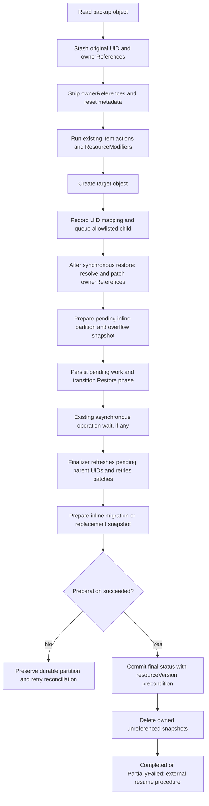

# OwnerReference Relinking

## Glossary

- **UID mapping:** In-memory lookup from an object's backup UID to a record of its created or eligible existing target object's live UID, GroupKind, name, namespace, and discovered scope.
- **Pass 1:** Immediate ownerReference resolution and patching after synchronous restoration finishes. Its child API patch loop is bounded by `resourceTimeout` (default 10 minutes); pending-state persistence has a separate budget.
- **Pass 2:** Finalizer-side parent UID refresh and retry of persisted ownerReference patches, after the asynchronous restore-operation wait. Refresh each distinct parent once per execution; do not revisit children completed in Pass 1. It does not pause or unpause resources.
- **Pending patch:** A child's identity and already-resolved ownerReference slice persisted for retry without reconstructing the UID map.
- **Overflow snapshot:** An immutable, Restore-owned ConfigMap containing compressed pending patches that do not fit in the inline count limit. `PendingPatchesConfigMap` names the authoritative snapshot.
- **Live precedence:** Preserve an existing live controlling owner and demote a different incoming restored controlling owner to avoid multiple controlling owners.

## Background

### OwnerReferences and Garbage Collection

An ownerReference identifies its parent by apiVersion, kind, name, and UID, with optional `controller` and `blockOwnerDeletion` flags. Newly created objects receive new UIDs during restore. Reusing backed-up owner UIDs can expose restored children to garbage collection because those original owners do not exist in the destination cluster.

Velero's `resetMetadataAndStatus()` strips `metadata.ownerReferences` before creation. This avoids dangling restored ownerReferences, but custom operators may not adopt the resulting orphans. Built-in workload controllers have established selector-adoption behavior that this design preserves through resource priorities and a deny list.

The restoration pipeline can create children before their parents. Rather than imposing a topological order, this design creates objects without ownerReferences and relinks them once synchronous restoration finishes and eligible parent UIDs are known.

### Controller Races Are an Operational Boundary

Removing ownerReferences can let active controllers observe incomplete hierarchies while restore is running. Relinking alone does not prevent duplicate provisioning or other controller mutations. Operators must determine whether their workloads tolerate this window and, where needed, pause or suspend all relevant controllers before those resources can reconcile.

For a Cluster API restore, for example, the external procedure may inject `cluster.x-k8s.io/paused` on Cluster resources and suspend GitOps that would remove it. Existing restore priorities place CAPI Clusters late, after Tanzu ClusterBootstraps; this design retains those priorities. It does not guarantee that pausing only a root freezes every provider or that all controllers tolerate out-of-order creation. Provider behavior and pause coverage must be validated by the restore procedure.

## Goals

- Relink allowlisted Kubernetes ownerReferences using data already present in existing backup archives.
- Preserve the current resource priority order and deny-listed workload adoption behavior.
- Resolve references during Pass 1 and persist transient failures for restart-tolerant Pass 2 retries.
- Merge restored ownerReferences with live references under optimistic concurrency control.
- Retain crash-safe copy-on-write overflow snapshots until replacement status is durable.
- Gate the feature with `--features=OwnerRefRelink`, with baseline and per-restore ConfigMap scope configuration.
- Report relink counts, omissions, failures, and pending work through restore results and CLI output.

## Non-Goals

- Backup-side graphs, sidecar manifests, archive changes, or global topological sorting.
- Relinking or rewriting UID-bearing object references within resource `.spec`.
- Relinking or rewriting references within resource `.status`.
- Automated controller pause injection or unpause orchestration (such as pause tracking labels, paused-object status, and leftover-pause catch-up).
- Parent-to-root dependency graphs, transitive root pinning, or per-workload unquiesce evaluation.
- Relinking pre-existing live objects through update, skip, or ServiceAccount merge paths. Their UIDs may be registered for newly created children.
- Resuming a restore that crashes while its phase is `InProgress`.
- Sharding a pending partition across multiple overflow ConfigMaps or increasing existing count limits in this revision.
- Authorizing cross-namespace ownership. Namespaced owners must share their dependent's namespace; cluster-scoped dependents may have only cluster-scoped owners.

## Configuration Model

`Restore.Spec.OwnerRefConfigMap` (`--owner-ref-restore-configmap`) references an ownerReference scope ConfigMap in the Velero namespace. The server baseline is selected by `--owner-ref-configmap`, or the conventional `velero-ownerref-config` name.

The configuration has one section, `inScope`:

```yaml
apiVersion: v1
kind: ConfigMap
metadata:
  name: velero-ownerref-config
  namespace: velero
data:
  inScope: |
    - group: cluster.x-k8s.io
    - group: controlplane.cluster.x-k8s.io
    - group: bootstrap.cluster.x-k8s.io
    - group: infrastructure.cluster.x-k8s.io
    - group: ipam.cluster.x-k8s.io
    - group: addons.cluster.x-k8s.io
```

Each entry matches an API group and optional kind; matching ignores version. Core resources use an empty group with an explicit kind. Baseline and per-restore entries are unioned and deduplicated. There are no pause rules or field-path override semantics in this design.

Unsupported owner-reference configuration sections must produce validation errors rather than silently activating or ignoring deferred features. ResourceModifiers use their existing separate ConfigMap and CLI option.

### Feature Gating and Precedence

| Source | Behavior |
| :--- | :--- |
| Feature flag disabled, no ownerRef ConfigMap reference | Preserve legacy behavior; the relinking engine is dormant. |
| Feature flag disabled, Restore references an ownerRef ConfigMap | Fail validation before restore begins. |
| Explicit server baseline ConfigMap | Load from the Velero namespace; missing/unreadable baseline warns and proceeds with an empty baseline. Invalid content fails validation. |
| Server flag unset | Load conventional `velero-ownerref-config` from the Velero namespace; missing/unreadable storage warns and proceeds with an empty baseline. Invalid content fails validation. |
| Per-restore ConfigMap specified | Require a readable valid ConfigMap and union its scope with the baseline; otherwise fail validation. |

`NewScope()` contains the immutable safety deny list only. CAPI defaults are delivered in the baseline ConfigMap rather than hardcoded into the binary. PVCs are not included in the curated baseline.

### Scope and Safety Boundaries

| Resource class | OwnerReference behavior |
| :--- | :--- |
| `core/Pod`, `apps/ReplicaSet`, `core/ReplicationController`, `batch/Job` | Always strip and retain existing adoption behavior. Explicit denied entries fail configuration validation. |
| `core/PersistentVolumeClaim` | Strip by default. Relink only when explicitly opted in per restore; omit PVC ownerRefs whose parent GroupKind is denied. |
| Deployment, StatefulSet, DaemonSet, CronJob | Strip by default; relink if allowlisted. |
| Allowlisted application CRDs | Create stripped, then relink resolvable ownerReferences. |
| Unlisted resources | Legacy strip behavior. |

PVC opt-in permits restoring eligible ownership found in the backup, which can make restored PVCs eligible for garbage collection when their owners disappear. The comparison is with Velero leaving those references stripped; opt-in can restore the workload's original deletion behavior. It does not invent an ownerReference absent from the backup or change a StatefulSet's `persistentVolumeClaimRetentionPolicy`.

For StatefulSet template PVCs, the default `Retain` policy normally leaves them without StatefulSet/Pod deletion ownerReferences. With `whenDeleted: Delete`, the controller uses StatefulSet ownership to implement PVC deletion; this design may relink that backed-up relationship. With `whenScaled: Delete`, the controller uses Pod ownership for replicas being scaled down; this design omits backed-up Pod references under its PVC parent deny-list filter. Disabling PVC relinking does not guarantee retention: the StatefulSet controller can independently reconcile these references according to its restored policy. See [Kubernetes StatefulSet PVC retention](https://kubernetes.io/docs/concepts/workloads/controllers/statefulset/#persistentvolumeclaim-retention).

Administrators must assess the backed-up owners and target retention policies before opting in; enabling the feature alone must not activate PVC relinking.

PVC opt-in is a source-specific exception to the additive scope union. Reject `group: ""`, `kind: PersistentVolumeClaim` in any server baseline, including a custom baseline, during configuration validation. Accept it only in the per-restore ConfigMap, where it explicitly opts newly created PVCs into relinking for that restore. Validate each configuration source before unioning entries so the opt-in cannot be inherited from the baseline.

For example, a separate per-restore ConfigMap may contain:

```yaml
apiVersion: v1
kind: ConfigMap
metadata:
  name: restore-pvc-ownerrefs
  namespace: velero
data:
  inScope: |
    - group: ""
      kind: PersistentVolumeClaim
```

Select it with `--owner-ref-restore-configmap restore-pvc-ownerrefs`; the baseline application groups remain included through the normal union. The PVC parent deny-list filter still applies, and existing PVCs are never enqueued for relinking.

## External Pause and Resume Procedure

### ResourceModifier Example

Create a separate ResourceModifier ConfigMap to inject a pause annotation. A merge patch preserves existing annotations and handles an absent annotations map:

```yaml
apiVersion: v1
kind: ConfigMap
metadata:
  name: restore-controller-pauses
  namespace: velero
data:
  resource-modifiers.yaml: |
    version: v1
    resourceModifierRules:
      - conditions:
          groupResource: clusters.cluster.x-k8s.io
          namespaces:
            - source-workloads
        mergePatches:
          - patchData: |
              metadata:
                annotations:
                  cluster.x-k8s.io/paused: ""
```

ResourceModifier conditions match the original backup namespace, before namespace mapping. This example demonstrates injection only; its controller coverage must be checked for the installed CAPI providers.

```bash
velero restore create cluster-restore \
  --from-backup cluster-backup \
  --owner-ref-restore-configmap velero-ownerref-config \
  --resource-modifier-configmap restore-controller-pauses
```

Use this procedure for fresh-resource DR restores. ResourceModifiers also feed existing-resource update paths, so `existingResourcePolicy: update` can apply pause annotations to running objects. The relinking engine cannot enforce create-only pause behavior for an external modifier.

### Operational Responsibilities

1. Record intentionally pre-existing pauses and the exact resources the procedure will temporarily pause. Velero does not distinguish those cases or maintain a pause inventory.
2. Establish controller suspension before reconciliation can act on incomplete resources. ResourceModifier injection occurs before Create, but root-only rules may be insufficient; use provider-specific suspension where needed.
3. Suspend GitOps or configure it to preserve the externally injected pause annotations during restore.
4. Wait for restore finalization, then inspect restore errors, warnings, pending patches, missing children, and the relevant volume-operation results. `Completed` alone does not prove that every original relationship was relinked or that the workload is ready.
5. Remove only the temporary pauses introduced by the external procedure after dependencies and data restoration are verified. Preserve intentional pauses.

For a verified temporary CAPI pause, external remediation may use:

```bash
kubectl annotate clusters.cluster.x-k8s.io -n target-workloads prod-cluster cluster.x-k8s.io/paused-
```

Velero never runs that command or equivalent unpause patches. Failure, restart, overflow, cancellation, and Restore deletion leave modifier-injected annotations in place until an external actor changes or deletes the resource.

## Restore Workflow



### Synchronous Restoration: Create and Register UIDs

In `restoreItem()`, retain `itemFromBackup` unchanged and copy its original UID and ownerReferences before `resetMetadataAndStatus()`. Continue running existing restore item actions and ResourceModifiers on `obj`; the ownerReference engine injects no pause metadata.

Immediately after a successful `resourceClient.Create(obj)`, register the backup UID to created UID mapping and enqueue ownerReferences for an allowlisted child. Capture target identity from the actual created object, including its final GVK, name, namespace, and created UID. Store that created UID as `RestoredUID` on queued and persisted requests. Register before status updates, managedFields patches, or hooks that may return early.

Each mapping stores a `UIDMappingRecord` as defined below, rather than only a UID pair. Capture the parent's actual target GroupKind, destination API version, served-version snapshot, name, namespace, and discovered scope for every registered resource, including resources outside the child allowlist. Obtain scope from restore discovery/RESTMapper information during synchronous restoration and cache it in the record; capture the child's scope on its queued request as well. If scope cannot be established, keep `ScopeKnown: false` and diagnose affected relationships as omissions. An empty namespace alone must not be treated as proof of cluster scope.

Record eligible existing parent identities and UIDs before sanitizing the live object's metadata. Update, ServiceAccount merge, and equal-skip paths register target identity records only; they do not enqueue ownerReference patches against existing objects. Where the selected restore mode supports restoring volume data into an existing PVC/PV, register the existing PVC's backup UID to target record while leaving its ownerReferences unchanged. This registration lets newly created children refer to that PVC; it does not certify that volume data restoration succeeded. A different object skipped without an update policy is not mapped by this design. Failed creation is a normal restore error; external readiness checks must account for missing children.

Namespaces use a separate ensure/create path, both in the selected-resource loop and for synchronous additional items. Register them there using the original archive metadata and the live Namespace UID. Newly created, allowlisted namespaces can also be queued as children; repeated ensures must not enqueue them twice. Existing namespaces supply parent mappings when their retained labels, annotations, and spec match the requested namespace or the restore uses the update policy, and are never queued as children. Synthesized namespaces with no archive entry have no backup UID to map.

No parent graph or quiesced-root index is built. UID mappings are collected for eligible resources even when those resources are not themselves in the child relink allowlist.

### Worked Example: Child Created Before Parent

Assume the backup contains a namespaced `WidgetSet` named `workers` with UID `parent-old` and an allowlisted `Widget` named `worker-1` whose ownerReference points to that WidgetSet. Both kinds belong to `workloads.example.io`; names, kinds, and namespaces remain unchanged during this restore.

1. Restore `worker-1` first with ownerReferences stripped. Its created UID is `child-new`; record its UID mapping and queue its original ownerReference with `RestoredUID: child-new`.
2. Restore `workers` later with UID `parent-new`. Record `uidMap[parent-old]` with live UID `parent-new`, GroupKind `workloads.example.io/WidgetSet`, name `workers`, its target namespace, and known namespaced scope, even if WidgetSet is outside the child relink allowlist.
3. After synchronous restoration finishes, Pass 1 resolves the queued owner UID to `parent-new`, GETs `worker-1`, and merges and patches its ownerReferences using the fetched resourceVersion.
4. If the patch succeeds, count one relinked child and remove the request. If it fails transiently, persist the child's target identity, `RestoredUID`, and the resolved ownerReference with UID `parent-new` for Pass 2.

The child can therefore be restored before its parent without changing resource priorities. Pass 2 needs only the persisted request, not the original UID map. Controller suspension, where needed, remains an external responsibility throughout this sequence.

### Pass 1: Immediate OwnerReference Relinking

`RestoreController` invokes `ApplyOwnerRefRelinking()` immediately after `RestoreWithResolvers` finishes, before phase transition and result persistence. RestoreItemAction additional items restored through the synchronous item loop participate in UID mapping and enqueueing.

The UID map, including target identities and cached scope information, is frozen when synchronous `RestoreWithResolvers` processing finishes, including AdditionalItems restored through that synchronous item loop. Pass 1 resolves and validates against those completed records. Objects created later by asynchronous operations or live controllers are not added dynamically. The freeze is a Pass 1 snapshot boundary. Pass 1 performs no additional parent GETs before patching. Pass 2 may refresh UIDs for established parent targets referenced by pending requests, including same-identity replacements; it does not expand the eligible relationship set.

For each queued child:

1. Resolve each original owner UID through the in-memory UID map.
2. Omit missing/excluded owners with warnings. Verify owner identity, cached scope, and actual target namespace against the frozen mapping record; omit invalid owner relationships with diagnostics.
3. Fetch the live child and merge references resolved from the frozen map with its current ownerReferences. Do not GET parents or refresh their UIDs in Pass 1.
4. Patch with a resourceVersion precondition and bounded retries.
5. Count successful child patches in `OwnerRefsRelinked`; collect transient failures as pending requests containing already-resolved references.

The child patch loop is bounded by `resourceTimeout`. Once its context expires, resolve and validate the remaining queue entries from the frozen records without further child/parent API calls, discovery calls, or repeated backoff sleeps. Persist the resulting pending payloads under a separate bounded persistence context as described below. No spec GET, spec traversal, or fallback spec-payload fetch is needed.

Before leaving `InProgress`, persist remaining requests inline and in an immutable overflow snapshot as required. The pending state becomes restart-recoverable only once the Restore phase and status partition are committed.

### Pass 2: Durable Finalizer Retry

`RestoreFinalizerController` runs relink retries in `Finalizing` or `FinalizingPartiallyFailed`, after the existing asynchronous-operation wait and finalization tasks. This scheduling does not assert that every volume operation succeeded; external resume checks remain responsible for workload readiness.

Load the inline pending list and the referenced snapshot. Missing, unreadable, empty, or corrupt referenced storage must fail closed: retain the reference and pending state, never treat partial loading as an empty queue, and report failure. Before patching children, build an execution-local parent UID snapshot from the complete pending partition:

1. Deduplicate established parent targets by GroupKind, target namespace, and name, ignoring API version. Discover scope so namespaced parents are read in the child's actual target namespace and cluster-scoped parents are read without a namespace. If the recorded API version is unavailable, use a served version of the same GroupKind for both lookup and the emitted ownerReference, following the emitted-version rule below.
2. GET each distinct parent at most once per execution. Cache both successful results and failures. A same-identity replacement supplies its current UID and produces a replacement warning; do not require equality with the previously persisted UID. Missing, deleting, or UID-less parents are unavailable, so affected children remain pending without being patched. Permanent lookup/scope errors fail the affected requests; transient lookup failures leave them pending.
3. Rewrite all pending ownerReferences from the refreshed snapshot before child patching. If one owner cannot be refreshed, do not patch that child. Preserve successful refreshes for its other owners in the retained payload. A permanent failure on any owner takes precedence over unavailable/transient owners.
4. Patch eligible children with fresh child GETs and the normal merge/resourceVersion retry behavior. Conflict retries and the child Forbidden fallback reuse the snapshot without additional parent GETs. For example, 100 pending children with one shared parent require one parent GET.
5. Persist refreshed ownerReferences in remaining requests through the existing copy-on-write partition protocol. Never mutate the previously loaded durable partition in place. A subsequent finalizer reconciliation or restart refreshes parents again from its loaded pending work.

Pass 2 does not reconstruct or persist the original backup-UID map. The execution-local mapping contains only established targets in pending references. Owners omitted in Pass 1, excluded parents, and new relationships are not discovered. Successfully patched Pass 1 children are not retained or revisited.

This is a bounded retry contract, not a hierarchy-wide reconciliation guarantee. If Pass 1 completed C1 against parent UID A and Pass 2 refreshes pending C2 to replacement UID B, C1 remains untouched. A parent replacement after the Pass 2 snapshot is likewise outside the guarantee. Parent reads are not an atomic cluster snapshot, and relinking does not recover children already deleted by garbage collection; controller suspension remains an operational responsibility.

Pass 2 parent discovery and child patching share the existing `resourceTimeout` budget (default 10 minutes). At the deadline, retain unresolved and unprocessed requests without further parent, discovery, or child API calls. Parent lookup failures are cached for this execution rather than retried per child. Successful child patches drain, non-retriable failures become restore errors and leave the retry queue, and unavailable parents or exhausted transient failures remain pending. Remaining work follows the existing terminal `PartiallyFailed` contract; it does not introduce an indefinite polling loop.

Prepare the resulting pending partition with copy-on-write storage. Preparation failures return a reconciliation error, preserve the previous durable partition, and avoid terminal status changes. After successful preparation, persist replay-safe results, commit the pending partition, counters, and final phase to the Restore, then clean up obsolete storage.

Failure to load the complete durable partition also returns a reconciliation error and preserves the previous phase and pending state. These storage failures retry through reconciliation. By contrast, remaining child patches after bounded retries do not keep finalization running indefinitely: once their partition is safely prepared and committed, the Restore becomes terminal `PartiallyFailed` with those requests retained for external remediation. Subsequent terminal reconciliations only retry snapshot cleanup; they do not replay ownerReference patches or automatically reopen the Restore.

Pass 2 remains necessary even without automatic unpause: it retries Pass 1 timeouts and transient failures using persisted payloads across an asynchronous wait or pod restart. A restore with no pending work proceeds through ordinary finalization and snapshot cleanup without an additional relink patch loop.

### Timeout and Persistence Contexts

In both passes, the child patch loop and pending-state persistence have separate deadline budgets. Derive each context from the active restore/reconciliation context, not from an expired child patch context. Parent cancellation or server shutdown still cancels the operations; do not detach them with an uncancellable background context.

- **Pass 1:** Start a child patch context bounded by `resourceTimeout`. When patching ends, start a fresh persistence context bounded by `resourceTimeout` for overflow snapshot preparation, result persistence, and the phase/status commit. Expiry of the patch budget alone must not prevent saving pending requests.
- **Pass 2:** Load the complete durable partition under its own bounded storage context before starting the shared parent-refresh and child-patch budget. When patching ends or its deadline expires, start a fresh persistence context bounded by `resourceTimeout` for replacement snapshot preparation, result persistence, and the terminal phase/status commit.
- **Cleanup:** Run post-commit or terminal-reconciliation cleanup with a fresh bounded context. Its failure follows the existing warning/requeue contract and does not reopen relinking.

Each fresh budget uses the existing `resourceTimeout` setting (default 10 minutes); no new timeout option is introduced. These are per-stage bounds, so the whole relinking/finalization sequence may take longer than one `resourceTimeout`. A persistence timeout follows the normal storage failure contract: Pass 1 reports unsaved overflow as errors if a subsequent status commit is possible, while a failed status commit has no `InProgress` recovery guarantee. Pass 2 preserves the previous durable partition and retries reconciliation; ambiguous commit failures retain snapshots until durable status is reloaded.

### Results and Completion Contract

Missing or excluded owners and deliberately omitted invalid relationships produce warnings and are not retried indefinitely. Actual non-retriable patch failures produce restore errors rather than a paused-root flag. They are omitted from the retry queue but force `PartiallyFailed`. Dropped overflow work also records errors and forces `PartiallyFailed`.

A restore can be `Completed` only when its normal error criteria are satisfied and both `PendingOwnerRefPatches` and `PendingPatchesConfigMap` are empty. Existing volume, creation, hook, and other restore failures remain failures even if relinking drains. Remaining pending requests force `PartiallyFailed` and are retained for inspection.

`Completed` does not certify that every original ownerReference was restored: excluded/missing-owner omissions remain visible through warnings. It also does not mean that controllers were resumed or that unchanged UID-bearing spec references are usable.

## OwnerReference Patch Mechanics

### Emitted OwnerReference API Version

Resolve backup-to-destination API-version differences as well as UIDs. For each managed ownerReference, preserve the matching live reference's `apiVersion` when destination discovery identifies it as served; otherwise preserve the resolved incoming reference's version when served; otherwise use the registered/resolved parent's destination-served version. Keep GroupKind and name unchanged. Preserve unrelated live references without rewriting them. Do not switch versions merely because another served version is preferred.

During synchronous registration, retain the parent's actual destination `APIVersion` and a snapshot of `ServedAPIVersions` from RESTMapper metadata. If that discovery is unavailable, retain the known destination version from the successful restore request as the conservative fallback; do not assume other versions are served. Pass 1 resolves backup references using this frozen metadata without additional parent GETs or discovery during child patching, including after the patch deadline. Save the selected version alongside the resolved UID in pending ownerReferences.

Pass 2 normally keeps that persisted version. Its existing scope discovery supplies served versions for the same GroupKind; legacy pending references using an unavailable version fall back to a served destination version for both the parent GET and the emitted ownerReference. Cache discovery per GroupKind and parent GET outcomes per GroupKind/namespace/name. Child conflict retries and the Forbidden fallback reuse the version snapshot, with no per-patch discovery or parent revalidation. Persist successful version corrections together with UID updates in remaining requests through copy-on-write storage.

The motivating case is a backup referencing `example.io/v1` restored into a destination serving only `example.io/v2`: both passes emit `v2`. If both versions remain served, preserve the applicable existing version. Concurrent API-version removal during a restore is not a supported migration workflow; successful Pass 1 children are not revisited. No new Restore API fields are needed, and this rule does not rewrite spec references.

Regression coverage must assert emitted `apiVersion` and UID for removed backup versions, stale matching live versions, preservation of served non-preferred versions, and pending-state persistence/replay. Continue asserting zero parent GETs in Pass 1 and at most one per distinct pending parent in Pass 2.

### Merge and Retry Rules

- Kubernetes merge patch replaces the entire ownerReferences array. Fetch live references, merge in memory, and send the unified array with the current `metadata.resourceVersion`.
- Match restored and live entries by Group, Kind, and Name, ignoring the API version suffix. On a match, keep the live apiVersion only when it is served according to the version snapshot; otherwise use the resolved incoming version. Update the resolved UID and applicable flags. Preserve unrelated live references.
- Preserve a live controlling owner. If a different restored owner requested `controller: true`, demote the incoming reference and warn; do not manufacture a second controlling owner or demote the matching live controlling owner.
- On an admission 403 with restored `blockOwnerDeletion: true`, strip that flag from incoming restored references and retry once. Preserve unrelated live owner flags. A second 403, or a 403 without that flag, is a non-retriable failure.
- Parent discovery occurs only once per distinct target in Pass 2, before child patching. Pass 1 uses frozen records. Child conflict retries and the Forbidden fallback perform no parent revalidation. A parent GET Forbidden is a lookup failure and must not trigger the child `blockOwnerDeletion` fallback.
- Retry conflicts with a fresh child GET and re-merge using the same pass-specific parent UID snapshot. Apply the failure classification below.
- Namespaced owners must remain in the dependent's actual target namespace. Namespaced children may have cluster-scoped owners; cluster-scoped children cannot acquire namespaced owners. Validate using scope cached from discovery during registration; unknown parent or child scope is an omission with a warning rather than an assumed cluster-scoped relationship.
- Before rewriting a UID, compare the backup ownerReference's GroupKind and name with the mapping record's actual target GroupKind and name. A version-only change is supported; a name or GroupKind change is omitted with a warning. This design does not rewrite owner names or kinds. Use the record's actual target namespace to validate ownership, including changes made by plugins/modifiers, rather than relying only on the configured namespace mapping. A missing Pass 1 mapping has no name-based fallback. Pass 2 lookup is limited to established parent identities already present in pending requests. Same-name child replacement is handled by the explicit policy below.

### Failure Classification

| Condition | Behavior |
| :--- | :--- |
| Source owner UID missing from the frozen map, including an excluded parent | Omit that backup reference, warn, and continue with any resolvable references. Do not create pending work for the omission. |
| Invalid or unknown owner/child scope, invalid target namespace, unsupported parent identity change, or a denied PVC parent | Omit the invalid reference with a warning; do not retry it as a temporary API failure. |
| Pass 2 finds a different UID at an established parent target | Refresh pending references to the discovered UID and warn. Do not revisit completed children. |
| Pass 2 parent GET returns NotFound, or the parent is deleting or has no UID | Cache the unavailable result and retain affected requests without patching them. Remaining pending work forces terminal `PartiallyFailed`. This differs from an owner never resolved in Pass 1. |
| Pass 2 parent scope discovery or GET fails | Cache the failure for this execution. Transient failures retain the request, including any successful refreshes of other owners. Permanent failures, including Forbidden or an unavailable kind, fail the child request without mutation and force `PartiallyFailed`. |
| Child GET/PATCH returns 409 Conflict | Retry with a fresh GET, reassess replacement identity, and re-merge. Retain the resolved request if bounded retries are exhausted. |
| Child GET/PATCH returns 429, a transient server error, a timeout, connection reset/refused, closed connection, probable EOF, or HTTP/2 connection loss; pass deadline expires | Retain the resolved request for Pass 2 after Pass 1, or in terminal pending state after Pass 2. Unprocessed resolved requests follow the same rule at the deadline. |
| Patch returns 403 Forbidden while incoming restored references request `blockOwnerDeletion: true` | Remove that flag from incoming references and retry once. Warn if the fallback succeeds; classify any remaining failure by its resulting error. |
| Child GET/PATCH returns 404 NotFound, 400 BadRequest, 422 Invalid, or persistent 403 Forbidden | Record a non-retriable restore error, remove the request from retry work, and force `PartiallyFailed`. A 403 without incoming `blockOwnerDeletion: true` is persistent Forbidden without a fallback. |

A missing child is an actual relink failure, unlike a missing source owner, which is an intentional omission. A later same-name recreation is eligible only if the child is present when a queued request is attempted; once a missing-child error removes that request, the relinking engine does not watch for a replacement or enqueue it again. Missing or corrupt overflow storage follows the separate fail-closed recovery contract rather than being treated as a missing child.

### Multiple Owners and Partial Resolution

Resolve each entry in the child's original ownerReferences independently. If Parent A is mapped to its live UID and Parent B was excluded or is missing from the frozen UID map, include Parent A in the restored references, omit Parent B, and record a warning for Parent B. Do not discard the whole child's patch or create a retry request solely for the unresolved Parent B.

Merge the resolvable references with the child's current live references using the normal live-precedence rules. Omitting a backup reference does not authorize deleting an unrelated live ownerReference. If the patch itself fails transiently, persist only the resolved incoming references for Pass 2; the missing-parent omission remains a warning. If no original references resolve, perform no relink patch and preserve current live references.

### Replacement Child Policy

A child deleted and recreated under the same GroupKind, namespace, and name is treated as the current logical restore target. The relinking engine relinks its ownerReferences and reports the replacement as a warning rather than skipping it or failing solely because its UID changed.

Persist the originally created child UID in `RestoredUID`. In both passes, GET the current child before every patch attempt. If its UID differs from `RestoredUID`, record a restore warning identifying the expected and observed UIDs, then continue with the normal live-reference merge. Preserve unrelated live references and live controller precedence. Patch using the fetched object's resourceVersion; on conflict, GET again, reassess the UID, and rebuild the merge. Avoid duplicate warnings for the same observed replacement UID within a pass.

```text
Relinking ownerReferences on replacement Machine default/worker-1:
originally created UID A, current UID B.
```

Successful patching removes the request from pending work and counts as relink success. The restore may finish Completed with warnings; a UID change alone is not a restore error. Actual patch failures retain the normal retry/error behavior.

This is deliberate adoption: adding restored ownerReferences can change the replacement's garbage-collection relationships. External resume checks must inspect replacement warnings. The policy applies only to a child already created and queued by this restore; it does not enable general relinking of pre-existing objects. Parent UID refresh is separately limited to pending work in Pass 2; namespace/scope validation still applies. Neither replacement policy re-enqueues completed children.

## Data Structures and API Additions

```go
type RestoreSpec struct {
    // Existing fields omitted.
    OwnerRefConfigMap *corev1.TypedLocalObjectReference `json:"ownerRefConfigMap,omitempty"`
}

type RestoreStatus struct {
    // Existing fields omitted.
    PendingOwnerRefPatches  []PendingPatchRef `json:"pendingOwnerRefPatches,omitempty"`
    PendingPatchesConfigMap string          `json:"pendingPatchesConfigMap,omitempty"`
    OwnerRefsRelinked        int             `json:"ownerRefsRelinked,omitempty"`
}

type PendingPatchRef struct {
    Group           string                  `json:"group"`
    Version         string                  `json:"version"`
    Kind            string                  `json:"kind"`
    Namespace       string                  `json:"namespace"`
    Name            string                  `json:"name"`
    RestoredUID     types.UID               `json:"restoredUID"`
    OwnerReferences []metav1.OwnerReference `json:"ownerReferences,omitempty"`
}
```

Pending requests are ownerReference-only; `PatchType`, `SpecPatchJSON`, and `Targets` are unnecessary in the target schema. There are no `QuiescedObjectRef`, `TargetRef`, `QuiescedObjects`, `UnquiesceBlocked`, or `SpecRefsRelinked` fields in this design. Existing ownerReferences carry resolved parent UIDs and destination-served API versions, refreshed during Pass 2 for remaining work; no persisted UID-map field is needed. `RestoredUID` identifies the child originally created by this restore so replacement can be diagnosed; a mismatch follows the warn-and-relink policy above.

Internal state retains an enabled flag, resolved scope, UID map, and owner patch queue protected by mutexes. The map is keyed by backup UID and contains:

```go
// Internal restore state; not a Restore API or persisted snapshot field.
type UIDMappingRecord struct {
    LiveUID           types.UID
    GroupKind         schema.GroupKind
    APIVersion        string
    ServedAPIVersions []string
    Name              string
    Namespace         string
    Namespaced        bool
    ScopeKnown        bool
}

// uidMap map[types.UID]UIDMappingRecord
```

Populate each record from the created or eligible existing target object before metadata sanitization can erase its UID. `Namespaced` is meaningful only when `ScopeKnown` is true; an unknown scope never authorizes relinking. A queued request also retains its backup UID, original ownerReferences, and child scope (`Namespaced` and `ScopeKnown`) alongside its actual target identity. This supplies all identity/scope validation data in memory, including after Pass 1's patch deadline. Only validated, resolved ownerReferences enter `PendingPatchRef`; the registry and scope fields need not be persisted or reconstructed in Pass 2. There is no spec queue, parentMap, quiesced-root map, or paused-object inventory.

## Pending Storage and Crash Recovery

This design uses two count-based inline limits, without measuring serialized Restore size on every status update:

```go
const (
    MaxPendingPatches        = 100
    MaxInlineOwnerReferences = 400
    MaxTotalPendingPatches   = 10000
)
```

`MaxPendingPatches` limits the number of inline pending requests. `MaxInlineOwnerReferences` limits the sum of `len(request.OwnerReferences)` across those requests; it is not a per-request allowance.

Partition requests in queue order. Add each complete request to the inline prefix only when adding it satisfies both limits. At the first request that would exceed either limit, put that request and all following requests in overflow. Never truncate or split a request's ownerReference array. A single request with more than 400 references therefore goes entirely to overflow, leaving an empty inline prefix if it is first.

Apply the same partition rule in Pass 1 and Pass 2. Migrate all remaining work inline and clear the snapshot reference only when the entire remaining list satisfies both limits. For example, 100 requests carrying 401 total references still require overflow; 50 requests with eight references each fit both limits.

Additional requests, up to `MaxTotalPendingPatches = 10000` across inline and overflow combined, are compressed into one authoritative snapshot under `binaryData["patches.json.gz"]`. Gzip plus key is limited to 1 MiB. Reducing the inline limits does not change that snapshot size limit or the bounded-overflow failure contract.

### Expected Pending Volume

We expect the unresolved ownerReference requests remaining after Pass 1 to fit within the current storage limits: at most 10000 pending requests in total and an overflow payload fitting one 1 MiB compressed snapshot. These limits apply to pending retry work, not the total number of resources restored. The inline 100-request/400-ownerReference limits simply determine when work moves to that snapshot.

This is the capacity assumption for this design. Keep the explicit failure behavior below if capacity is exceeded; do not silently discard work or report successful completion. No sharding is required.

### Sizing Estimate and Rationale

The defaults are based on compact JSON serialization of the `PendingPatchRef` shape with Kubernetes `metav1.OwnerReference` values, 36-character child/owner UIDs (including `RestoredUID`), and explicit controller/blockOwnerDeletion flags. The calculation excludes spec payloads, Targets, and quiesced-object records.

The long-identifier scenario uses 253-character object names and API groups and 63-character namespaces, kinds, and versions. These are stress-test inputs, not an asserted upper bound for all possible API values. Typical identifiers use CAPI GroupKinds and short workload names.

| Request scenario | Bytes per request | 100 requests | 200 requests | 500 requests |
| :--- | ---: | ---: | ---: | ---: |
| Typical identifiers, 1 owner | 375 | 36.7 KiB | 73.4 KiB | 183.6 KiB |
| Typical identifiers, 4 owners | 921 | 90.0 KiB | 180.1 KiB | 450.2 KiB |
| Long identifiers, 1 owner | 1,588 | 155.2 KiB | 310.4 KiB | 775.9 KiB |
| Long identifiers, 4 owners | 3,871 | 378.1 KiB | 756.3 KiB | 1,890.6 KiB |
| Long identifiers, 8 owners | 6,915 | 675.4 KiB | 1,350.8 KiB | 3,377.0 KiB |

Example base Restore serialization was 581 bytes for a basic Restore with progress/counters and 29,824 bytes (29.1 KiB) after adding 100 namespace mappings and 16 KiB of annotations. These samples do not include large managedFields, hooks, selectors, or arbitrary user metadata.

Use a **512 KiB planning reserve** for the rest of the Restore object. This reserve is an estimate, not a runtime-enforced limit. With the long-identifier/four-owner scenario:

| Inline request limit | Pending JSON + 512 KiB reserve |
| :--- | ---: |
| 100 | approximately 890 KiB |
| 200 | approximately 1,268 KiB |
| 500 | approximately 2,403 KiB |

The etcd default request limit is 1.5 MiB (1,536 KiB), although deployment settings can differ and JSON object bytes are not the exact etcd request size. Thus 100 leaves substantially more headroom than 200; 500 can exceed that default. [etcd system limits](https://etcd.io/docs/v3.7/dev-guide/limit/)

The aggregate ownerReference limit prevents an unusually large owner list from defeating the request limit. In the long-identifier sample, budget approximately 828 bytes of request overhead (including the 53-byte `RestoredUID` field) and 761 bytes per ownerReference:

```text
100 requests × 828 bytes + 400 ownerReferences × 761 bytes
≈ 387,200 bytes ≈ 378 KiB of pending JSON

378 KiB pending JSON + 512 KiB planning reserve ≈ 890 KiB
```

The array/wrapper overhead is small relative to this estimate. Without the aggregate limit, 100 eight-owner requests consume approximately 675 KiB; with it, only the first 50 such requests fit inline, consuming approximately 338 KiB. Overflow retains whole requests beyond that point.

**Sizing assumption:** The inline estimate covers only resource identity fields and ownerReferences, using the identifier lengths above. Pending requests do not contain restored resources' complete manifests, specs, status, or annotations, so the sizes of those manifests do not affect this calculation. The 512 KiB reserve is for the Velero Restore CR's other fields, including its own metadata, namespace mappings, selectors, and hooks; it is a planning assumption, not a runtime-enforced limit. Retain the overflow compressed-size preflight.

During Pass 1, items beyond the total cap, an oversized snapshot, or exhausted snapshot creation retries cannot be retained in this bounded storage model. Record explicit restore errors for dropped requests and force `PartiallyFailed`; no root-blocking or pause mutation occurs. Pass 2 preparation failures preserve existing recovery data and retry rather than dropping requests.

### Overflow Snapshot Commit and Cleanup Protocol

1. **Prepare:** Partition pending requests using both inline limits above. If overflow is non-empty, create an immutable `<restore-name>-pending-patches-<hash>` snapshot for the complete overflow suffix. Hash the Restore UID and compressed payload, truncate the name prefix within API limits, label it with `velero.io/pending-patches-restore-uid`, and set its Restore controller ownerReference. Reuse an existing snapshot only when ownership, immutability, and payload match. Never overwrite authoritative storage. If all remaining requests fit both inline limits, stage the complete remaining list inline and an empty reference without deleting the previous snapshot.
2. **Commit:** Upload results before committing the inline partition, snapshot reference, counters, and phase to the Restore. Object storage and the Restore API do not form one atomic transaction. On every finalizer attempt, reload persisted results and append only messages not already present in the same severity and scope (Velero, cluster, or a specific namespace). Preserve existing messages, including duplicates from earlier restore stages. Reconcile status counters from the merged results without reducing already recorded counts. Reload results even when the new attempt has no messages, so a previously uploaded error cannot disappear when a replay succeeds. The finalizer's Restore update has a resourceVersion precondition; conflicts reload through reconciliation. Ambiguous API failures retain all snapshots. Old snapshot A remains authoritative until the new status partition referencing B (or inline work) is durable.
3. **Cleanup:** After a successful terminal commit, use an uncached Restore read, verify its UID, and delete only owned snapshots other than the durable reference. Include ConfigMap UID deletion preconditions. Terminal `Completed` and `PartiallyFailed` reconciliations retry cleanup after restart, without replaying restore work. Cleanup failure warns and requeues after 30 seconds without changing the restore outcome.
4. **Retention:** Preserve a referenced B while pending work remains. Once work drains or fits inline, commit an empty reference before deleting B. A referenced snapshot on a `PartiallyFailed` Restore remains available for remediation. Restore deletion garbage-collects owned snapshots. Legacy conventional-name snapshots remain readable and are migrated without in-place rewriting; cleanup requires matching Restore ownership.

One snapshot is authoritative at a time, but replacement and orphan snapshots may temporarily coexist. That is copy-on-write recovery storage, not sharding.

<a id="catch-up-invariants-and-crash-matrix"></a>
### Crash Recovery Contract and Crash Matrix

The legacy anchor above is retained for existing research links; this design has no pause catch-up behavior. Recovery concerns ownerReference pending work only.

| Failure point | Durable state and recovery |
| :--- | :--- |
| `InProgress` crash before status commit | No automatic resume. In-memory UID mappings and queues may be lost. Inspect created resources and restore logs; external pauses remain externally managed. |
| Pass 1 status persistence fails | Restore may remain `InProgress`; no finalizer recovery contract starts until the phase/status partition is durable. Uncommitted snapshots remain until manual cleanup or Restore deletion. |
| `WaitingForPluginOperations[*]` restart after status commit | Existing controllers continue; Pass 2 later loads already-resolved pending ownerReferences from status and the snapshot. |
| Pass 2 crash before replacement status commit | Old partition and snapshot remain intact. Successful patches may replay; unresolved work remains recoverable. |
| Pass 2 results upload succeeds before a failed status commit or restart | Reload and merge the persisted diagnostics without appending identical messages again. Reconcile counters and final phase from those results even if the child succeeds on replay. |
| Pass 2 crash after commit, before cleanup | New partition is authoritative. Terminal reconciliation deletes obsolete snapshots. |
| Pass 2 snapshot preparation fails | Preserve old partition, return a reconciliation error, and retry. |
| Referenced snapshot cannot be loaded | Preserve the reference and fail closed; report unresolved work rather than completing from an incomplete list. |
| Restore deleted or cancelled | Owner-owned snapshots are garbage-collected. External pause annotations are not removed by this engine. |

## Validation and CLI

Validate the feature flag and ConfigMap reference before restore. `OwnerRefConfigMap` must refer to a ConfigMap in the Velero namespace with an empty API group; incompatible kind/group values fail validation. Reject an empty inScope entry, explicit denied GroupKinds, malformed configuration, unsupported feature sections, and PVC entries in a server baseline. Validate baseline and per-restore entries separately before their union so PVC relinking requires explicit per-restore opt-in. Deny-list checks always take precedence over broader group matching.

`velero restore create --owner-ref-restore-configmap` continues to select the per-restore scope. The existing `--resource-modifier-configmap` independently supplies external manifest transformations. The server uses `--features=OwnerRefRelink` and optional `--owner-ref-configmap`.

`velero restore describe` reports the ownerRef configuration, relinked object count, inline pending requests, and the referenced snapshot name. It must make overflow storage visible rather than displaying an empty inline list as no pending work. It contains no spec relink count, paused-object list, or automatic unpause commands.

```text
OwnerReference Relinking:
  ConfigMap:           velero-ownerref-config
  Relinked OwnerRefs:  48 items
  Pending Patches:     none
  Overflow Snapshot:   none
```

Pending patches and restore results diagnose relinking failures. The external procedure supplies provider-specific pause inventories and resume commands.

## Compatibility and Relationship to Prior Research

The feature remains disabled by default and adds optional ownerReference API fields without changing backup archives. This design is compatible with backups created by older Velero versions, subject to the existing resource/version compatibility requirements.

The earlier [proposal](https://github.com/velero-io/velero/pull/10556) explored a broader design that combined three distinct capabilities: `metadata.ownerReferences` relinking, automated controller pause injection and unpause orchestration, and spec-level reference rewriting. This design isolates and focuses exclusively on the core restore-side ownerReference relinking engine:

- **Controller Pause and Unpause:** Automated controller pause injection, root propagation, unpause matching, and pause-tracking metadata are deferred from this engine. Operational pause injection and resumption remain external responsibilities (for example, using existing ResourceModifiers and operational procedures). Consequently, this design accepts only `inScope` configuration in its ConfigMap rather than pause-related sections.
- **Spec Reference Rewriting:** Rewriting UID-bearing references in resource `.spec` (or `.status`) is deferred. That capability addresses different operational needs (such as operators storing raw target UIDs in custom fields) and warrants its own dedicated schema and safety validation. This design contains no dormant spec-reference processing.

## Alternatives Considered

- **Backup-Side Dependency Graph:** Constructing a DAG during backup and embedding it in the archive was rejected. It would alter the backup archive contract, create tight coupling between backup and restore versions, and is unnecessary because parent-child relationships can be resolved directly on the restore side using captured UID mappings.
- **Global Topological Sorting:** Sorting restored manifests so every parent is created strictly before its children was rejected. Imposing strict topological order conflicts with Velero's established workload restore priorities (for example, restoring Pods before Deployments).
- **Single-Pass Patching (Pass 1 Only):** Attempting all relinking solely at the end of the synchronous restore item loop was rejected. Pass 1 alone cannot survive process restarts or accommodate asynchronous volume data movement without losing retry state. Pass 2 in the finalizer ensures durable retry for transient failures and clean storage lifecycle management.
- **Multi-ConfigMap Snapshot Sharding:** Sharding overflow pending requests across multiple ConfigMaps is a potential enhancement rather than an initial requirement. If real-world restore feedback demonstrates that pending request counts or compressed snapshot sizes regularly exceed the single snapshot limits, sharding can be introduced. Until then, a single authoritative overflow snapshot keeps crash-recovery state simple and consistent.

## Open Issues and Limits

- **Live controller interference:** Without external suspension, controller claims and incomplete child creation remain possible. Live precedence prevents an invalid controlling-owner array; it does not guarantee correct operator adoption.
- **UID-bearing spec/status references:** Values are unchanged and may be stale. Their presence can prevent safe workload restoration even when ownerReference relinking succeeds.
- **InProgress recovery:** No automatic resume or reconstruction of the UID map is introduced.
