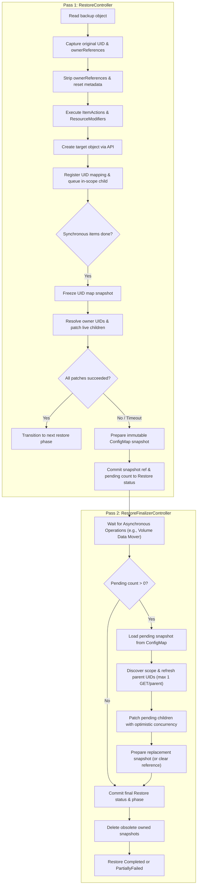
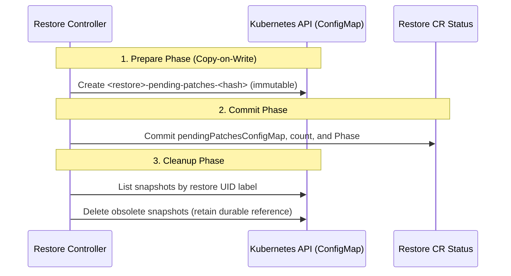

# OwnerReference Relinking

## Executive Summary

During a Kubernetes restore, newly created objects receive fresh UIDs. Because Velero strips `metadata.ownerReferences` before creating resources to prevent dangling references to non-existent backup UIDs, custom resources and operator-managed dependents lose their ownership relationships. Consequently, custom controllers and operators may fail to adopt orphaned dependents or may redundantly reprovision duplicate workloads.

This design introduces an in-engine **two-pass ownerReference relinking system** that reconstructs ownership hierarchies using data already present in backup archives, without requiring backup archive schema changes, sidecar manifests, or global topological sorting:

1. **Pass 1 (Immediate Relinking):** During synchronous restore, Velero creates resources stripped of ownerReferences while registering an in-memory mapping of backup-to-live UIDs. Once synchronous restore completes, Pass 1 patches resolved ownerReferences onto children using live-reference merging and optimistic concurrency control.
2. **Pass 2 (Durable Finalizer Retry):** Any patches that encounter transient failures or time out in Pass 1 are saved to an immutable, compressed ConfigMap snapshot. After asynchronous operations (e.g., volume data movement) finish, `RestoreFinalizerController` reloads the snapshot, refreshes parent UIDs, and retries the pending patches before finalizing the Restore.

---

## Background & Problem Statement

### OwnerReferences and Garbage Collection

An `ownerReference` identifies a parent object by `apiVersion`, `kind`, `name`, and `UID`, optionally specifying `controller` and `blockOwnerDeletion` flags. Newly created objects receive new UIDs during restore. Reusing backed-up owner UIDs exposes restored children to immediate Kubernetes garbage collection because those original UIDs do not exist in the destination cluster.

Velero's `resetMetadataAndStatus()` strips `metadata.ownerReferences` before creation. This avoids dangling references, but custom operators may not automatically adopt the resulting orphans. While built-in workload controllers have established selector-based adoption behavior, custom controllers (such as Cluster API, KubeVirt, or Knative) rely strictly on ownerReferences for lifecycle tracking.

The restoration pipeline can create children before their parents. Rather than imposing a fragile global topological order, this design creates objects without ownerReferences and relinks them once synchronous restoration finishes and eligible parent UIDs are known.

### Controller Races Are an Operational Boundary

Active controllers can observe restored resources before their ownership relationships are established. Relinking alone does not prevent duplicate provisioning or other controller mutations during this interval. Workloads that cannot tolerate this intermediate state require external controller suspension; see [External Pause and Resume Procedure](#external-pause-and-resume-procedure) for operational guidance.

---

## Terminology & Glossary

- **UID mapping:** In-memory lookup from an object's backup UID to a `UIDMappingRecord` containing its created or eligible existing target object's live UID, GroupKind, destination API versions, name, namespace, and discovered scope.
- **Pass 1:** Immediate ownerReference resolution and patching after synchronous restoration finishes. Its child API patch loop is bounded by `resourceTimeout` (default 10 minutes); pending-state persistence has a separate budget.
- **Pass 2:** Finalizer-side parent UID refresh and retry of persisted ownerReference patches, executed after the asynchronous restore-operation wait. Refreshes each distinct parent at most once per execution and does not revisit children completed in Pass 1.
- **Pending patch:** A child's identity and already-resolved ownerReference slice persisted for retry without needing to reconstruct the original backup UID map.
- **Pending snapshot:** An immutable, Restore-owned ConfigMap containing the complete compressed pending queue. `PendingPatchesConfigMap` names the authoritative snapshot; `PendingOwnerRefPatchCount` reports its number of child requests.
- **Live precedence:** The conflict resolution rule that preserves an existing live controlling owner and demotes a different incoming restored controlling owner to avoid multiple controlling owners on a single object.

---

## Goals & Non-Goals

### Goals
- Relink allowlisted Kubernetes ownerReferences using data already present in existing backup archives.
- Preserve existing resource priority orders and native workload adoption behavior.
- Resolve references during Pass 1 and persist transient failures for restart-tolerant Pass 2 retries.
- Merge restored ownerReferences with live references under optimistic concurrency control.
- Persist pending patches in immutable, Restore-owned ConfigMap snapshots, preserving crash recoverability until replacement status is durable.
- Gate the feature with `--features=OwnerRefRelink`, supporting baseline and per-restore ConfigMap scope configuration.
- Expose the pending request count and snapshot reference in Restore status and CLI output, alongside relink counters and diagnostics.

### Non-Goals
- Backup-side graphs, sidecar manifests, archive format changes, or global topological sorting.
- Relinking or rewriting UID-bearing object references within resource `.spec` or `.status`.
- Automated controller pause injection or unpause orchestration.
- Relinking pre-existing live objects through update, skip, or ServiceAccount merge paths (though their UIDs may be mapped as parents for newly created children).
- Relinking a Namespace's own ownerReferences (Namespaces participate only as eligible parents for other restored resources).
- Resuming a restore that crashes while its phase is `InProgress`.
- Sharding a pending queue across multiple ConfigMaps.
- Authorizing cross-namespace ownership (namespaced owners must share their dependent's namespace; cluster-scoped dependents may have only cluster-scoped owners).

---

## Core Architecture & Restore Workflow

### High-Level Workflow Diagram



### Worked Example: Child Created Before Parent

Consider a backup containing a namespaced `WidgetSet` named `workers` (UID `parent-old`) and an allowlisted `Widget` named `worker-1` whose ownerReference points to `workers`. Both belong to `workloads.example.io`; names, kinds, and namespaces remain unchanged during restore.

1. **Child Restored First:** `worker-1` is restored with ownerReferences stripped. Its created live UID is `child-new`. Velero records its UID mapping and enqueues its original ownerReference with `RestoredUID: child-new`.
2. **Parent Restored Later:** `workers` is created with live UID `parent-new`. Velero records `uidMap[parent-old]` with live UID `parent-new`, GroupKind `workloads.example.io/WidgetSet`, name `workers`, target namespace, and namespaced scope.
3. **Pass 1 Relinks Child:** After synchronous restoration completes, Pass 1 resolves the queued owner UID `parent-old` to `parent-new`, performs a live GET on `worker-1`, merges ownerReferences, and patches the object using its current `resourceVersion`.
4. **Outcome / Retry:** If the patch succeeds, `OwnerRefsRelinked` increments by 1. If the patch fails transiently (e.g., 429 or timeout), Velero persists the child's identity, `RestoredUID`, and the resolved ownerReference (`parent-new`) to the ConfigMap snapshot for Pass 2.

This architecture decouples restoration order from resource creation priorities: parents and children resolve naturally without topological sorting.

---

## Data Structures and API Additions

### Restore API Extensions

```go
type RestoreSpec struct {
    // Existing fields omitted.
    OwnerRefConfigMap *corev1.TypedLocalObjectReference `json:"ownerRefConfigMap,omitempty"`
}

type RestoreStatus struct {
    // Existing fields omitted.
    PendingOwnerRefPatchCount int    `json:"pendingOwnerRefPatchCount,omitempty"`
    PendingPatchesConfigMap   string `json:"pendingPatchesConfigMap,omitempty"`
    OwnerRefsRelinked         int    `json:"ownerRefsRelinked,omitempty"`
}
```

### Persisted Pending Snapshot Payload

Each queued child persisted in the snapshot ConfigMap uses the following schema:

```go
type PendingPatchRef struct {
    Group           string                  `json:"group"`
    Version         string                  `json:"version"`
    Kind            string                  `json:"kind"`
    Namespace       string                  `json:"namespace"`
    Name            string                  `json:"name"`
    RestoredUID     types.UID               `json:"restoredUID"`
    OwnerReferences []metav1.OwnerReference `json:"ownerReferences,omitempty"`
}
```

- `RestoredUID` records the child UID originally created by this restore, enabling detection and handling of replaced children.
- Persisted `OwnerReferences` already hold resolved parent UIDs and destination-served API versions; Pass 2 does not need to reconstruct the original backup UID map.

### Internal Restore State

The in-memory UID mapping records captured during synchronous restoration use:

```go
// Internal restore state; not exposed in the API or persisted snapshots.
type UIDMappingRecord struct {
    LiveUID           types.UID
    GroupKind         schema.GroupKind
    APIVersion        string
    ServedAPIVersions []string
    Name              string
    Namespace         string
    Namespaced        bool
    ScopeKnown        bool
}

// uidMap map[types.UID]UIDMappingRecord
```

`Namespaced` is authoritative only when `ScopeKnown` is `true`; unknown scope never authorizes relinking.

---

## Detailed Restore Pipeline Execution

### Synchronous Restoration: Create and Register UIDs

In `restoreItem()`:
1. Retain `itemFromBackup` unchanged and copy its original UID and ownerReferences before invoking `resetMetadataAndStatus()`.
2. Execute existing restore item actions and ResourceModifiers on `obj`.
3. Immediately after a successful `resourceClient.Create(obj)`, register the backup UID to created UID mapping and enqueue ownerReferences if the child matches scope. Register before status updates, managedFields patches, or hooks that might exit early.
4. Obtain parent scope from RESTMapper metadata during synchronous restoration and cache it in `UIDMappingRecord`. If scope cannot be determined, set `ScopeKnown: false` and treat affected relationships as omissions.
5. For update, ServiceAccount merge, and equal-skip paths, record target identity records only; do not enqueue ownerReference patches against existing objects.
6. For Namespaces, register backup-to-live UID mappings for newly created or eligible existing Namespaces so dependent resources can resolve them. Namespaces themselves are never queued as children.

### Pass 1: Immediate OwnerReference Relinking

`RestoreController` invokes `ApplyOwnerRefRelinking()` immediately after synchronous `RestoreWithResolvers` completes:

1. **Freeze Snapshot:** The in-memory UID map is frozen. Pass 1 validates and resolves strictly against these completed records without performing parent GETs.
2. **Resolve:** For each queued child, resolve original owner UIDs through the map. Omit missing or excluded owners with warnings.
3. **Fetch & Merge:** GET the live child and merge resolved references with existing live references under optimistic concurrency control.
4. **Patch:** Apply the merge patch with a `resourceVersion` precondition and bounded retries.
5. **Record:** Count successful child patches in `OwnerRefsRelinked`. Collect transient failures as pending requests containing already-resolved references.
6. **Persist Snapshot:** If any pending requests remain when the patch loop finishes or times out, write the complete queue to an immutable ConfigMap snapshot before advancing the restore phase.

### Pass 2: Durable Finalizer Retry

`RestoreFinalizerController` executes Pass 2 during `Finalizing` or `FinalizingPartiallyFailed`, after asynchronous operations (such as volume data movement) finish:

1. **Load Snapshot:** Load the complete queue from the ConfigMap referenced in `status.pendingPatchesConfigMap` and verify the item count matches `status.pendingOwnerRefPatchCount`. Inconsistent or unreadable storage fails closed.
2. **Deduplicate Parents:** Group pending references by parent `(GroupKind, Namespace, Name)`.
3. **Refresh Parents (Max 1 GET per Parent):** GET each distinct parent at most once per execution. Cache results and failures:
   - If a parent exists with a different live UID, update pending references to the new UID and emit a replacement warning.
   - If a parent is missing, deleting, or has no UID, mark it unavailable; affected children remain pending.
   - Permanent parent errors fail the affected requests; transient errors retain them in pending state.
4. **Patch Eligible Children:** Refresh child GETs, merge ownerReferences, and patch with `resourceVersion` preconditions. Conflict retries and Forbidden fallbacks reuse the cached parent snapshot without re-querying parents.
5. **Update Snapshot (Copy-on-Write):** Prepare a replacement snapshot for any remaining pending requests. If all patches succeed, stage an empty snapshot reference and count 0.
6. **Commit Status & Cleanup:** Commit final status to the `Restore` CR, then delete obsolete owned ConfigMap snapshots.

### Timeout and Persistence Contexts

Pass 1 and Pass 2 decouple their child patching loops from snapshot persistence using independent timeout budgets derived from the parent context:

```
Restore Context
 ├── Pass 1 Patch Budget (resourceTimeout, default 10m)
 ├── Pass 1 Persistence Budget (resourceTimeout, default 10m)
 ├── [Asynchronous Restore Wait]
 ├── Pass 2 Storage Load Budget (bounded)
 ├── Pass 2 Parent Refresh & Patch Budget (resourceTimeout, default 10m)
 ├── Pass 2 Persistence Budget (resourceTimeout, default 10m)
 └── Snapshot Cleanup Budget (bounded)
```

- Expiry of a child patch budget does not prevent pending work from being persisted.
- Operations respect server shutdown and restore cancellation; they are never detached into uncancelable background routines.

### Results and Completion Contract

- **Omissions vs. Errors:** Missing or excluded owners produce restore **warnings** and are not retried. Non-retriable patch errors or dropped requests produce restore **errors** and force the phase to `PartiallyFailed`.
- **Completion Criteria:** A Restore transitions to `Completed` only when standard error criteria are satisfied, `status.pendingOwnerRefPatchCount` is `0`, and `status.pendingPatchesConfigMap` is empty.
- **Pending Work Retention:** Any remaining pending requests when Pass 2 finishes force `PartiallyFailed` and remain stored in the ConfigMap snapshot for administrator inspection.

---

## OwnerReference Patch Mechanics

### Emitted OwnerReference API Version

When patching an `ownerReference`, destination cluster API version differences must be handled cleanly. Velero selects the emitted `apiVersion` using the following strict precedence:

1. **Live Reference Version:** Retain the live reference's `apiVersion` if destination discovery confirms it is currently served.
2. **Resolved Incoming Version:** Preserve the backed-up incoming `apiVersion` if destination discovery confirms it is currently served.
3. **Parent Destination Version:** Fall back to the registered parent's served `apiVersion` discovered during restore.

*GroupKind* and *name* are never altered. Unrelated live references are preserved without modification.

### Merge and Retry Rules

- **Full Array Replacement:** Kubernetes merge patches replace the entire `ownerReferences` slice. Velero fetches live references, merges them in memory, and submits the unified array with the live `resourceVersion`.
- **Identity Matching:** Match incoming and live entries by `(Group, Kind, Name)`, ignoring the API version suffix.
- **Live Controller Precedence:** Preserve any existing live controlling owner (`controller: true`). If an incoming restored reference also specifies `controller: true`, demote the incoming reference (`controller: false`) and log a warning.
- **Admission 403 Fallback (`blockOwnerDeletion`):** If an admission webhook rejects a patch with HTTP 403 Forbidden and the incoming reference requested `blockOwnerDeletion: true`, strip that flag from incoming references and retry once. A second 403 is treated as a non-retriable error.
- **Conflict Handling:** On HTTP 409 Conflict, re-fetch the live child, reassess replacement identity, re-merge references, and retry.

### Failure Classification Matrix

| Condition | Classification | Behavior |
| :--- | :--- | :--- |
| Backup owner UID not found in frozen map (or parent excluded) | Omission | Omit reference, log warning, patch any remaining valid references. Do not create pending work. |
| Unknown scope, mismatched target namespace, or denied PVC parent | Invalid Reference | Omit reference with warning; do not retry. |
| Pass 2 discovers updated UID on established parent | Replacement | Refresh pending reference to new UID, log warning, continue patching. |
| Pass 2 parent GET returns 404, or parent is deleting / lacks UID | Unavailable Parent | Cache result; retain child request in pending queue. Remaining items force `PartiallyFailed`. |
| Pass 2 parent GET fails permanently (403, unknown kind) | Permanent Parent Error | Fail child request immediately; force `PartiallyFailed`. |
| Child GET/PATCH returns 409 Conflict | Transient Conflict | Re-fetch child, re-merge, and retry. Retain if retries exhaust. |
| Child GET/PATCH returns 429, timeout, network reset, or deadline expires | Transient Failure | Retain request for Pass 2 (after Pass 1) or in terminal pending queue (after Pass 2). |
| Child PATCH returns 403 with incoming `blockOwnerDeletion: true` | Retriable Permission | Strip `blockOwnerDeletion` from incoming reference and retry patch once. |
| Child GET/PATCH returns 400, 404, 422, or persistent 403 | Non-Retriable Error | Record restore error, drop request from queue, force `PartiallyFailed`. |

### Multiple Owners and Partial Resolution

Each entry in a child's original `ownerReferences` is resolved independently:
- If Parent A resolves successfully and Parent B was excluded or missing, Parent A is included, Parent B is omitted with a warning, and the patch proceeds.
- If the patch fails transiently, only the resolvable incoming references are persisted for Pass 2.
- If no original references resolve, no patch is submitted and live references remain untouched.

### Replacement Child Policy

If a child resource was deleted and recreated under the same `(GroupKind, Namespace, Name)` prior to relinking, Velero treats the recreated object as the legitimate restore target:

1. Velero compares the fetched child's live UID against `RestoredUID`.
2. If the UIDs differ, Velero logs a warning identifying the expected and observed UIDs:
   ```text
   Relinking ownerReferences on replacement Machine default/worker-1:
   originally created UID A, current UID B.
   ```
3. The merge patch proceeds against the replacement object using its current `resourceVersion`. Successful patching increments `OwnerRefsRelinked`.

---

## Pending Storage and Crash Recovery

### Storage Invariants and Capacity Bounds

- **Single Authoritative Snapshot:** All pending requests are stored in a single immutable ConfigMap in the Velero namespace under `binaryData["patches.json.gz"]`.
- **Capacity Limits:**
  - `MaxTotalPendingPatches = 10000` child requests.
  - Preflight limit of **1 MiB** for compressed payload plus key.
- **Overflow Handling:** During Pass 1, any requests exceeding 10,000 are recorded as restore errors, forcing `PartiallyFailed`.

### Snapshot Protocol: Prepare, Commit, Cleanup



1. **Prepare Phase:**
   - Compress the pending queue and calculate a deterministic hash from the Restore UID and payload.
   - Create an immutable ConfigMap `<restore-name>-pending-patches-<hash>` labeled with `velero.io/pending-patches-restore-uid` and owned by the `Restore` CR.
   - In Pass 2, if remaining requests are identical to the loaded state, reuse the existing snapshot without additional storage writes.
2. **Commit Phase:**
   - Diagnostic messages are uploaded to object storage before status commit.
   - Status updates enforce optimistic concurrency control via `resourceVersion` preconditions.
   - **Authority Rule:** Snapshot A remains authoritative until status referencing Snapshot B (or clearing the reference and count) is durably committed to the `Restore` resource.
3. **Cleanup Phase:**
   - After a successful terminal commit, execute an uncached GET on the `Restore` CR to verify phase and UID.
   - LIST ConfigMaps matching `velero.io/pending-patches-restore-uid` and delete all owned snapshots *except* the currently referenced snapshot.
4. **Retention:**
   - Nonempty snapshots associated with `PartiallyFailed` restores are preserved for administrator inspection. Normal `Restore` deletion garbage-collects owned snapshots.

### Crash Recovery Matrix

| Failure Point | Durable State & Recovery Action |
| :--- | :--- |
| `InProgress` crash before status commit | In-memory UID mappings lost. Restore does not resume automatically. |
| Pass 1 status persistence fails | Restore remains `InProgress`. Uncommitted snapshots cleaned up manually or on Restore deletion. |
| Controller restarts during async wait | Pending state safe in ConfigMap. Pass 2 loads snapshot upon finalizer execution. |
| Pass 2 crash before status commit | Previous snapshot remains authoritative. Pass 2 replays cleanly on reconciliation. |
| Pass 2 results upload succeeds, status commit fails | Results reloaded and merged idempotently on retry; diagnostic messages deduplicated. |
| Pass 2 crash after commit, before cleanup | New snapshot is authoritative. Subsequent reconciliation completes snapshot cleanup. |
| Snapshot corrupt, unreadable, or count mismatch | Fail closed: retain reference and pending count, report error, transition to `PartiallyFailed`. |

---

## Configuration and Scope Model

### ConfigMap Scope Schema

Scope is configured via a ConfigMap in the Velero namespace. The server baseline defaults to `velero-ownerref-config` (or `--owner-ref-configmap`). Individual restores can override or augment scope via `Restore.Spec.OwnerRefConfigMap` (`--owner-ref-restore-configmap`).

```yaml
apiVersion: v1
kind: ConfigMap
metadata:
  name: velero-ownerref-config
  namespace: velero
data:
  inScope: |
    # Match an entire API group (omitting kind matches all kinds)
    - group: cluster.x-k8s.io
    # Match a specific GroupKind
    - group: controlplane.cluster.x-k8s.io
      kind: KubeadmControlPlane
    - group: bootstrap.cluster.x-k8s.io
      kind: KubeadmConfig
    - group: infrastructure.cluster.x-k8s.io
```

### Effective Scope Evaluation

Both `inScope` and `outOfScope` match target **child (dependent)** resources that hold `metadata.ownerReferences`, not the referenced parents.

```
[Baseline inScope]  ──┐
                      ├── Union ──► [Combined Inclusions] 
[Restore inScope]   ──┘                     │
                                            ▼
                                  Minus: [Restore outOfScope]
                                            │
                                            ▼
                                  Minus: [Built-in Denied Kinds]
                                         (Pod, ReplicaSet, RC, Job, Namespace)
                                            │
                                            ▼
                                  = Effective Child Scope
```

- **Inclusions (`inScope`):** Baseline and per-restore `inScope` entries are unioned.
- **Exclusions (`outOfScope`):** Per-restore `outOfScope` matches are subtracted. Exclusions always win over inclusions (including group-wide exclusions against exact-kind inclusions). Baseline ConfigMaps must not contain `outOfScope`.
- **Parents:** Parents do not need to be in scope to supply their live UIDs for in-scope children.

### Feature Gating and Precedence

| Configuration State | System Behavior |
| :--- | :--- |
| Feature flag disabled, no ConfigMap referenced | Legacy behavior preserved; relinking engine is dormant. |
| Feature flag disabled, ConfigMap referenced | Validation error before restore starts. |
| Explicit server baseline ConfigMap missing/unreadable | Logs warning and proceeds with empty baseline. Invalid syntax fails validation. |
| Server flag unset, conventional ConfigMap missing | Logs warning and proceeds with empty baseline. |
| Per-restore ConfigMap specified | ConfigMap must be valid and readable. Unions `inScope`, applies `outOfScope`. |

### Scope and Safety Boundaries

| Resource Class | Configuration Rule | Engine Relink Behavior |
| :--- | :--- | :--- |
| **Denied Workloads**<br>(`core/Pod`, `apps/ReplicaSet`, `core/ReplicationController`, `batch/Job`) | Forbidden in `inScope` (validation error) | **Always stripped.** Relinking disabled to preserve native controller selector adoption. |
| **Namespaces**<br>(`core/Namespace`) | Forbidden in `inScope` (validation error); permitted in `outOfScope` | **Always stripped on creation.** Never queued as children. Registered live UIDs remain available for dependent resources. |
| **PersistentVolumeClaims**<br>(`core/PersistentVolumeClaim`) | Allowed in per-restore `inScope` only; forbidden in server baseline | **Stripped by default.** When opted in, relinks eligible owners while filtering out Pod, ReplicaSet, RC, and Job parents. |
| **Allowlisted Resources**<br>(e.g., CAPI CRDs, `Deployment`, `StatefulSet`) | Included in baseline or restore `inScope`, not excluded | **Created stripped, then relinked** in Pass 1 / Pass 2. |
| **Unlisted or Excluded Resources** | Omitted from `inScope` or matched by `outOfScope` | **Legacy strip behavior.** Created stripped, never queued for relinking. UIDs remain available for children. |

### PersistentVolumeClaim Opt-In Nuances

PVC relinking supports operator-managed storage (e.g., KubeVirt DataVolume-owned disks or Tekton workspace PVCs) where ownership-based garbage collection is critical:

- **Explicit Per-Restore Opt-In Required:** To prevent unintended data loss, PVCs cannot be included in server baselines. They must be explicitly listed in the per-restore `inScope`:
  ```yaml
  apiVersion: v1
  kind: ConfigMap
  metadata:
    name: restore-pvc-ownerrefs
    namespace: velero
  data:
    inScope: |
      - group: ""
        kind: PersistentVolumeClaim
  ```
- **PVC Parent Filter:** Backed-up references pointing to Pod, ReplicaSet, ReplicationController, or Job are filtered out to avoid binding PVC lifecycles to ephemeral workloads.
- **StatefulSet Retention Semantics:** For StatefulSet PVCs with `persistentVolumeClaimRetentionPolicy` set to `whenDeleted: Delete`, StatefulSet ownership controls deletion. Relinking restores this relationship if present in the backup. If retention is `whenScaled: Delete`, the controller uses Pod ownership, which is filtered out by the PVC parent filter.

---

## Validation and Observability (CLI)

### Validation Rules

- Verify `--features=OwnerRefRelink` is active if `ownerRefConfigMap` is specified.
- Verify ConfigMap references point to the Velero namespace.
- Reject invalid YAML, unknown keys, binary data, or unsupported sections.
- Reject explicit denied workloads and `core/Namespace` in `inScope`.
- Reject `PersistentVolumeClaim` in server baseline ConfigMaps.
- Reject `outOfScope` in server baseline ConfigMaps.

### CLI Inspection

`velero restore describe` reads summary counters directly from `Restore.Status` without retrieving or decompressing the ConfigMap payload:

```text
OwnerReference Relinking:
  ConfigMap:           velero-ownerref-config
  Relinked OwnerRefs:  48 items
  Pending Patches:     0
  Pending Snapshot:    none
```

---

<a id="external-pause-and-resume-procedure"></a>
## Operational Considerations: External Pause and Resume Procedure

### Why Controller Suspension May Be Needed

Because resources are created without ownerReferences and relinked only after synchronous restore finishes, active controllers running in the destination cluster may observe intermediate states:

```
[Backup State]            Parent P owns Child C

[Restore Step 1]          Child C created (ownerReferences stripped)
                          Parent P created (not yet linked to C)

[Controller Race Window]  Controller reconciles Parent P before Pass 1 relinks C.
                          Controller does not recognize C and provisions duplicate Child C'.

[Restore Step 2]          Pass 1 relinks P -> C. Duplicate C' remains!
```

Workloads vulnerable to this race require external controller suspension until restoration completes.

### Injecting Pauses with ResourceModifiers

Use Velero's existing ResourceModifier feature to inject pause annotations on root resources during creation:

```yaml
apiVersion: v1
kind: ConfigMap
metadata:
  name: restore-controller-pauses
  namespace: velero
data:
  resource-modifiers.yaml: |
    version: v1
    resourceModifierRules:
      - conditions:
          groupResource: clusters.cluster.x-k8s.io
          namespaces:
            - source-workloads
        mergePatches:
          - patchData: |
              metadata:
                annotations:
                  cluster.x-k8s.io/paused: ""
```

Run restore specifying both modifiers and relinking scope:

```bash
velero restore create cluster-restore \
  --from-backup cluster-backup \
  --owner-ref-restore-configmap velero-ownerref-config \
  --resource-modifier-configmap restore-controller-pauses
```

### Operational Checklist for Administrators

1. **Pre-Restore:** Inventory pre-existing pauses. Configure GitOps to prevent automated reconcilers from stripping injected pause annotations during restore.
2. **Execute Restore:** Trigger restore with pause ResourceModifiers and ownerRef configuration.
3. **Inspect Results:** Check restore diagnostics, pending patch counts, and data movement status.
4. **Resume Controllers:** Once ownership and workload readiness are verified, manually unpause controllers:
   ```bash
   kubectl annotate clusters.cluster.x-k8s.io -n target-workloads prod-cluster cluster.x-k8s.io/paused-
   ```

---

## Compatibility and Relationship to Prior Research

### Compatibility
- The feature is disabled by default behind the `OwnerRefRelink` feature flag.
- Backups created by older Velero versions remain fully compatible without modification.

### Key Distinctions from Prior Proposal

The earlier [proposal](https://github.com/velero-io/velero/pull/10556) attempted to bundle three distinct features: ownerReference relinking, automated controller pause/unpause orchestration, and spec-level UID rewriting. This design isolates and refines the core relinking engine:

1. **Decoupled Controller Pause Orchestration:** Automated pause injection and unpause tracking are deferred. Operational pauses are handled via existing ResourceModifiers and manual runbooks, avoiding complex root-dependency tracking.
2. **Omission of Spec/Status Rewriting:** Rewriting UIDs embedded inside `.spec` or `.status` is excluded. That capability serves different use cases and requires dedicated schemas and safety boundaries.
3. **ConfigMap Snapshot Storage:** Replaced the prior hybrid model (storing small queues in CR status and overflowing to ConfigMaps) with a single, consistent ConfigMap snapshot model. This eliminates size partition bugs, migration logic, and CR bloat.

---

## Alternatives Considered

- **Backup-Side Dependency Graph:** Constructing a DAG at backup time was rejected. It would alter backup archives, introduce tight version coupling, and is unnecessary because parent-child relationships can be resolved directly on the restore side using captured UID mappings.
- **Global Topological Sorting:** Sorting restored manifests so every parent is created strictly before its children was rejected. It conflicts with Velero's established workload restore priorities (e.g., restoring Pods before Deployments).
- **Single-Pass Patching (Pass 1 Only):** Attempting all relinking solely at the end of the synchronous restore item loop was rejected. Pass 1 alone cannot survive process restarts or accommodate asynchronous volume data movement without losing retry state.
- **Multi-ConfigMap Snapshot Sharding:** Sharding pending requests across multiple ConfigMaps was rejected as premature complexity. A single 1 MiB compressed ConfigMap supports up to 10,000 pending requests, which comfortably accommodates target scale.

---

## Open Issues and Limits

- **Live Controller Interference:** Without external suspension, controllers may act on unlinked resources during restoration. Live precedence prevents an invalid controlling-owner array, but cannot prevent external controllers from provisioning duplicate resources.
- **UID-Bearing Spec References:** Unmodified UID references in resource `.spec` (e.g., custom operator fields pointing to parent UIDs) remain unchanged and may reference non-existent backup UIDs.
