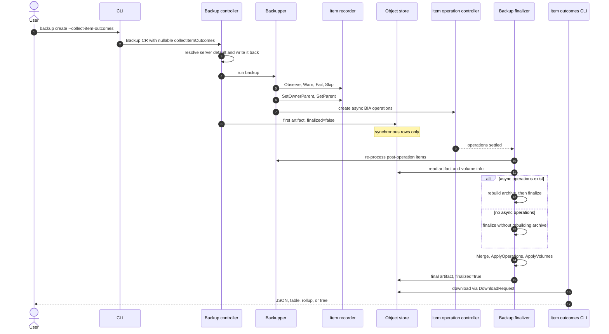
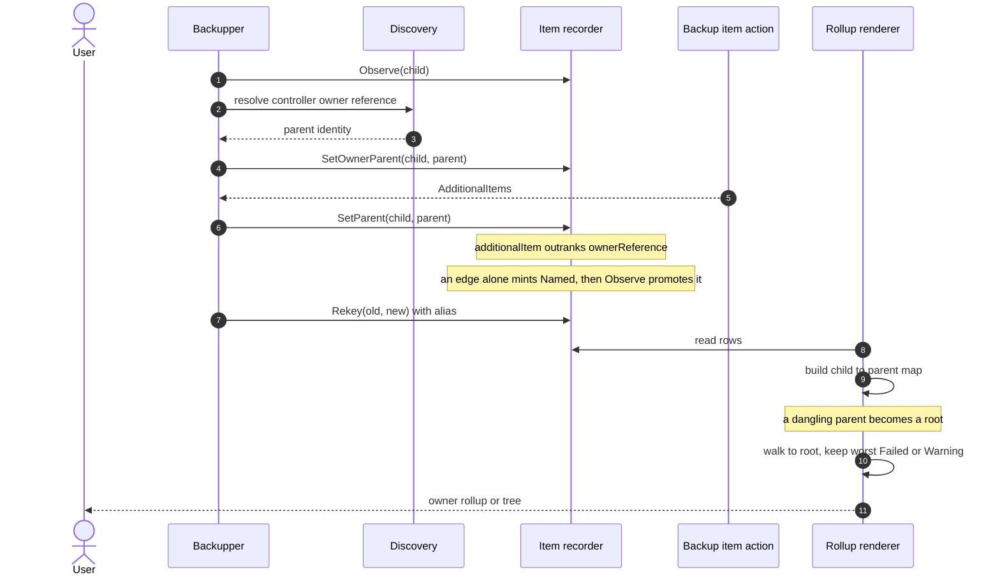
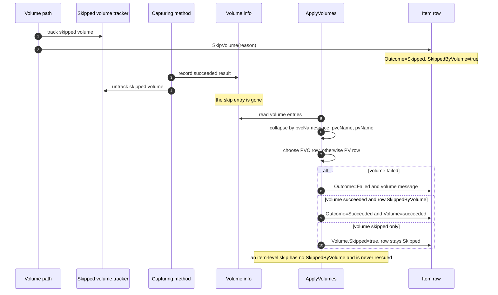
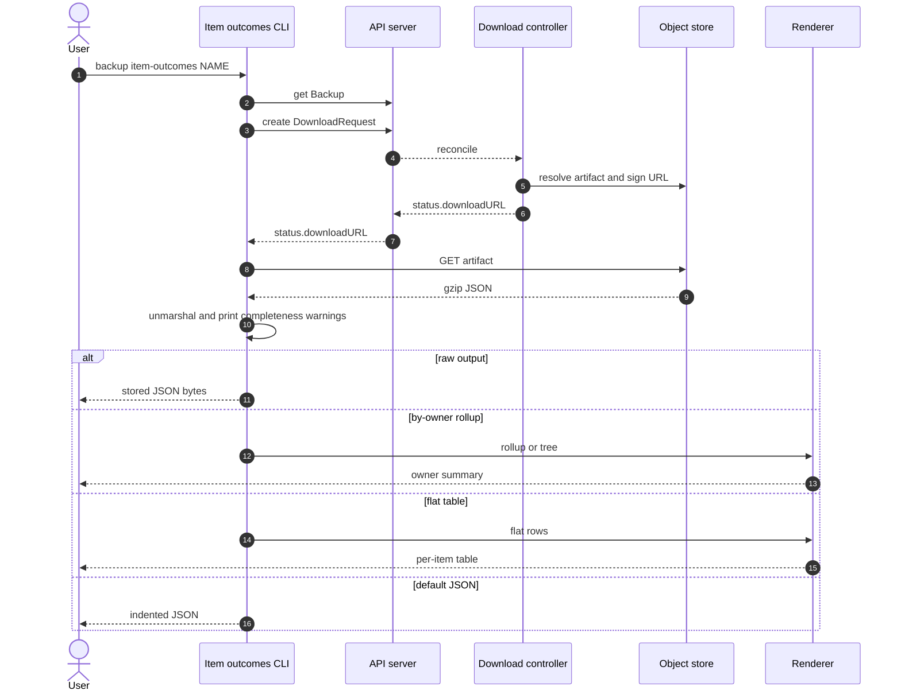

# Per-item outcomes for backups and restores

**Status:** Draft; phase 1 is implemented, phase 2 is not started.

**Tracking:** [#10503 Per-item outcomes for observability](https://github.com/velero-io/velero/issues/10503) (`Needs Design`, `observability`, `1.20-candidate`).

**Related work:**

- [#9377 BackupItemAction timeouts are not reported in backup results](https://github.com/velero-io/velero/issues/9377) — the stale-after-async-work bug this artifact addresses structurally.
- [#9402 Re-upload backup results and volume info after BIA operations](https://github.com/velero-io/velero/pull/9402) — a narrow patch for #9377 that refreshes two existing artifacts without producing per-item rows.

**Phasing:** Phase 1 is backup item outcomes.
Phase 2 is restore item outcomes.
The v1 artifact schema reserves the restore fields so both phases use one schema.

## Abstract

Velero reports a finished backup or restore only at the operation level, so a `PartiallyFailed` operation offers no structured way to find which item broke and which owner is responsible.
This design adds one opt-in artifact per operation built from three components: a per-item outcome row, parentage that attributes a child to its owner, and a fold of volume verdicts into the row that owns the volume.

## Background

Velero already writes logs, results, resource lists, item operations, and volume info per operation.
Each serves a different consumer, and none gives a synchronous item a structured verdict with its identity.
Logs are free text, results have no item identity, the resource list is an inventory, item operations cover asynchronous work only, and volume info is per volume rather than per item.
A consumer therefore joins artifacts written at different moments and reconstructs ownership by hand.
The async case is the sharpest: a `BackupItemAction` can settle after the first write, and its failure then appears in the log and in the operation artifact but not against the item (#9377).
The three components address three separate gaps:

- Item outcomes: no structured verdict with identity and messages.
- Parentage: no edge from a child to the workload that owns it.
- Volume folding: no item-level verdict for a lost disk.

## Goals

- Record a per-item outcome, with identity and messages, for every item Velero processes.
- Record parentage and roll it up so a child's failure is attributed to the owning workload.
- Fold volume verdicts into the owning item row so a failed disk is visible without a second artifact.

## Non Goals

- Restore capture in phase 1; phase 2 covers it with the same artifact schema.
- Restore volume results, because restore volume info has no trusted terminal failure signal.
- Changing what Velero backs up or restores, or deciding on its own authority whether bytes arrived.
- Replacing logs, results, resource lists, item operations, or volume info.

## High-Level Design

A `Recorder` accumulates one row per item during the operation.
The rows are written to object storage after synchronous work, re-read and completed at finalize, and read through one command.

```text
capture per item -> first write -> finalize -> read
```

The three components are deliberately layered:

| Component | What it adds | Why |
|---|---|---|
| Item outcomes | identity, outcome, messages | the per-item verdict the operation status lacks |
| Parentage | parent and parent source | attribution from a child to its owner |
| Volume folding | volume result on the item row | a lost disk is not hidden in a second artifact |

Phase 1 implements all three for backups.
Phase 2 reuses the item-outcome and parentage layers for restores, adds `source` and `action`, and leaves restore volume results out.
The artifact is opt-in per operation and off by default.

## Detailed Design

### Item outcomes

#### What it is

An `ItemOutcomes` artifact is one gzip'd JSON document with a schema version, an operation kind, a finalized flag, and a list of rows.
Each row records the identity of one processed item, its verdict, and the messages behind that verdict.
The verdict is one of `Succeeded`, `Warning`, `Skipped`, `Failed`, or `Named`.
`Named` is not a verdict: it marks a row that exists only because a parent edge named the child, and `Observe` promotes it once the child is processed.
The recorder ranks outcomes as `Named < Succeeded < Warning < Skipped < Failed`.
A row is minted at `Succeeded`; every later write can only raise it.
The asynchronous overlay applies settled operation results at finalize and raises the affected row to `Failed`.
The first write carries the synchronous rows; the finalize pass merges the post-operation rows and writes the final artifact.
A skip that a volume path records sets `SkippedByVolume`, which lets finalize tell a rescuable volume skip from an item-level skip.
The marker is row-local on purpose: when another method captures the same volume, the volume path removes its skip entry from volume info, so the row is the only place the provenance survives.
Because `Skipped` outranks `Warning`, a row that records both ends at `Skipped`; its warning text remains in `Messages`, but the row is not in the failure set.

```go
const SchemaVersion = "v1"
const MaxMessagesPerItem = 5

type ItemOutcomes struct {
	SchemaVersion string        `json:"schemaVersion"`
	Kind          Kind          `json:"kind,omitempty"`
	Finalized     bool          `json:"finalized"`
	Items         []ItemOutcome `json:"items"`
}

type ItemOutcome struct {
	// Identity, outcome, messages, and parentage, common to both operations.
	GroupResource string        `json:"groupResource"`
	Namespace     string        `json:"namespace,omitempty"`
	Name          string        `json:"name"`
	Outcome       Outcome       `json:"outcome"`
	Messages      []string      `json:"messages,omitempty"`
	Parent        *ItemRef      `json:"parent,omitempty"`
	ParentSource  *ParentSource `json:"parentSource,omitempty"`

	// Backup-specific. SkippedByVolume records that the skip came from a volume
	// path, not from excluding the item itself. Volume is set on the one row
	// that owns a volume.
	SkippedByVolume bool           `json:"skippedByVolume,omitempty"`
	Volume          *VolumeOutcome `json:"volume,omitempty"`

	// Restore-specific. Source is the backup-side identity; Action is the
	// operation-specific verb behind a successful outcome.
	Source *ItemRef `json:"source,omitempty"`
	Action string   `json:"action,omitempty"`
}

type ItemRef struct {
	GroupResource string `json:"groupResource"`
	Namespace     string `json:"namespace,omitempty"`
	Name          string `json:"name"`
}

type Outcome string
const (
	OutcomeSucceeded Outcome = "Succeeded"
	OutcomeWarning   Outcome = "Warning"
	OutcomeFailed    Outcome = "Failed"
	OutcomeSkipped   Outcome = "Skipped"
	OutcomeNamed     Outcome = "Named"
)

type Kind string
const (
	KindBackup  Kind = "backup"
	KindRestore Kind = "restore"
)

var precedence = map[Outcome]int{
	OutcomeNamed:     -1,
	OutcomeSucceeded: 0,
	OutcomeWarning:   1,
	OutcomeSkipped:   2,
	OutcomeFailed:    3,
}
```

Messages are capped at `MaxMessagesPerItem = 5`: the first four are kept and the tail is replaced by `... and N more`, so truncation is visible.
Readers key rows with an internal three-field `Key` (group resource, namespace, name); `Key` is never serialized.

#### Why it exists

The operation status reports a phase and aggregate counts, not which item failed.
The log has identity only where the caller attached it, and results have no identity at all.
A failed async operation can settle after results are written and then appear only in the log (#9377).
A row keyed by identity is the smallest unit that makes a partial failure actionable.
It also gives the async overlay a place to write a failure that the synchronous pass could not know about.

The contract that keeps the row honest:

- A capture site must record `Fail`, `Warn`, or `Skip` on every exit path after `Observe`; otherwise the row stays `Succeeded`.
- A terminal operation or volume error survives the message cap; a second terminal error can displace the first.
- The finalize pass merges its rows, and applying the same result twice is idempotent.
- `Finalized` is owned by the operation overlay: true only when no operation is still pending.

### Parentage

#### What it is

`Parent` is a reference to the item that owns this row, and `ParentSource` records where the edge came from.
An owner-reference edge comes from the child's controller owner reference.
An additional-item edge comes from a backup or restore item action that named the child while processing the parent.
An additional-item edge outranks an owner-reference edge.
A parent edge alone mints a `Named` row; the child is promoted only when processing actually observes it.
A rename records an alias, so parent edges, later writes, and operation joins resolve to the same final identity.
The alias map lives only in the running recorder; the artifact does not carry it.
The rollup walks each row to its root and reports the worst `Failed` or `Warning` outcome in the subtree, with counts.
The parent edge can be rendered as a rollup table or a tree; the flat table lists rows without the rollup.

```go
type ParentSource string
const (
	ParentSourceOwnerReference ParentSource = "ownerReference"
	ParentSourceAdditionalItem ParentSource = "additionalItem"
)
```

#### Why it exists

A failure on a PVC, PV, or generated pod is rarely the object the user thinks of as broken.
The workload that owns it is the object the user can act on.
Owner references are live metadata and can be stripped or rewritten by an item action; additional-item edges exist only during the run and are persisted nowhere else.
If the edge is not captured at processing time, it cannot be reconstructed reliably later.
An edge is a capture-time fact and is not retracted if the parent is later skipped, rekeyed, or fails.
The rollup is what turns the edge into an answer: a failed disk is attributed to the workload, not to a generated pod.

The rules that keep the tree stable:

- Only the controller owner reference is used; other owner references are associations.
- A self-edge is refused.
- A dangling parent becomes a root, because a cluster-scoped owner can fall outside a namespace-scoped operation.
- Renames preserve inbound edges.
- Cycles and malformed chains terminate at a bounded depth.

### Volume folding

#### What it is

`VolumeOutcome` records the verdict for one volume on the single item row that owns it: the PVC row when the PVC is in the operation, otherwise the PV row.
The result is `succeeded` or `failed`; a volume with no result has `skipped: true` and a reason.
The fold runs at finalize, after volume info is settled.
The fold is a backup-side step; restore volume results remain out of scope.
Duplicate entries for one volume collapse before any row is touched, with failure outranking success and success outranking a skip.
A volume's identity is the exact `(pvcNamespace, pvcName, pvName)` triple; entries that differ in any field are distinct.
Ownership is decided by row presence: the PVC row wins over the PV row even when the PVC row is `Named` or `Skipped`.
A failed volume raises the owning row to `Failed` and adds a message naming the volume.
A skip recorded by a volume path is rescued to `Succeeded` only when the row carries `SkippedByVolume` and the merged volume result succeeded.
The rescue cannot use the volume-info skip entry: when another method captures the volume, the volume path removes that entry before finalize.
The marker remains on the row after a rescue, so a `Succeeded` row that still carries a volume-skip message shows why the message is there.

```go
type VolumeOutcome struct {
	PVCNamespace  string       `json:"pvcNamespace,omitempty"`
	PVCName       string       `json:"pvcName,omitempty"`
	PVName        string       `json:"pvName,omitempty"`
	Method        string       `json:"method,omitempty"`
	Result        VolumeResult `json:"result,omitempty"`
	Skipped       bool         `json:"skipped,omitempty"`
	SkippedReason string       `json:"skippedReason,omitempty"`
}

type VolumeResult string
const (
	VolumeResultSucceeded VolumeResult = "succeeded"
	VolumeResultFailed    VolumeResult = "failed"
)
```

`SkippedReason` is meaningful only when `Skipped` is true and `Result` is empty; a volume captured by another method carries that method's result.

#### Why it exists

Volume info is already persisted, but it is organized by volume, not by the item that owns the volume.
A reader looking at an item verdict cannot tell whether its disk survived without downloading a second artifact and joining on PVC/PV identity.
The fold performs that join once on the server, where the volume results are authoritative and already in memory.
The result is one artifact that tells a reader whether the item and its disk succeeded.

The rules that keep the fold honest:

- A volume is recorded on exactly one row.
- A volume's identity is the full `(pvcNamespace, pvcName, pvName)` triple.
- The PVC row wins by row presence, even when it is `Named` or `Skipped`.
- A failed volume raises its row and names the volume.
- Only a row marked `SkippedByVolume` is rescued; an item-level skip stays skipped.
- The row marker is required because volume info removes the skip entry when another method captures the volume.
- A captured volume never carries a skip reason.
- A volume with no matching row is dropped; volume info still records it.

### Sequences

These diagrams show the backup lifecycle, parentage capture and rollup, volume folding, and the read path.

#### Backup lifecycle



#### Parentage and rollup



#### Volume folding and rescue



#### Read path



### Restore phase 2

A restore row is keyed by the target identity: the mapped namespace and the name the object received, including a server-generated name.
The backup-side identity is kept in `source`, and `action` records the restore verb such as `created` or `updated`.
The restore artifact uses `restores/<restore>/<restore>-item-outcomes.json.gz` and the restore command.
Restore volume results remain out of scope.

### Invariants

These are the normative rules.
Each group is mirrored as a condensed comment block at the code site that enforces it: `recorder.go`, `owner.go`, `rollup.go`, `operations.go`, and `volumes.go` in `internal/itemoutcome`, plus `updateItemOutcomes` in `pkg/backup/backup.go` and `backupItemInternal` in `pkg/backup/item_backupper.go`.

Recorder:

- A row is minted at `Succeeded`, because Velero treats an item as successful unless a failure, warning, or skip is recorded.
- Every later write can only raise the row.
- A row created by a parent edge alone starts at `Named`, and `Observe` promotes it when the child is processed.
- A skip is either item-level or volume-path; only the volume-path form sets `SkippedByVolume`.
- `Parent` is the strongest relationship recorded for reporting, not an assertion of Kubernetes ownership.
- Claims of equal strength currently keep the first parent recorded; only a stronger `ParentSource` replaces an existing edge.

Parent edges:

- Only the controller owner reference is used; other owner references are associations.
- An additional-item edge outranks an owner-reference edge.
- The parent namespace comes from discovery: namespaced owners sit in the child's namespace, cluster-scoped owners have none.
- A self-edge is refused.
- An unresolvable edge is reported as no parent.
- An edge is capture-time and is not retracted when the parent is later skipped, rekeyed, or fails.
- A rename records an alias, so parent edges and operation identities resolve to the final identity.
- Aliases live only in the recorder; a rename during the finalize pass can leave the first-write row and a new row for the same object.

Operation overlay:

- A failed operation raises its item to `Failed` and appends the operation's error.
- A succeeded operation changes nothing.
- A pending operation is neither applied nor used to create a row, and it leaves the artifact unfinalized.
- A failed operation with no matching row creates one.
- `Parent` is never modified here; it is set at capture time.
- The overlay only raises a row.

Volume fold:

- Duplicate entries for one volume collapse before any row is touched, preferring a failed result, then a succeeded result, then a skip.
- A volume's identity is the full `(pvcNamespace, pvcName, pvName)` triple.
- A volume is recorded on exactly one row.
- The PVC row wins by row presence, even when it is `Named` or `Skipped`.
- A failed volume raises the row to `Failed` and adds a message naming the volume.
- A row marked `SkippedByVolume` and captured by another method is raised to `Succeeded`; an item-level skip is left alone.
- The marker is row-local because volume info removes the skip entry when another method captures the volume.
- A volume with no matching row is dropped.

Rollup:

- A parent edge is not an outcome; a row named only by an edge stays `Named`.
- A dangling parent makes the child a root.
- Cycles and malformed chains terminate at a bounded depth.
- A summary carries the worst `Failed` or `Warning` outcome in its subtree; `Skipped` and `Named` are counted but never become the summary's outcome.
- Because `Skipped` outranks `Warning`, a row that records both is not in the failure set; its warning remains in `Messages`.
- `IsFailure` is the single definition of a problem: `Failed` or `Warning`, and nothing else.

Finalize and writes:

- The first write happens after synchronous work; the second at finalize; neither can be dropped.
- The backup sequence is `GetBackupItemOutcomes` → merge finalize-pass rows → `ApplyOperations` → `ApplyVolumes` → `PutBackupItemOutcomes`; restore has no volume fold.
- In the async finalize path the archive is rebuilt before the finalized artifact is written; a tarball failure leaves the artifact unfinalized.
- `finalized` is true when, and only when, no operation is still pending; `ApplyOperations` owns the flag and `ApplyVolumes` does not change it.
- The finalize pass merges its rows before the overlays; terminal errors survive the cap; the overlays are idempotent.
- `Merge` is additive and envelope-preserving: it never deletes or downgrades a row and never changes schema version, kind, or finalized.
- `Merge` dedupes exact messages, re-counts truncation markers, and re-applies the cap.
- A backup with no async operations uses `FinalizeItemOutcomes` and does not rebuild the tarball.
- The store's getter synthesizes an empty v1 backup artifact when the object is absent, so finalize cannot distinguish a lost first write from zero rows.

### Read surfaces

- `backup item-outcomes NAME` prints indented JSON by default.
- `-o table` prints a flat per-item table.
- `--by-owner` prints the rollup; `-o table|tree|json` selects the rollup format.
- `--all` keeps clean chains in the rollup table.
- `--raw` prints the compact JSON as stored.
- The item-outcomes commands print four warnings to stderr: operation-level errors that may not belong to a listed row, an unfinalized artifact, an unknown schema version, or a kind that does not match the command.
- Default JSON and table/rollup emit the warnings; `--raw` emits them when the stored bytes parse, and always prints the raw bytes unchanged.
- The flat table shows each row's own outcome and only a message count, not the messages or the parent edge.
- The rollup table shows `GROUP/RESOURCE`, `NAMESPACE`, `NAME`, `OUTCOME`, and `ITEMS`; the success label comes from the artifact's `kind`.
- The tree prints rows rather than subtree summaries, so a clean ancestor of a failed descendant still prints clean.
- The tree annotates only `Failed` and `Warning` rows; `Skipped` and `Named` rows print without an annotation.
- The rollup counts `Skipped` and `Named` but never makes either the summary's outcome; `--all` keeps clean chains.
- The rollup JSON `failed` list contains rows at the summary's exact severity.
- The restore command is phase 2.
- `describe --details` integration is a follow-on.

### Configuration and persistence

- `BackupSpec.CollectItemOutcomes` and `RestoreSpec.CollectItemOutcomes` are nullable booleans.
- Phase 1 exposes `--collect-item-outcomes` on backup and schedule create; the restore flag is phase 2.
- The server default is `--default-collect-item-outcomes`.
- The controller resolves the nullable backup field against the server default and writes the resolved value back into the backup spec, so the first write and finalize agree across restarts and default changes.
- A schedule stores the nullable value.
- An unset schedule inherits the server default at run time.
- `RestoreSpec.CollectItemOutcomes` is reserved and inert in phase 1; the restore command does not expose the flag.
- The backup key is `backups/<backup>/<backup>-item-outcomes.json.gz`.
- The restore key is `restores/<restore>/<restore>-item-outcomes.json.gz`.
- `DownloadTargetKindBackupItemOutcomes` and `DownloadTargetKindRestoreItemOutcomes` are added to the `DownloadRequest` enum.
- The backup, restore, schedule, and download-request CRDs carry the fields and kinds.
- An absent artifact is reported as not collected; an unfinalized artifact is provisional.

## Alternatives Considered

- **Build the artifact only at finalize.** Rejected: no existing artifact stores a synchronous item's outcome, messages, or parentage against a reliable key.
- **Join the existing artifacts at read time.** Rejected: the join cannot recover a synchronous item's verdict or the ephemeral additional-item edges.
- **Extend `results.gz` or the resource list.** Rejected: they carry no per-item ownership or messages.
- **Store only the rollup.** Rejected: it freezes one grouping rule and discards the rows.
- **Nest per-operation detail.** Rejected: the flat row is smaller to read and keeps one schema for both operations.
- **One combined backup-and-restore artifact.** Rejected: a restore can be repeated, partial, or read from an older backup.

## Security Considerations

Rows contain resource identities and the messages Velero already writes to its log, and the artifact introduces no new secret material.
It is stored with the other per-operation artifacts under the same access controls.
Clients read it through `DownloadRequest`, so the existing namespace scoping and existence checks apply.

## Compatibility

- The feature is additive and opt-in, and it is off by default.
- An absent artifact is reported as "not collected", not as an empty success.
- An unfinalized artifact is reported as provisional.
- The artifact is gzip'd JSON at schema v1; an empty schema version reads as v1.
- `skippedByVolume` is an optional additive field; a reader that does not know it ignores it.
- An artifact written before `skippedByVolume` existed has no marker, so a newer finalize cannot rescue its volume-path skips and leaves them `Skipped`.
- Older backups and restores remain readable.
- Phase 1 reserves the restore fields and restore plumbing; no restore capture is included, and the restore spec field is inert.
- Existing artifacts keep their shape and consumers.

## Implementation

Phase 1 is implemented; phase 2 is not started.

| Phase | Scope | Status |
|---|---|---|
| 1 | Backup: item outcomes, parentage, volume fold, JSON/flat table/rollup/tree | implemented |
| 2 | Restore: capture, source/action, restore command and rollup | not started |
| Follow-on | describe integration, user documentation and Helm, restore volume results | not started |

Phase 1 lands in ten area commits: artifact model, recorder, and operation overlay; backup persistence and capture; the command; parentage core; the rollup; backup parentage; the by-owner and tree views; the volume package; the backup volume join; and PV skip outcomes with the volume-aware read text.
Validation covers targeted unit and controller tests at each layer, plus live backups covering a stateless workload, a volume-backed VM, a failing hook, and the opt-out path on the phase 1 cluster.

Success criteria:

- A user can identify the top-level objects with problems in one command.
- A failed disk is attributed to the workload that owns it.
- The artifact can be read without volume info, item operations, or the log.

## Open Issues

- Equal-strength additional-item claims for one child still resolve by arrival order; a deterministic tie-break or a documented race is needed.
- A rename during the finalize pass can produce a second row because aliases live only in the recorder; persist the alias map or merge by source.
- The store's getter cannot distinguish a missing first artifact from an empty one; finalize can therefore finalize a lost first write from its own rows.
- Only the most recent terminal error is guaranteed to survive the cap; two independent terminal errors can hide the first.
- A row that records both a warning and a skip ends at `Skipped` and is excluded from the failure set; decide whether to surface the warning.
- A capture-time edge is not retracted when its parent is later skipped; a child failure can therefore roll up to a parent that was not backed up.
- A volume can be assigned to a `Named` or `Skipped` PVC row by row presence; decide whether ownership should require a processed row.
- Restore capture and the restore command are phase 2.
- Restore volume results remain out of scope until each restore method has a trusted terminal state.
- Artifact size and retention at 1k/10k/100k items are unmeasured.
- Whether one server default should cover both operations or one flag per operation is open.
- Describe integration and user documentation are follow-ons.
