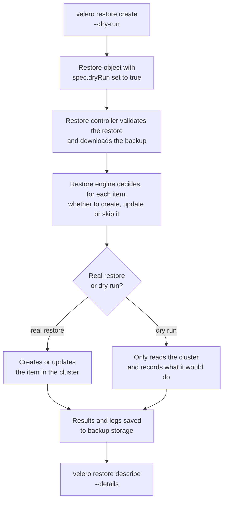
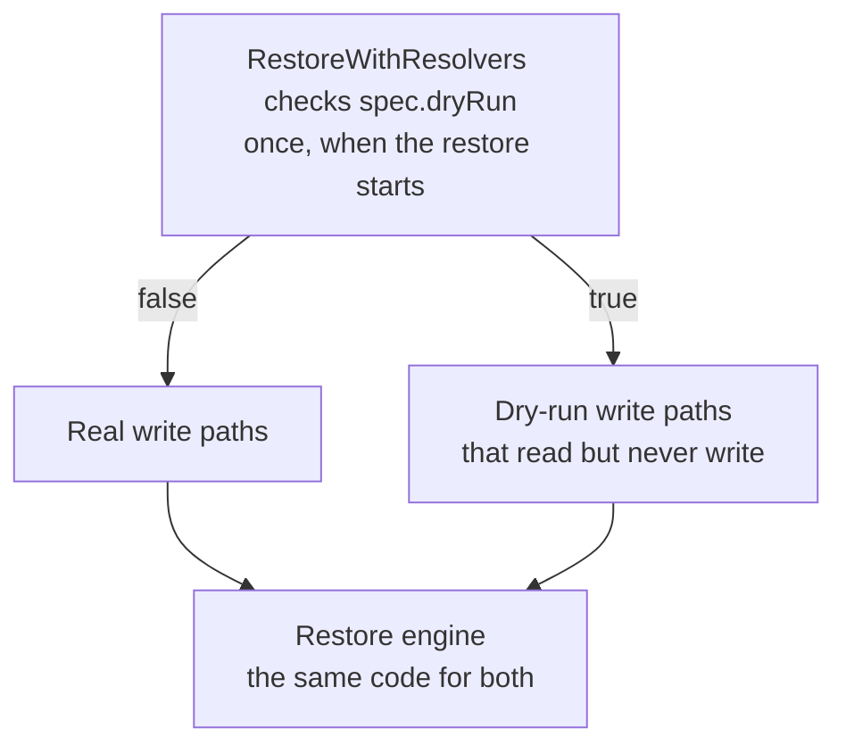
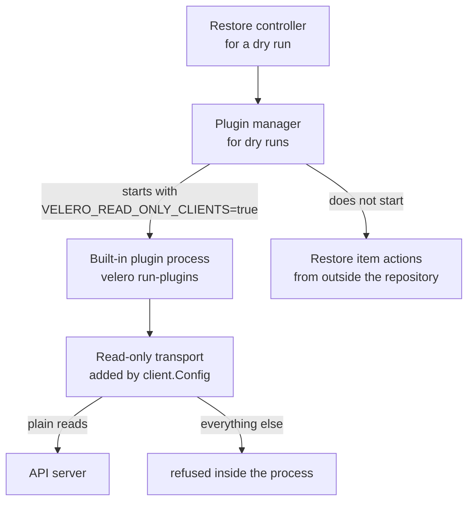
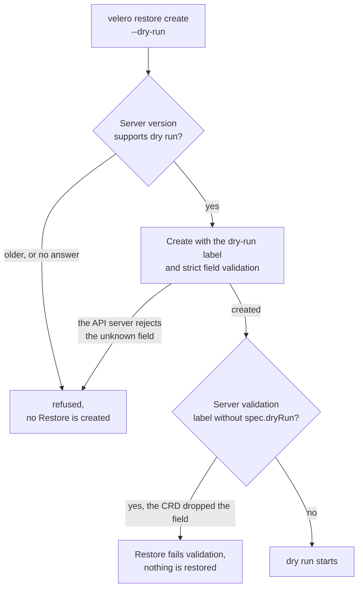
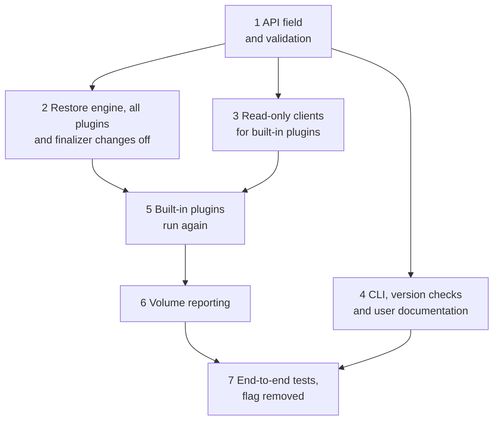

# Restore Dry-Run Design

## Abstract

A dry-run restore runs the complete restore decision logic against a backup and the target cluster, and reports for every item what a real restore would do, without changing any resource, volume or volume data.
It lets a user check filters, namespace mappings, resource modifiers and existing-resource handling before committing to a restore.

> [!IMPORTANT]
> **In short**
>
> - One optional field, `spec.dryRun`, and the same restore engine, so a dry run gives the answers a real restore would give.
> - A dry run never writes.
>   When the restore starts, Velero gives the engine read-only versions of its [write paths](#write-paths), runs its built-in plugins with [clients that can only read](#read-only-clients-for-the-built-in-actions), and does not start plugins from outside the Velero repository.
> - A dry run creates nothing, so it keeps the namespaces and CRDs a real restore would create in a [planned state](#planned-state), and checks the objects that depend on them against it.
> - It cannot predict errors that only the API server or a storage provider returns, and six cases differ from a real restore, see [Item outcomes](#item-outcomes).
> - An old `Restore` CRD or an old Velero server could turn a dry run into a real restore.
>   The Velero CLI is guarded against both, and other clients only partly, see [Version skew](#version-skew).
> - It costs less than a real restore of the same backup, because it sends the same number of API requests, with reads in place of writes, and copies no volume data.
>   But the controller runs one restore at a time, so a real restore created while a large dry run is running waits until the dry run finishes, see [Controller, phases and metrics](#controller-phases-and-metrics).
>   Letting a real restore go before dry runs that are still waiting in the queue is a follow-up in [Non Goals](#non-goals).
> - It is built in seven pull requests behind a feature flag, and no step lets a dry run write, see [Feature flag and order of work](#feature-flag-and-order-of-work).
> - One question is open for plugin authors, whether a plugin should be able to declare that it follows the dry-run contract, see [Open Issues](#open-issues).

## Background

The result of a restore depends on many inputs at once, such as the backup contents, include and exclude filters, label selectors, namespace mappings, resource modifiers, RestoreItemAction plugins, the existing-resource policy, and the current state of the target cluster.
Today the only way to learn the result is to run the restore.
`velero backup describe --details` shows what a backup contains, but not what a restore of it would do to a particular cluster.

This has been requested since 2018 in [#448](https://github.com/velero-io/velero/issues/448).
This document follows the approach @sseago outlined in [#448](https://github.com/velero-io/velero/issues/448#issuecomment-2088588859), which adds a new field to the restore spec, keeps the normal restore pipeline, and leaves out the create and patch calls.

Earlier discussion named three obstacles.
None of them blocks this design.

| Obstacle | Why it no longer blocks |
|---|---|
| A per-item report does not fit in a custom resource, because of the etcd object size limit | Restore logs, results and the restored resource list are already uploaded to the backup storage location and fetched by the CLI through `DownloadRequest`. |
| Plugins must know that a restore is a dry run ([#654](https://github.com/velero-io/velero/issues/654)) | `RestoreItemActionExecuteInput` already carries the `Restore` object, so a plugin can read a new spec field without any plugin API change. |
| Dry-run was listed as a use case of the object graph manifest ([`graph-manifest.md`](graph-manifest.md), [#3536](https://github.com/velero-io/velero/issues/3536)) | The manifest has not been implemented, and it would not be enough, because the outcome of a restore depends on cluster state and plugin output, which a manifest of the backup alone cannot provide. |

## Goals

- Add `spec.dryRun` to `Restore`.
  A dry run uses the same selection, transformation and decision logic as a real restore, and changes no resource, volume or volume data.
- Report the planned action for every item through the existing restore artifacts and CLI commands.
- Define what RestoreItemAction plugins must do during a dry run.

## Non Goals

- Backup dry-run.
  As noted in #448, a restore dry-run is the more valuable half, since a backup with `snapshotVolumes=false` already shows what a backup would select.
- Predicting outcomes that only exist once objects are really created, such as admission webhook decisions, quota, IP and port allocation, volume provisioning and binding, volume data restore results, hook results, and asynchronous plugin operations.
  See [Server-side dry-run validation](#server-side-dry-run-validation).
- Field-level differences between the backed-up object and the object in the cluster.
  The dry run reports that an object exists and differs, as a real restore does, not how it differs.
- Follow-up work, which can be added later without changing this proposal.
  - A metric and a dashboard for dry runs.
  - Letting a real restore run before a dry run that is waiting in the queue.
  - Deleting old dry-run `Restore` objects automatically.
  - Checking restore exec hooks without running them.

## High-Level Design

A new optional boolean field, `spec.dryRun`, is added to the `Restore` API.
A dry run goes through the same steps as a real restore.
Velero validates the restore, downloads and unpacks the backup, and decides for every item whether a real restore would create, update, skip or fail it.

The difference is what happens when a real restore would change something.
A real restore creates or updates the item in the cluster, while a dry run only reads the cluster and records the action it would have taken.



## Detailed Design

### API

```go
type RestoreSpec struct {
	// ...

	// DryRun specifies whether this restore only reports what it would do.
	// When true, Velero runs the full restore logic but does not create, update
	// or delete any restored resource, volume or volume data.
	// +optional
	// +nullable
	DryRun *bool `json:"dryRun,omitempty"`
}

// IsDryRun returns true if the restore is a dry run.
func (r *Restore) IsDryRun() bool {
	return r.Spec.DryRun != nil && *r.Spec.DryRun
}
```

A label `velero.io/dry-run: "true"` marks the `Restore`, so dry runs can be selected and excluded with a label selector.
The Velero CLI sets it when it creates the restore, and the controller sets it during validation for restores created by other clients.
A `Restore` that has the label but not `spec.dryRun` fails validation, see [Version skew](#version-skew).

### Rule for side effects

**A dry-run restore may read anything a real restore reads, and may write only its own records**, which are the status and progress of the `Restore` object and the restore artifacts in the backup storage location.
It must not create, update, patch or delete any other object in the cluster, and must not ask a storage provider to create, change or delete a volume or snapshot.

The rule is enforced in three places.

- In the restore engine, through its [write paths](#write-paths).
- In the plugins built into Velero, through [clients that can only read](#read-only-clients-for-the-built-in-actions) and [their contract](#restoreitemaction-plugins).
- In the controllers that act after the engine, see [Writers outside the engine](#writers-outside-the-engine).

### Write paths

A write path is a client or helper that the restore engine uses to change something outside itself, for example the client that creates the restored objects, or the volume snapshotter that asks a storage provider for a new volume.
The engine has six write paths, and it receives all of them from `RestoreWithResolvers` when a restore starts.
For a dry run, `RestoreWithResolvers` checks `spec.dryRun` once and gives the engine a dry-run version of each write path instead of the real one.
The engine code is the same for both.



Every dry-run version passes reads through unchanged.
The table shows what each one does in place of the writes.

| Write path | In a real restore | In a dry run |
|---|---|---|
| Resource client (`client.DynamicFactory`) | creates and patches the restored objects | checks whether each object already exists, see [Dry-run resource client](#dry-run-resource-client), and logs the fields a patch would change |
| Namespace client | creates missing namespaces | checks whether each namespace exists, see [Planned state](#planned-state) |
| Controller-runtime client (`kbClient`) | updates the status and progress of the `Restore`, and deletes temporary `ConfigMap`s | updates the status and progress of the `Restore` |
| Volume snapshotter | asks the storage provider to create a new volume from a native snapshot | logs which snapshot would be used, and returns a placeholder volume ID |
| Pod volume restorer | creates `PodVolumeRestore` objects and waits while helper pods copy the files | logs which pod volumes would be restored |
| Pod command executor | runs exec hooks inside restored pods | nothing, because no pod is restored |

A few writes return a made-up result, such as the placeholder volume ID, because the engine needs a result to carry on.
Every other write returns an error.
**So a case that was missed fails loudly instead of writing.**
Each dry-run version holds the real write path as a named field instead of embedding it, so a method added to a write path later breaks the build until someone decides what a dry run does with it.
A client that is added to the engine later needs a dry-run version of its own.
**One switch was chosen over a check before each write**, because a forgotten check is a silent write, while new code that uses an existing write path is covered without knowing about dry runs.

Four small dry-run checks remain inside the engine, and none of them is needed for safety.
They plan missing namespaces, see [Planned state](#planned-state), and skip the steps that act on objects a dry run never created.

### Writers outside the engine

**The write paths cover the restore engine only.**
Three other places write during a restore.

| Writer | Dry-run handling |
|---|---|
| RestoreItemAction plugins | The built-in ones run in their own process, whose Kubernetes clients can only read during a dry run, and plugins from outside the repository are not started, see [RestoreItemAction plugins](#restoreitemaction-plugins). |
| Restore finalizer controller, which patches dynamically provisioned PVs, deletes stub `VolumeGroupSnapshotContent`s, waits for exec hooks and uploads the restore volume info | For a dry run it checks once and only uploads the restore volume info, one of the dry run's own records. The other steps would wait up to the resource timeout, 10 minutes by default, for PVCs and snapshots that a dry run never creates, and the stub cleanup finds stubs by restore name, so it would delete stubs that an earlier restore of the same name left behind. Dry-run write paths stop writes, not waits. |
| Restore operations controller | Nothing to track, because a dry run starts no asynchronous operation. |

The restore controller itself writes only the `Restore` status and the restore artifacts, which are the output of the dry run.

### Dry-run resource client

In a dry run, `Create` looks the object up instead of creating it.
If the object is not found, it would be created.
If it is found, `Create` returns the same `AlreadyExists` error as a real create.
That error sends the engine down the same existing-object path as a real restore, so **the comparison, the policy and the patch come from unchanged code**.
The table follows a Pod that exists with a different image, restored with `existingResourcePolicy: update`.

| Step | Real restore | Dry run |
|---|---|---|
| 1. Create | create sent, and the API server answers `AlreadyExists` | lookup finds the Pod, and the client returns the same `AlreadyExists` |
| 2. Get the in-cluster object | `Get` | same code |
| 3. Remove server-set fields | same code | same code |
| 4. Compare with the backup copy | differs | same code, differs |
| 5. Apply the existing-resource policy | patch computed | same code, same patch |
| 6. Patch | patch sent | field paths logged, patch not sent |
| 7. Record | `updated` | `updated` |

Two lookups need care.

- The API server also answers "not found" for a resource it does not serve, so before reporting `created` the client asks whether the resource is served or planned, see [Planned state](#planned-state).
- An object with only a `generateName`, which a plugin can produce, cannot already exist.
  It is recorded as `created` if its resource is served or planned.

`Patch` logs the paths of the fields it would change, never their values, because a patch of a `Secret` carries its data and the restore log is uploaded to the backup storage location.

### Planned state

Two in-memory sets on the restore context remember what the restore would already have created.

- `plannedNamespaces` holds the missing namespaces that this restore would create.
  A planned namespace is recorded as `created` once and is not looked up again for later items.
- `plannedCRDs` holds the names (`<plural>.<group>`) of the missing CustomResourceDefinitions that this restore would create, added at the create step.
  The engine restores CRDs in a pass of its own before every other resource, fixed in `execute` and independent of the resource priorities an operator configures, so the set is complete before any custom resource is looked at.

The API server answers "not found" both for a missing object and for a resource it does not serve, so the CRD set is what tells these cases apart.

| CRD of a custom resource | Real restore | Dry run records |
|---|---|---|
| In the backup, not in the cluster | creates the CRD in the first pass, then the custom resource | `created`, because the CRD is in `plannedCRDs` |
| Already served by the cluster | creates the custom resource | `created` |
| In neither | the create fails, because the resource is not served | `failed`, with the API server's error |

**Without the two sets**, the first restore into an empty cluster, which is the main disaster-recovery case, would report most items as failures, or would report custom resources as created that a real restore cannot create.
Both behaviours were checked against Kubernetes v1.33 with a prototype.

### Item outcomes

The recorded action for an item follows the same rules as a real restore.

| State of the target cluster | Existing-resource policy | Recorded action | Warning or error |
|---|---|---|---|
| Object does not exist, or its namespace or CRD would be created by this restore | any | `created` | none |
| Custom resource whose CRD is neither served nor part of this restore | any | `failed` | the API server's "could not find the requested resource" error |
| Object exists and is equal | none | `skipped` | none |
| Object exists and differs | none | `skipped` | the existing "already exists ... in-cluster version is different" warning |
| Object exists and differs | `update` | `updated` | none |
| Object exists and is equal | `update` | `updated` when the restore labels differ, otherwise `skipped` | none |
| Excluded by filters, completed job or pod, mirror pod, or skipped by a plugin | any | `skipped` | none |
| A plugin returns an error, or the item cannot be decoded | any | `failed` | the existing error |

As in a real restore, an item that exists and equals the backup copy is recorded `failed` instead of `skipped` when it gets a warning, for example the warning that its volume data will not be restored.

**Six cases are known to differ from a real restore.**
Each is tested on its own against the outcome defined here.

| Case | Real restore | Dry run | Why the dry run cannot know |
|---|---|---|---|
| An action from a plugin outside the Velero repository | runs, and may change, add or skip items | skipped, with a warning that names the action | running it could write |
| A PV with a native snapshot whose in-cluster PV, claim or claim namespace is released, missing or being deleted | waits, then restores the PV or fails when the resource terminating timeout ends | `created`, with a warning that a real restore waits here, except a released PV with reclaim policy `Retain`, which is `failed`, because that wait can only end in the timeout | the outcome depends on what happens during the wait |
| A target namespace that is terminating | waits for it to disappear, then creates it, or fails its items when the timeout ends | the namespace and its items `created`, with a warning in the restore results | the outcome depends on what happens during the wait |
| A patch that the API server would reject, for example because of an immutable field or an admission webhook | records a warning and patches only the restore labels | `updated` | the patch is never sent |
| An object with only a `generateName` | listed under the name the API server generated | listed under its name in the backup | only the API server picks the name |
| An in-place restore of volume data into a PVC that exists | the CSI PVC action deletes the PVC first, so the PVC is `created` again and its data is restored | reported like any PVC that exists, for example `failed` when it equals the backup copy, with a warning that its volume data will not be restored | the PVC that a real restore deletes is still there |

**Errors that only the API server or a storage provider can return are not predicted.**
A create rejected by an admission webhook, or a volume that cannot be made because its snapshot was deleted or a quota is reached, is recorded as `created`.
The documentation and the CLI output state this limit.

### Volumes

A dry run restores no volume data.
For every persistent volume in scope it reports the method a real restore would use, taken from the backup volume info that the engine already loads (`backupVolumeInfoMap`), and the reason when a volume would not be restored, for example when `restorePVs` is false.
A real restore fills the restore volume info file by reading the restored PVCs and PVs from the cluster.
A dry run skips that read, because it created none, and fills the file from the backup volume info instead, so `velero restore describe --details` shows the volume report in its usual place.

| Method | A real restore | The write goes through | Dry run |
|---|---|---|---|
| Native snapshot | asks the storage provider for a volume made from the snapshot | the volume snapshotter write path | the dry-run version logs which snapshot would be used and returns a placeholder volume ID, and the PV is recorded `created` |
| CSI snapshot | creates the `VolumeSnapshotContent`, the `VolumeSnapshot` and a PVC whose data source is the snapshot, and the CSI driver then provisions the PV | the resource client write path | the CSI actions still point the PVC at the snapshot, then the dry-run resource client looks up the PVC, the `VolumeSnapshot` and the `VolumeSnapshotContent`, logs "would create" for each one that is missing and records it `created` |
| CSI snapshot taken as part of a volume group snapshot | also creates a stub `VolumeGroupSnapshotContent` first, because the CSI snapshot controller needs it | the `VolumeSnapshot` action, with its own client | the `VolumeSnapshot` action logs the stub it would create |
| Snapshot data movement | creates a `DataDownload`, and a data mover pod copies the data into the new PVC | the CSI PVC action, with its own client | the CSI PVC action logs the `DataDownload` it would create, and the PVC is looked up and recorded `created` when it is missing |
| Pod volume restore | creates `PodVolumeRestore` objects, and a helper copies the files | the pod volume restorer write path | the dry-run version logs which pod volumes would be restored |
| Snapshot data movement in place, into an existing PVC | sets the existing PV's reclaim policy to `Retain` and deletes the existing PVC before the data is copied | the CSI PVC action, with its own client | the CSI PVC action runs its pre-flight checks, which only read, reports the ones that fail, and logs that it would keep the PV and replace the PVC |

> [!WARNING]
> In a real in-place restore, the CSI PVC action deletes the user's existing PVC.
> This write happens inside a plugin, outside the write paths, so the plugin contract below is what keeps a dry run from reaching it.

### RestoreItemAction plugins

The actions built into Velero run during a dry run as they do in a real restore.
They have to, because they change items, add additional items and skip items, and all of that decides what a restore would do.
Without them, a namespace restore would leave its PVs out of the report, because only the PVC action brings them in, and Velero's own `DataUpload` objects would be reported as `created` instead of `skipped`.

During a dry run, an action must follow this contract.

- It can tell from `input.Restore.Spec.DryRun`.
  No plugin API change is needed for this, and it works for both v1 and v2 actions.
- It must not create, change or delete anything in the cluster or in an external system.
- It must not start an asynchronous operation.
  If an action returns an operation ID during a dry run, Velero does not track it and records a warning that names the action.
- It should still return the updated item, additional items and skip decision it would return in a real restore.

All actions in the Velero repository are updated to follow this contract.
Three of them write to the cluster today.
`DataUploadRetrieveAction` creates a temporary DataUploadResult `ConfigMap`.
The `VolumeSnapshot` action creates a stub `VolumeGroupSnapshotContent` for a snapshot that was taken as part of a volume group snapshot.
The CSI PVC action writes as listed in [Volumes](#volumes), including a `VolumeSnapshot` of the existing PVC for an incremental in-place restore.
The CSI PVC action reads that `ConfigMap`, so in a dry run it must not depend on it.

#### Read-only clients for the built-in actions

The contract is not left to the code of each action.
The built-in actions run in their own process, `velero run-plugins`, and the restore controller starts a new one for every restore.
For a dry run, the plugin manager starts that process with `VELERO_READ_ONLY_CLIENTS=true`.
Every Kubernetes client in that process is built from one function, `client.Config`, and with this setting the function adds a transport that lets only plain reads leave the process.



| Request | Result |
|---|---|
| `GET` or `HEAD` of an object, a list, a watch, discovery or a log | sent |
| `POST`, `PUT`, `PATCH`, `DELETE` or any other method, server-side dry runs included | refused with `403 Forbidden`, as RBAC would refuse it |
| `exec`, `attach`, `port-forward` and `proxy`, which act even on a `GET`, and any connection upgrade | refused with a `Forbidden` error |

**So a write that an action was not updated for fails loudly with an error, instead of writing.**
The transport sits under every kind of client, the typed clientset, the dynamic client, the controller-runtime client and the CSI snapshot clientset, and under helpers such as `CreateRetryGenerateName`, so it does not depend on reading every action correctly.
A dry run never falls back to the ordinary plugin manager, and does not start without the read-only one.

Two tests keep the guard complete as the code changes.

- Every restore item action registered in the Velero executable runs through its real constructor against a fake API server, once with the read-only clients and once without.
  A newly registered action fails the test until it has a case.
- The Velero packages that the plugin process loads are scanned for ways to reach the API server without `client.Config`, such as `rest.InClusterConfig`, `rest.AnonymousClientConfig` or replacing `WrapTransport`.

#### Actions from outside the repository

Velero cannot make actions from plugins outside the repository safe, see [Open Issues](#open-issues).
They run in their own process with their own clients, and a plugin built before this change decodes the `Restore` with older API types, drops `spec.dryRun`, and cannot see the dry run even if its author wanted to respect it.

Therefore **the plugin manager of a dry run starts only the restore item actions that the Velero executable serves**, so no code of any other action runs, not even its constructor.
It decides by the executable and not by the name, because any plugin can register a `velero.io/` name.
For each action it did not start, the restore records one warning that names it and states that the report may be less accurate for the items it applies to.

`VolumeSnapshotter` plugins are reached only through the volume snapshotter write path.
`ObjectStore` plugins are used as usual to read the backup and to write the restore artifacts.

### Controller, phases and metrics

A dry-run restore is validated like any restore, so a dry run is also a way to check a restore spec.
It moves through `New`, `InProgress` and `Finalizing` to `Completed`, `PartiallyFailed` or `Failed`, and never enters the waiting-for-plugin-operations phases, because no operations are tracked.
`status.warnings` and `status.errors` count what a real restore would have reported, within the limits above.

A dry-run restore is not counted in the existing restore metrics (`restore_total`, `restore_attempt_total`, `restore_success_total`, `restore_partial_failure_total`, `restore_failed_total` and `restore_validation_failed_total`), so that dashboards and alerts built on them keep describing real restores.
`kubectl get restores` gets an additional printer column `Dry Run` that shows `spec.dryRun`.

The restore controller handles one restore at a time, so a large dry run that is already running delays a real restore created after it, and the documentation states this.
A dry run sends as many requests to the API server as a real restore of the same backup, with reads in place of writes.
With 1,000 items, half of them already in the cluster, both sent 1,503 requests with the informer cache and 2,501 without it.
Dry-run `Restore` objects are kept and deleted like any other restore.

### Restore artifacts and CLI

The restored resource list (`restore-<name>-resource-list.json.gz`) keeps its format and its four action values, which for a dry run mean "would be created", "would be updated", and so on, so tools that read it need no change.
The `Restore` object and its label mark the run as a dry run.
Per-item outcome artifacts are being designed for backups in [#10616](https://github.com/velero-io/velero/pull/10616), and if that design is extended to restores, the dry-run report should use it.

The user reads the report where a real restore puts its results.

- `velero restore describe --details` shows the warnings, the errors and the resource list.
- `velero restore logs` shows a line starting with "Dry run" for each write that was left out, with field paths and never values.
- Both are available once the dry run has finished, as for any restore.

```bash
velero restore create nightly-check --from-backup nightly-20261114 --include-namespaces shop --dry-run --wait
velero restore describe nightly-check --details
```

```text
Name:         nightly-check
Namespace:    velero
Dry run:      true (no resources or volume data were changed; actions below are what a real restore would do)

Phase:  Completed

Resource List:
  apps/v1/Deployment:
    - shop/cart(created)
    - shop/web(skipped)
```

`velero restore get` shows a dry-run marker next to the phase.
Unlike `kubectl --dry-run=client` and `velero install --dry-run`, which only print resources, this `--dry-run` runs on the server, and the help text of the flag says so.

### Version skew

A structural CRD schema prunes fields it does not know, so two mixes of versions can turn a dry run into a real restore.

| Mix of versions | Without a guard | Guard |
|---|---|---|
| A `Restore` CRD older than this feature | the CRD drops `spec.dryRun`, and the server performs a real restore | the server refuses a `Restore` that has the dry-run label but no `spec.dryRun` |
| A CRD that knows the field and a Velero server older than this feature, after a rollback or during an upgrade | the old server ignores the field and performs a real restore | the Velero CLI checks the server version with a `ServerStatusRequest` before it creates the `Restore`, as `velero version` does |

**The label check is what stops a real restore when the CRD is old.**
A CRD drops the spec fields it does not know but keeps the labels, so the `Restore` reaches the server with `velero.io/dry-run: "true"` and without `spec.dryRun`.
The server fails it in validation, so nothing is restored.
Strict field validation alone is not enough, because API servers enforce it by default only from Kubernetes v1.25, and Velero supports older versions.
The Velero CLI still creates with strict field validation (`client.FieldValidation("Strict")`), so that a newer API server refuses the request before a `Restore` exists.

On Kubernetes v1.33 with the current `Restore` CRD, a strict create was rejected, and a create without strict validation dropped `spec.dryRun` and kept the label.



> [!WARNING]
> Only the Velero CLI is protected in both cases.
> Other clients are protected against an old CRD if they set the dry-run label or validate fields strictly, as `kubectl create`, `kubectl apply` and server-side apply do by default, and never against an old server, because the old server is the one that acts.
> The user documentation therefore says that the Velero CLI is the safe way to create a dry run, and names both cases in which another client can turn a dry run into a real restore.

### Feature flag and order of work

A dry run needs the `EnableRestoreDryRun` feature flag until the last step removes it.
**No step lets a dry run write**, even with the flag on.

1. API field and validation, which still rejects every dry run.
2. Restore engine with the dry-run write paths, with all plugins and the finalizer's cluster changes turned off.
3. Read-only clients for the built-in plugins.
4. CLI, version checks and user documentation.
5. Built-in plugins run again in dry runs.
6. Volume reporting.
7. End-to-end tests, then the feature flag is removed.

Steps 2, 3 and 4 depend only on step 1, so they can be reviewed at the same time.



### Testing

- A no-write guard runs the existing restore test tables a second time with `dryRun` set to true, against fake clients that fail the test on any write except a patch of the `Restore` being run.
- Parity tests check that the dry run's resource list, warnings and errors equal those of the real restore of the same input, except the six known differences in [Item outcomes](#item-outcomes), which are tested on their own.
- Unit tests cover each dry-run write path, an empty-cluster restore with a CRD and its custom resource, the read-only clients for every kind of request, every built-in action through its real constructor with and without them, the scan for client configurations that bypass them, the plugin manager starting no action from outside the repository, the finalizing phase, the label check, and the CLI version check.
- An end-to-end test on kind checks that a dry run leaves every resource version unchanged, and that its resource list equals that of the real restore that follows.

## Alternatives Considered

### Server-side dry-run validation

Kubernetes can process a create without storing it (`dryRun=All`), which runs validation and admission.
The API server checks each request on its own, so it cannot see the namespaces, CRDs and service accounts that the same restore would create first.
On Kubernetes v1.33, items that depend on them were refused with `NotFound`, "no matches for kind" and `Forbidden`, all false failures, while node ports outside the valid range, missing storage classes and missing roles were accepted.
It could be added later as an optional second level, for items whose dependencies are not in the planned sets.

### Compute the plan in the CLI

The CLI could download the backup and compute the plan locally.
It cannot run server-side plugins, and it would duplicate the selection and decision logic of the engine, which would then drift from it.

### A separate dry-run engine

A second engine used only for dry runs would leave the restore code untouched.
It would have to copy every decision of the real one.
`pkg/restore` has about 7,950 lines outside tests, and `restore.go` alone has 3,256 lines and changed in 27 commits in the last year.
Every such change would have to be made twice, and a copy that drifts gives answers that differ from a real restore, which is worse than no dry run, because users trust it.
This design keeps one engine and puts the dry-run behaviour in the dry-run write paths.

### A separate resource kind

A new kind, for example `RestorePlan`, would keep dry runs out of the list of restores, and it is safe for every client and both directions of version skew, because an old CRD rejects the unknown kind and an old server ignores it.
It would also duplicate the `Restore` spec, the controller and the CLI commands.
The spec field is still proposed, because it is the approach discussed in #448, it reuses everything, and the Velero CLI can be made safe with the label check and the server version check.

## Security Considerations

A dry run needs the same permission as a real restore, which is creating a `Restore` in the Velero namespace.
It shows the same information as a real restore, which is the names of resources in the backup, whether they exist in the cluster, and the paths of fields that differ, never their values.
It grants no new access.

The security-relevant property is the side-effect rule, because users would trust a dry run, so a dry run that writes would be worse than none.
The dry-run write paths, the no-write guard in tests, the feature flag, the [version checks](#version-skew), the [read-only clients of the built-in plugins](#read-only-clients-for-the-built-in-actions) and the [plugin rule](#actions-from-outside-the-repository) protect it, and all existing restore checks run unchanged during a dry run.

## Compatibility

- The field is optional and defaults to a real restore, so existing `Restore` objects and clients are not affected.
- For mixed versions, see [Version skew](#version-skew).
  A client other than the Velero CLI is not protected against an old server, and is protected against an old CRD only if it sets the dry-run label or validates fields strictly.
- Plugins from outside the Velero repository keep working for real restores, and their restore item actions are not started during a dry run.
- Tools that watch for `Restore` objects reaching `Completed` also see dry runs, and can exclude them with the `velero.io/dry-run` label.
- The printer column is additive, and the restore artifacts keep their names and formats.

## Implementation

The work follows the seven steps in [Feature flag and order of work](#feature-flag-and-order-of-work), one pull request per step.
I intend to implement all steps.

## Open Issues

### Restore item actions from outside the Velero repository

A dry run does not start restore item actions from plugins outside the Velero repository, because Velero cannot stop them from writing.
They build their own clients, and they may call systems other than the cluster.
A dry run of a restore that depends on such an action is therefore less accurate for the items it applies to, and the restore results say which actions were not run.
A later change could let a plugin declare that it follows the dry-run contract, but Velero could only trust that declaration, not enforce it.
I would like to hear from plugin authors whether that is worth adding.
