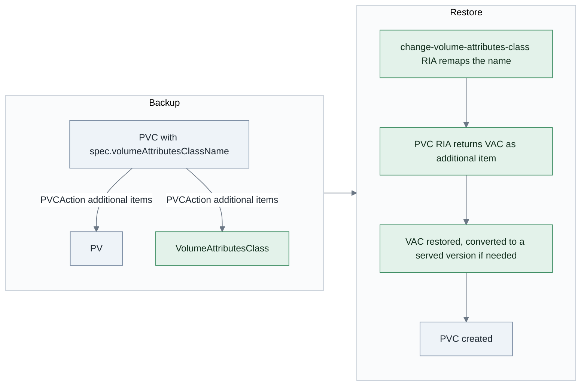
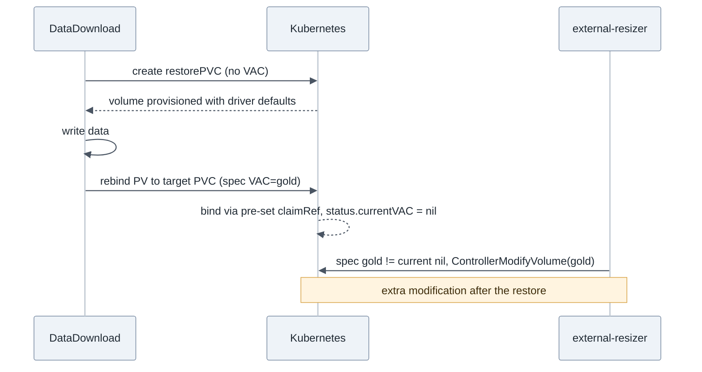

# VolumeAttributesClass Support

## Abstract
Kubernetes VolumeAttributesClass (VAC) lets a PVC declare mutable, driver-specific volume attributes such as IOPS and throughput, and change them later without moving data.
Velero today carries `spec.volumeAttributesClassName` along with the PVC, but it does not back up the referenced VAC, does not order or remap it on restore, and drops it from the intermediate PVC in the data mover restore path.
This proposal makes VAC a first-class citizen in Velero's backup, restore, and data mover workflows.

Tracking issue: [#10852](https://github.com/velero-io/velero/issues/10852)

## Background
A VolumeAttributesClass is a cluster-scoped object in `storage.k8s.io`.
It was introduced as alpha in Kubernetes 1.29, went beta in 1.31 (disabled by default), and became GA and enabled by default in 1.34 as `storage.k8s.io/v1`.

```yaml
apiVersion: storage.k8s.io/v1
kind: VolumeAttributesClass
metadata:
  name: gold
driverName: ebs.csi.aws.com
parameters:
  iops: "10000"
  throughput: "500"
```

A PVC references it by name through `spec.volumeAttributesClassName`.
The StorageClass still decides what kind of volume gets provisioned.
The VAC decides the mutable attributes of that volume, and the user can change it at any time.

The relevant controller behavior, which this design relies on, is:

- **Provisioning.** external-provisioner looks up the VAC and passes its parameters as `MutableParameters` in `CreateVolume`. If the VAC does not exist, provisioning is retried and the PVC stays Pending. If the VAC's `driverName` does not match the provisioner, provisioning fails. If the CSI driver does not report the `MODIFY_VOLUME` capability, PVCs that reference a VAC cannot be provisioned at all ([external-provisioner controller.go](https://github.com/kubernetes-csi/external-provisioner/blob/7edeeae7086aaf07c4a0aea15fde1dc0bb9baac8/pkg/controller/controller.go#L475-L481), [L817-L827](https://github.com/kubernetes-csi/external-provisioner/blob/7edeeae7086aaf07c4a0aea15fde1dc0bb9baac8/pkg/controller/controller.go#L817-L827)).
- **Binding.** When a PVC asks for a specific, unclaimed PV, the PV controller refuses to bind them if their VAC names differ ([pv_controller.go checkVolumeSatisfyClaim](https://github.com/kubernetes/kubernetes/blob/v1.34.0/pkg/controller/volume/persistentvolume/pv_controller.go)). When the PV is already pre-bound to the PVC through `claimRef`, which is what Velero does, this check is skipped and the PVC's `status.currentVolumeAttributesClassName` is copied from the PV.
- **Modification.** external-resizer compares `pvc.spec.volumeAttributesClassName` with `pvc.status.currentVolumeAttributesClassName`, and when they differ it calls `ControllerModifyVolume` and then updates both the PVC status and `pv.spec.volumeAttributesClassName` ([external-resizer modify_volume.go](https://github.com/kubernetes-csi/external-resizer/blob/master/pkg/modifycontroller/modify_volume.go)).

Storage vendors are starting to ship VAC support in their CSI drivers, and users expect a restored workload to come back with the same performance profile it was backed up with.

## Goals
- Back up and restore the VACs referenced by the PVCs in a backup, and restore them before the PVCs that use them.
- Preserve the VAC across every volume restore path, including the data mover restore path, and allow it to be remapped on restore.
- Allow users to set a VAC on the intermediate PVCs that the data mover creates.

## Non Goals
- Backing up or restoring VACs that are not referenced by any PVC in the backup. Users can still include them explicitly as cluster-scoped resources.
- Guaranteeing that a volume restored by a native (non-CSI) VolumeSnapshotter plugin actually has the attributes described by its VAC. Those plugins create volumes outside of CSI, and Velero cannot influence how they do it.
- Adding VAC as a condition in volume policies. This can follow as a separate, small proposal if there is demand.
- Supporting the alpha `v1alpha1` API.

## High-Level Design
On backup, the existing PVC BackupItemAction returns the VACs referenced by the PVC as additional items, the same way the CSI VolumeSnapshot action returns its VolumeSnapshotClass.
VACs are not added as ItemBlock related items, so PVCs that share a VAC are not pulled into one ItemBlock.

On restore, the existing PVC RestoreItemAction returns the PVC's VAC as an additional item, so the VAC is created right before the PVC even when the restore is filtered to specific namespaces.
`volumeattributesclasses.storage.k8s.io` is also added to the default high restore priorities, directly after `storageclasses`, which covers full-cluster restores.
The restore converts VAC objects to a version the target cluster serves, and skips them with a warning when it serves none.
A new built-in RestoreItemAction, `velero.io/change-volume-attributes-class`, remaps VAC names on PVCs and StatefulSet volume claim templates using a labeled ConfigMap, following the same pattern as `velero.io/change-storage-class`.

For the data mover, the restore exposer copies the target PVC's VAC onto the restorePVC so the volume is created with the right attributes from the start.
The node-agent ConfigMap gets an optional `volumeAttributesClass` field for the backupPVC and the cache PVC.



Green boxes are new in this proposal, and grey boxes are existing behavior.

## Detailed Design

### 1. Backing up referenced VACs
`PVCAction` in `pkg/backup/actions/backup_pv_action.go` is changed to also return VACs as additional items.
The set of VAC names is the union of:

- `pvc.spec.volumeAttributesClassName`, which is the desired state.
- `pvc.status.currentVolumeAttributesClassName`, which mirrors the PV and can differ while a modification is in progress or has been marked Infeasible.

Empty names are skipped and duplicates are removed.
The VACs are collected before the existing early return for unbound PVCs, because a Pending PVC that uses `WaitForFirstConsumer` still needs its VAC on restore.

```go
for _, name := range vacNamesForPVC(pvc) {
    additionalItems = append(additionalItems, velero.ResourceIdentifier{
        GroupResource: kuberesource.VolumeAttributesClasses,
        Name:          name,
    })
}
```

A new constant is added to `pkg/kuberesource/kuberesource.go`:

```go
VolumeAttributesClasses = schema.GroupResource{Group: "storage.k8s.io", Resource: "volumeattributesclasses"}
```

The VACs are deliberately not added through `actionhelpers.RelatedItemsForPVC`, which is shared with the PVC ItemBlockAction.
A VAC such as `gold` is typically shared by many PVCs across namespaces, and making it a related item would merge all of those PVCs and their pods into a single ItemBlock, which would serialize hooks and reduce backup parallelism.
VolumeSnapshotClass is handled the same way today.

The existing filtering rules for cluster-scoped additional items in `pkg/backup/item_backupper.go` apply unchanged, the same as for PVs and VolumeSnapshotClasses.
For example, `--include-cluster-resources=false` or `--exclude-resources volumeattributesclasses.storage.k8s.io` skips the VAC, and cluster-scoped name filters are honored.

The item backupper resolves additional items to the preferred served version, so clusters that only serve `v1beta1` (1.31 to 1.33 with the feature enabled) back up the `v1beta1` object.
A VAC that was deleted after the PVC was created is logged as a warning and skipped, which is existing behavior.
However, if the VAC API is not served at all, resolving the additional item returns an error and the PVC itself would fail to back up.
This can happen on 1.31 to 1.33 when the feature gate is on but `storage.k8s.io/v1beta1` is not enabled.
To avoid that, `PVCAction` gets a discovery helper at construction and only returns VAC additional items when `volumeattributesclasses.storage.k8s.io` is served, logging a warning otherwise.

### 2. Restoring referenced VACs

#### 2.1 PVC restore action returns the VAC
Restore priorities alone are not enough.
With `--include-namespaces` and the default `includeClusterResources`, top-level cluster-scoped items are skipped (`pkg/restore/restore.go:2728-2731`), so a namespace-filtered restore, which is the most common kind, would never create the VAC.
PVs avoid this today because the PVC restore action returns them as additional items, and additional items are only blocked for cluster-scoped resources when `includeClusterResources` is explicitly `false` (`pkg/restore/restore.go:1436-1441`).

`PVCAction` in `pkg/restore/actions/pvc_action.go` is changed to return the PVC's VAC as an additional item in the same way.
Additional items are restored before the PVC itself is created (`pkg/restore/restore.go:1736-1777`), so provisioning never has to wait for the VAC.
The VAC is returned for every PVC that has one, including PVCs that are not bound and PVCs backed by a PodVolumeBackup, which today return no additional items at all.
The name is read from `input.Item`, not from `ItemFromBackup`, so a remap done earlier by `velero.io/change-volume-attributes-class` (section 3) is respected and the original VAC is not restored needlessly.
An empty name, or a name that is not present in the backup tarball, is skipped.
The second case already produces a warning in the existing additional-item code path.

Resource modifiers run after RestoreItemActions and after additional items are restored (`pkg/restore/restore.go:1838-1843`).
So if a resource modifier changes the PVC's VAC, the original VAC is the one restored as an additional item, and the new one is not.
Velero will not try to move resource modifiers earlier for this.
The documentation will say that the remap action is the supported way to change VAC names on restore, and that a VAC set by a resource modifier must already exist in the target cluster or be included in the restore explicitly.

#### 2.2 PVs restored directly
A PV can be restored without going through the PVC path, for example when its PVC is excluded, or when it is restored from a native snapshot or kept as is (`pkg/restore/restore.go:1535-1541`, `:3195-3207`).
Its `spec.volumeAttributesClassName` can also differ from the PVC's desired VAC while a modification is in progress.
In `restoreItem`, the PV branch restores the VAC named in the PV spec from the backup before creating the PV, using the same `restoreItem` call that is used for additional items and the same filtering rules.
The PV field itself is never remapped, for the reason given in section 3.

#### 2.3 Restore priority
`volumeattributesclasses.storage.k8s.io` is inserted into `defaultRestorePriorities.HighPriorities` in `pkg/cmd/server/config/config.go`, directly after `storageclasses`.
For full-cluster restores this creates every VAC in the backup before PVs, PVCs, and DataUploads.
Users who run with a custom `--restore-resource-priorities` are still covered by section 2.1.

#### 2.4 API version handling
Restore creates each object with the API version it was backed up with (`pkg/restore/restore.go:1326-1342`), and the `EnableAPIGroupVersions` logic falls back to the source version when there is no common one (`pkg/restore/prioritize_group_version.go:137-145`).
For VACs this breaks a realistic migration: a backup taken on 1.31 to 1.33 contains `storage.k8s.io/v1beta1` objects, and a 1.34 or later cluster does not serve `v1beta1` unless it is explicitly enabled.

`restoreItem` gets a small special case for `volumeattributesclasses.storage.k8s.io`, next to the existing PV and PVC special cases:

- If the object's API version is served, nothing changes.
- If another version is served, `apiVersion` is rewritten to the preferred served version. This is safe because `driverName` and `parameters` have the same shape in `v1beta1` and `v1`. The client is already re-resolved from the object's `apiVersion` after RestoreItemActions run (`pkg/restore/restore.go:1857-1875`).
- If no version is served, the VAC is skipped with a restore warning instead of failing with a create error.

This is done in core restore code rather than in a RestoreItemAction because it is a correctness fix, not an optional transformation.
Users can disable built-in actions, and a restore should not start failing because one was turned off.
It also sits next to the existing per-resource special cases in `restoreItem`, so it is a few lines of code rather than a new plugin.

#### 2.5 Existing VACs
VACs are immutable apart from metadata.
If a VAC with the same name already exists in the target cluster, Velero's existing behavior applies: with the default `existingResourcePolicy` of `none` a warning is recorded when the specs differ, and with `update` the parameter patch is rejected by the API server and reported as a warning.
Velero never deletes or replaces an existing VAC, since other PVCs in the cluster may depend on it.

#### 2.6 Existing PVCs
If the PVC already exists in the target cluster, the default `existingResourcePolicy` of `none` leaves it alone, so its VAC does not change.
With `update`, Velero patches the existing PVC to match the backup (`pkg/restore/restore.go:2049-2055`), and that patch includes `spec.volumeAttributesClassName`.
A different VAC in the backup therefore starts a live modification of the existing volume.
This is consistent with what `update` means, but it changes the performance of a volume whose data is not being restored, so the documentation will call it out.
If the backup or a remap clears the VAC on a PVC that already has one, the API server may reject the change, and Velero reports it as a patch warning like any other rejected update.
These cases get unit tests for `none`, `update` with a different VAC, and `update` that clears the VAC.

### 3. Remapping VACs on restore
A new built-in RestoreItemAction `ChangeVolumeAttributesClassAction` is added in `pkg/restore/actions/change_volume_attributes_class_action.go` and registered as `velero.io/change-volume-attributes-class`.
It applies to `persistentvolumeclaims` and `statefulsets` and is configured through a ConfigMap in the Velero namespace:

```yaml
apiVersion: v1
kind: ConfigMap
metadata:
  name: change-volume-attributes-class-config
  namespace: velero
  labels:
    velero.io/plugin-config: ""
    velero.io/change-volume-attributes-class: RestoreItemAction
data:
  # <old VAC name>: <new VAC name>
  gold: platinum
  # an empty value removes the VAC from the restored PVC
  legacy-iops: ""
```

Behavior:

- For PVCs, `spec.volumeAttributesClassName` is rewritten when a mapping exists.
- For StatefulSets, each entry in `spec.volumeClaimTemplates` is rewritten, so PVCs created by a later scale up use the new VAC.
- A non-empty target VAC must exist in the cluster, otherwise the item fails to restore with a clear error, matching the change-storage-class behavior.
- An empty target value clears the field. This is the escape hatch for restoring into a cluster whose CSI driver does not support `MODIFY_VOLUME`, where any PVC that references a VAC would fail to provision.

PVs are intentionally not rewritten.
A PV that is restored as is, for example from a native snapshot, reflects the attributes of the actual backing volume.
If the PVC is remapped to `platinum` and the PV still says `gold`, the PVC binds with `status.currentVolumeAttributesClassName=gold`, and external-resizer then calls `ControllerModifyVolume` to move the real volume to `platinum`.
Rewriting the PV instead would make Kubernetes believe the volume already has the new attributes when it does not.

VAC remapping usually goes together with a StorageClass remap to a different driver.
The two actions are independent, and the documentation will call out that both mappings are needed in that case, since a VAC is tied to a single `driverName`.

The action looks up the target VAC through the discovery helper and dynamic client, so it works on clusters that only serve `v1beta1`.
Its `AppliesTo` only lists PVCs and StatefulSets, which are always served.

Restore item actions run in the sorted order of their names (`pkg/plugin/framework/common/server_mux.go:61`), so `velero.io/change-volume-attributes-class` always runs before `velero.io/pvc`.
That is what lets the PVC action in section 2.1 return the remapped VAC instead of the original one.

### 4. Data mover restore: carry the VAC on the restorePVC
`createRestorePVC` in `pkg/exposer/generic_restore.go` builds the restorePVC from the target PVC's access modes, StorageClass, volume mode, and resources, but not its VAC.
In the common case where the target PVC does not exist yet, the flow today is:



So the restored volume is created with default attributes, the data is written at default performance, and the real attributes are applied by a second `ControllerModifyVolume` call after the restore.
This has real costs.
Some backends, AWS EBS for example, limit how often a single volume can be modified, so a modification spent by the restore can cause the user's next change to be rejected.
When the driver or external-resizer does not handle modification, the PVC is left with `spec` and `status` permanently out of sync and the volume keeps running with default attributes.

The fix depends on whether the restorePVC gets a new volume or reuses an existing one.

- **New volume** (`targetPV` is nil, the common case): the restorePVC gets `targetPVC.Spec.VolumeAttributesClassName`. The volume is provisioned with the right mutable parameters and binds to the target PVC with no follow-up modification.
- **Existing volume** (`targetPV` is set, the in-place restore path): the restorePVC gets `targetPV.Spec.VolumeAttributesClassName`, the VAC the volume actually has. If it used the target PVC's VAC instead and the two differed, external-resizer would start modifying the volume through the short-lived restorePVC. The restorePVC can then be deleted, or its PV replaced in the volume mode change path, before the modification finishes, and the modification status would be lost. Using the PV's VAC means the restorePVC never triggers a modification. If the final PVC wants a different VAC, external-resizer modifies the volume once after the rebind, which is the correct and only modification.

The volume mode change path already copies the VAC to the rebind PV through `RebindPV` in `pkg/util/kube/pvc_pv.go`.
Unit and E2E tests cover both in-place rebind modes, with the same and with different VACs on the PVC and PV.

To avoid turning a working restore into a failed one, the exposer checks the VAC before using it.
The two failure cases behave differently, so they are handled differently:

- If the VAC does not exist, a warning is logged and the restorePVC is created without it. This is a temporary condition. external-resizer applies the VAC to the final PVC once it shows up, which is today's behavior.
- If the restorePVC's StorageClass can be resolved and its provisioner does not match the VAC's `driverName`, the condition is permanent. The restorePVC is still created without the VAC so the data can be restored, but the final PVC keeps a VAC that its driver can never apply. Failing the DataDownload outright was rejected because the user would lose the data restore over a performance setting.

To make the permanent case visible, the restore finalizer (`pkg/controller/restore_finalizer_controller.go`), which already merges warnings into the restore result, adds a check.
For each PVC that the restore created or updated and that has a VAC, it compares the VAC's `driverName` with the CSI driver of the bound PV and records a restore warning naming the PVC when they differ, pointing to `velero.io/change-volume-attributes-class` as the fix.
The finalizer's existing PVC set only holds created PVCs (`internal/volume/utils.go:28-42`), so the check builds its own list that also includes PVCs with the `(updated)` result.
This is done in the finalizer rather than in the exposer so it covers every restore path, including native snapshots and restores without data movement.

This change needs no new configuration and is the part most suitable for backporting to a patch release.

### 5. Data mover backup and cache PVCs
Two optional fields are added to the node-agent configuration types in `pkg/types/node_agent.go`:

```go
type BackupPVC struct {
    // ...existing fields

    // VolumeAttributesClass is the name of the VolumeAttributesClass to be used by the backupPVC.
    // It must belong to the same CSI driver as the backupPVC's storage class.
    VolumeAttributesClass string `json:"volumeAttributesClass,omitempty"`
}

type CachePVC struct {
    // ...existing fields

    // VolumeAttributesClass specifies the VolumeAttributesClass for the cache PVC.
    VolumeAttributesClass string `json:"volumeAttributesClass,omitempty"`
}
```

Example node-agent ConfigMap:

```json
{
    "backupPVC": {
        "gp3-csi": {
            "storageClass": "gp3-csi",
            "readOnly": true,
            "volumeAttributesClass": "backup-high-throughput"
        }
    },
    "cachePVC": {
        "storageClass": "gp3-csi",
        "volumeAttributesClass": "cache-fast",
        "residentThresholdInMB": 1024
    }
}
```

The backupPVC is short lived and only read from, so it is a good fit for a temporary high-throughput class that shortens backups, or a cheaper class that reduces cost.
By default the backupPVC does not inherit the source PVC's VAC.
The source VAC describes what the workload needs, not what a read-only backup copy needs, and it would be wrong whenever `backupPVC.storageClass` points to a different driver.
Keeping the default empty also means existing installations see no change.

The value flows from `BackupPVCConfig` into `createBackupPVC` in `pkg/exposer/csi_snapshot.go`, and from `CacheConfigs` into `createCachePVC` in `pkg/exposer/cache_volume.go`.
The same validation as in section 4 applies: a missing VAC or a driver mismatch logs a warning and the PVC is created without a VAC, because a performance setting should not fail a backup.

There is no new `restorePVC` field.
The restorePVC must carry the VAC described in section 4, and using a different one during the data write would trigger a modification on the final volume, which is exactly the problem section 4 removes.

## Alternatives Considered

### Add VACs as ItemBlock related items
This would also back them up, but shared VACs would merge unrelated PVCs and pods into one ItemBlock.
Returning them only as BackupItemAction additional items gets the same backup content without that side effect.

### Rely on resource modifiers instead of a new remap action
Resource modifiers can already patch `spec.volumeAttributesClassName` with a JSON patch and a conditional match.
They are more general but much harder to write for a simple name mapping, and users already know the change-storage-class ConfigMap pattern.
They also run after additional items are chosen, so they cannot decide which VAC gets restored (section 2.1).
The documentation will mention resource modifiers for advanced cases, with that limitation.

### Let the backupPVC inherit the source VAC by default
This would make backup reads run at the workload's performance level without configuration.
It was rejected because it silently changes behavior and cost for existing users, and because it breaks when the backupPVC uses a different StorageClass.

### Rewrite PVs in the remap action
Rejected for the reason described in section 3: it would hide the difference between the requested attributes and what the backing volume actually has.

## Security Considerations
No new credentials or data paths are introduced.
The Velero server already reads cluster-scoped resources during backup and creates them during restore, and the restore finalizer check in section 4 only reads VACs and PVs.
The VAC and StorageClass lookups in sections 4 and 5 run in the node-agent, which uses the Velero ServiceAccount (`pkg/install/daemonset.go`).
Installations that run node-agent with a reduced custom role need `get` on `volumeattributesclasses.storage.k8s.io`.
Without it, the validation fails closed: the VAC is omitted and a warning is logged.

## Compatibility
- **Kubernetes 1.34 and later:** full support through `storage.k8s.io/v1`.
- **Kubernetes 1.31 to 1.33:** works when the `VolumeAttributesClass` feature gate and the `storage.k8s.io/v1beta1` API are enabled. Backups go through the preferred served version. The data mover validation in sections 4 and 5 uses the discovery helper and dynamic client so it does not require `v1`.
- **Migrating from 1.31 to 1.33 into 1.34 or later:** the backup holds `v1beta1` VACs. Restore rewrites them to the served `v1` version as described in section 2.4.
- **Clusters without VAC enabled:** the API server drops `spec.volumeAttributesClassName` from PVCs on create. VAC objects in the backup are skipped with a restore warning (section 2.4) instead of failing with a create error.
- **CSI drivers without `MODIFY_VOLUME`:** PVCs that reference a VAC cannot be provisioned. This is independent of Velero, but after section 4 the data mover restore path behaves like every other restore path here. Users should map the VAC to an empty value with the new restore action.
- **Velero upgrade:** backups taken by older Velero versions do not contain VAC objects. They still restore correctly as long as the VAC already exists in the target cluster.
- **Custom restore priorities:** the VAC is still created before its PVC through the PVC restore action (section 2.1), so custom lists do not need to change.
- **Backport to 1.19.x:** `release-1.19` already builds against `k8s.io/api v0.36.1`, so no dependency changes are needed. Sections 1, 2, 3, and 4 add no API fields. Section 5 adds two optional node-agent ConfigMap fields, which maintainers can decide to hold for 1.20.

## Implementation
The work is split into independent PRs so it can be reviewed and backported in pieces:

1. Data mover restorePVC carries the right VAC for new and existing volumes, with validation and fallback (section 4).
2. `kuberesource.VolumeAttributesClasses` and backup PVCAction additional items (section 1).
3. Restore PVCAction additional items, PV-path VAC restore, default restore priority, and VAC API version handling in `restoreItem` (section 2).
4. `velero.io/change-volume-attributes-class` RestoreItemAction (section 3).
5. Restore finalizer warning for VAC and driver mismatches (section 4).
6. node-agent `backupPVC.volumeAttributesClass` and `cachePVC.volumeAttributesClass` (section 5).
7. Documentation updates in `restore-reference.md`, `data-movement-backup-pvc-configuration.md`, and `data-movement-cache-volume.md`, plus E2E coverage.

Unit tests cover the new action, backup and restore additional items for bound, Pending, FSB, and mid-modification PVCs, namespace-filtered restores, `v1beta1` to `v1` conversion, the unserved skip, restorePVC and backupPVC construction, and the validation fallbacks.
E2E tests run CSI snapshot, data mover, and FSB backup and restore of a workload whose PVC uses a VAC, using csi-driver-host-path with `--enable-controller-modify-volume`, which implements `ControllerModifyVolume` and accepts mutable parameters.
Each restore checks that the VAC object exists, that `pvc.spec.volumeAttributesClassName` and `pvc.status.currentVolumeAttributesClassName` match, and that no `ModifyVolume` event is emitted on the restored PVC.

Shubham Pampattiwar will drive the design and implementation, targeting v1.20 with a backport of the restore side to 1.19.x.

## Open Issues
- StatefulSets whose replicas are scaled to zero have no PVCs, so their VACs are not backed up. A StatefulSet BackupItemAction could return the VACs from `volumeClaimTemplates`, but this case seems rare enough to leave out unless reviewers think otherwise.
- Should `BackupVolumeInfo` record the VAC name so that `velero backup describe --details` shows it? It is cheap to add, but it changes the volume info format.
